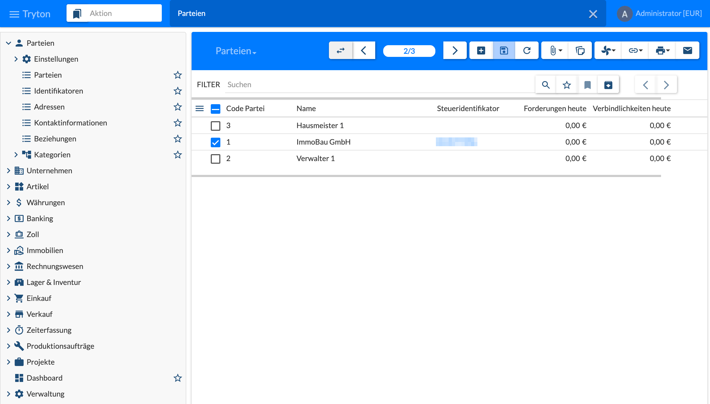
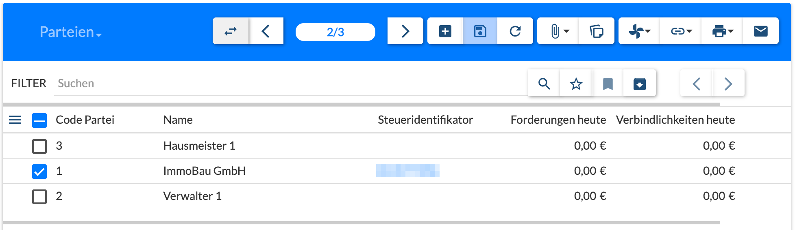
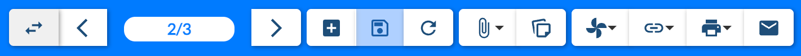
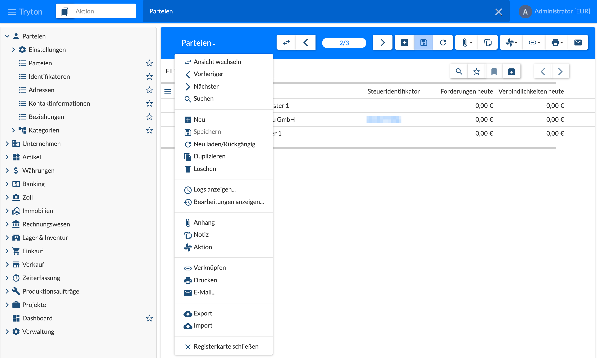

Die Bedienung ist in allen Bereichen von Tryton gleich. Die Bilder zeigen den Web-Client sao; der Desktop-Client ist gleich aufgebaut.

## Aufbau des Fensters

- **Menü (links):** die Bereiche, z. B. Parteien, Immobilien, Rechnungswesen, Verwaltung. Mit **›** werden Ordner aufgeklappt, ein Klick auf einen Eintrag öffnet ihn als **Registerkarte** rechts. Mit dem **Stern** wird ein Eintrag zu den Favoriten hinzugefügt.
- **Aktion (oben):** Suchfeld für Menüeinträge und Favoriten – Name eintippen und auswählen, ohne sich durch das Menü zu klicken. **≡ Tryton** blendet das Menü ein und aus.
- **Registerkarten:** Jeder geöffnete Menüeintrag erscheint oben als Karte; **×** schließt sie.
- **Benutzermenü (oben rechts):** Name und Unternehmen [Währung], darunter Benachrichtigungen, **Einstellungen…** (z. B. Sprache, aktuelles Unternehmen), **Hilfe…** und **Abmelden**.

## Liste und Filter

Die meisten Menüeinträge öffnen zuerst eine **Liste**. Ein Doppelklick auf eine Zeile öffnet die Maske des Datensatzes.

- **Filter:** Suchbegriff oder Bedingung eingeben, z. B. einen Namen oder `Name: Immo*`; **Lupe** sucht, beim Tippen werden passende Felder vorgeschlagen.
- **Stern:** den aktuellen Filter als Lesezeichen speichern; **Lesezeichen-Symbol:** gespeicherte Filter aufrufen.
- **Archiv-Symbol:** auch inaktive (archivierte) Datensätze anzeigen.
- **‹ ›** neben dem Filter: in langen Listen seitenweise blättern.
- **≡** links im Spaltenkopf: Spalten ein- und ausblenden; Klick auf eine Spaltenüberschrift sortiert.
- **Kästchen:** Datensätze markieren – Aktionen, Drucken usw. gelten dann für alle markierten.

## Symbolleiste

| Schaltfläche | Funktion |
|--------------|----------|
|  Ansicht wechseln | zwischen Liste und Maske umschalten |
|   Vorheriger / Nächster | zum vorherigen bzw. nächsten Datensatz |
|  Zähler | aktueller Datensatz / Anzahl in der Liste |
|  Neu | neuen Datensatz anlegen |
|  Speichern | Änderungen speichern |
|  Neu laden/Rückgängig | neu laden bzw. ungespeicherte Änderungen verwerfen |
|  Anhang | Anhänge (Dateien, Links) anzeigen und hinzufügen; die Zahl am Symbol zeigt vorhandene Anhänge |
|  Notiz | Notizen zum Datensatz |
|  Aktion | Assistenten und Aktionen des Datensatzes, z. B. Berechnungen |
|  Verknüpfen | zu verbundenen Datensätzen springen, z. B. vom Vertrag zu Rechnungen |
|  Drucken | Berichte und Schreiben drucken |
|  E-Mail | E-Mail mit Bericht als Anhang erstellen |

## Menü an der Überschrift

Ein Klick auf die **Überschrift** der Registerkarte (z. B. **Parteien ▾**) öffnet ein Menü mit allen Funktionen der Symbolleiste und einigen weiteren:

| Gruppe | Funktionen |
|--------|------------|
| Navigation | Ansicht wechseln, Vorheriger, Nächster, Suchen |
| Bearbeiten | Neu, Speichern, Neu laden/Rückgängig, Duplizieren, Löschen |
| Protokoll | **Logs anzeigen…** (wer hat wann angelegt bzw. geändert), **Bearbeitungen anzeigen…** (Änderungshistorie, falls für das Modell aktiv) |
| Zusatz | Anhang, Notiz, Aktion |
| Ausgabe | Verknüpfen, Drucken, E-Mail… |
| Daten | **Export** (Datensätze z. B. als CSV ausgeben), **Import** (Datensätze aus CSV einlesen) |
| | Registerkarte schließen |

**Duplizieren**, **Löschen**, **Logs**, **Export** und **Import** gibt es nur in diesem Menü.
