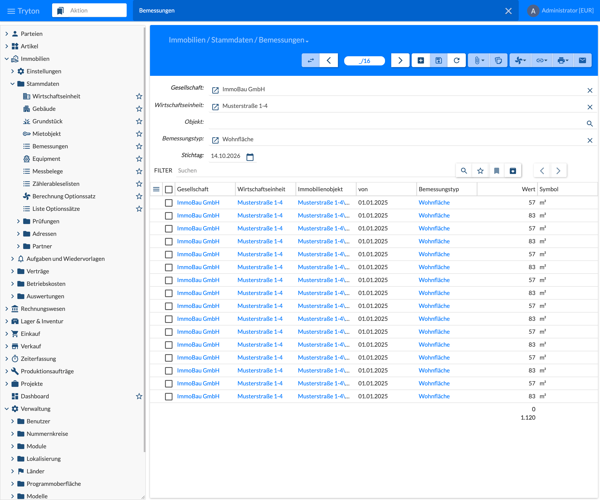
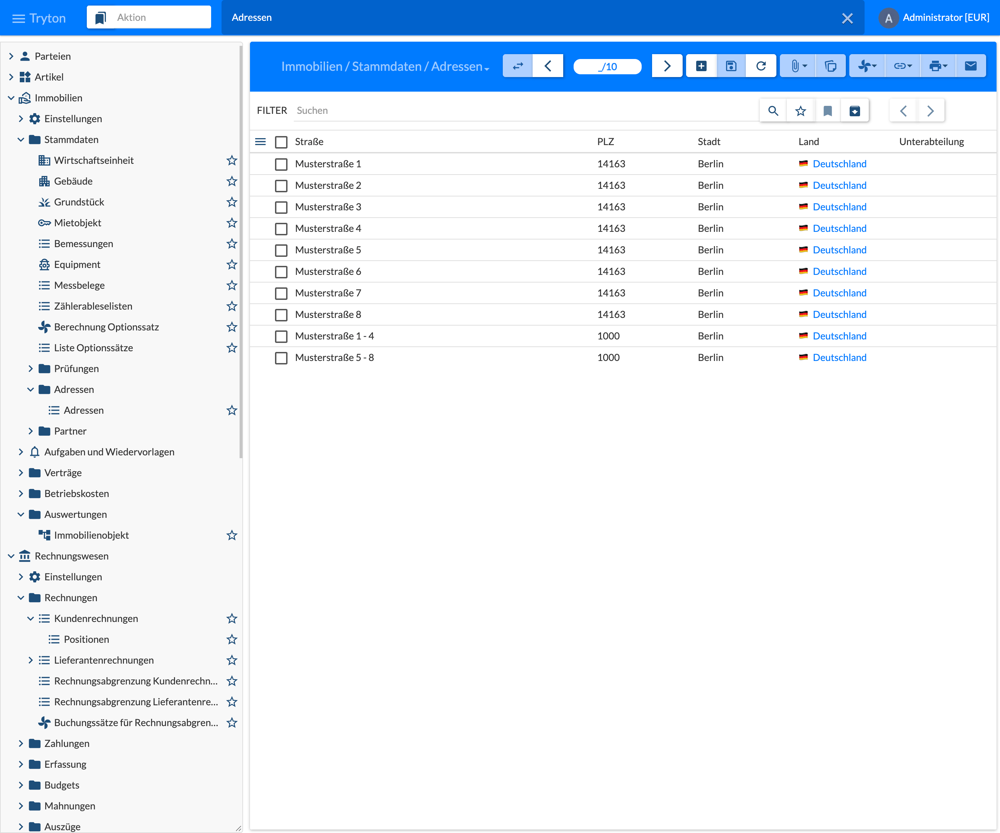

{}
Further reports are work in progress.
{}

## Measurements

Open the menu **Immobilien › Stammdaten › Bemessungen** (Real Estate › Master Data › Measurements). The list shows the measurements of the objects, e.g. living areas, and sums the values at the end of the list. Measurements are entered on the object in the tab **Bemessungen** (Measurements), see [5.1 Property]().

| Field | Description |
|-------|-------------|
| Gesellschaft (Company) | Company whose measurements are shown. Required. |
| Wirtschaftseinheit (Property) | Restricts the list to the objects of this property. |
| Objekt (Object) | Restricts the list to this object and all objects below it; takes precedence over the property. |
| Bemessungstyp (Measurement Type) | Shows only measurements of this type, e.g. living area. |
| Stichtag (Key Date) | Only measurements valid on the key date are shown: “from” date on or before the key date and not yet replaced by a newer entry of the same object and measurement type. Default is today. |

The columns show company, property, object, valid from, measurement type, value and symbol (unit).

{}
The total at the end of the list therefore gives the status on the key date, e.g. the total living area.
{}

## Addresses

Open the menu **Immobilien › Stammdaten › Adressen › Adressen** (Real Estate › Master Data › Addresses › Addresses). The list shows the addresses of the real estate objects with street, postal code, city, country and subdivision (e.g. federal state). These object addresses are independent of the addresses of business partners. They are assigned on the object in the field **Adresse** (Address, tab Allg. Daten), see [5.1 Property](); a new address can also be created directly there. With **+** (New) addresses can also be created in the list; the form corresponds to the Tryton address (street and number, postal code, city, country, subdivision).
