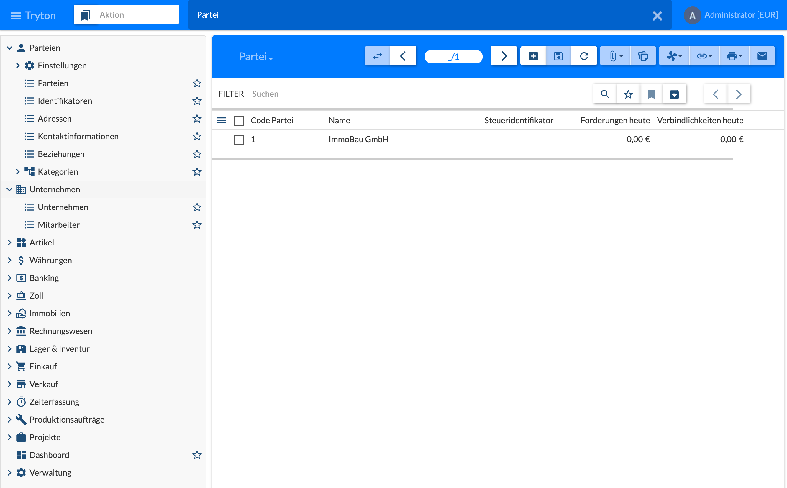
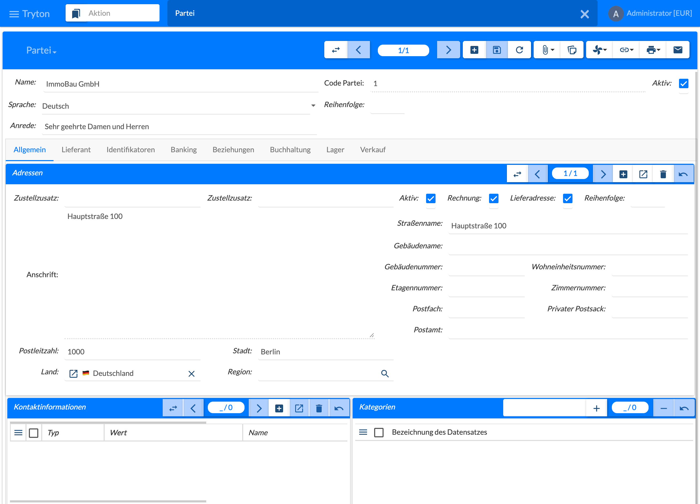

{}
Parties and companies are part of standard Tryton, not of the real estate module. This page only gives an overview of the forms and the fields that matter for real estate management; the other tabs are described in the [Tryton documentation](https://docs.tryton.org).
{}

Business partners are called **Parteien** (parties) in Tryton – persons and companies alike: tenants, owners, suppliers, service providers, authorities and also the own company. A party is created once and then used in all areas, in contracts, invoices and on the real estate objects.

## Entry and List

The menu **Parteien** (Parties) contains:

| Menu | Content |
|------|---------|
| Einstellungen (Configuration) | Basic settings of the parties, e.g. number sequence |
| Parteien (Parties) | List and form of the parties |
| Identifikatoren (Identifiers) | All identifiers, e.g. tax numbers |
| Adressen (Addresses) | All addresses |
| Kontaktinformationen (Contact Mechanisms) | Phone, e-mail, website etc. |
| Beziehungen (Relations) | Relations between parties |
| Kategorien (Categories) | Categories for grouping parties |

The list **Parteien** shows **Code Partei** (party code), **Name**, **Steueridentifikator** (tax identifier) and **Forderungen heute** / **Verbindlichkeiten heute** (receivables / payables today). **Filter** searches, a double click opens the form, **+** creates a new party.

The menu **Unternehmen** (Company) with **Unternehmen** and **Mitarbeiter** (employees) is described in [3.2 Companies and Employees]().

## Form and Tab General

The header of the form holds **Name**, **Code Partei** (party code, assigned on saving), **Aktiv** (active), **Sprache** (language of the correspondence), **Reihenfolge** (sequence) and **Anrede** (salutation), e.g. “Sehr geehrte Damen und Herren” for the letters. Below follow the tabs **Allgemein** (general), **Lieferant** (supplier), **Identifikatoren** (identifiers), **Banking**, **Beziehungen** (relations), **Buchhaltung** (accounting), **Lager** (stock) and **Verkauf** (sale).

The tab **Allgemein** contains:

- **Adressen** (addresses): one or more addresses with street name, postal code, city and country; further fields such as building name and number, floor, post box or region are optional. The flags **Rechnung** (invoice) and **Lieferadresse** (delivery) define what the address is used for; **Zustellzusatz** (party name / attention) takes e.g. “c/o” or a different name. **+** creates a further address, the arrows switch between the addresses.
- **Kontaktinformationen** (contact mechanisms): phone, mobile, e-mail, website etc. with type, value and name.
- **Kategorien** (categories): assignment to categories, see [3.4 Relations, Contact Mechanisms and Categories]().
