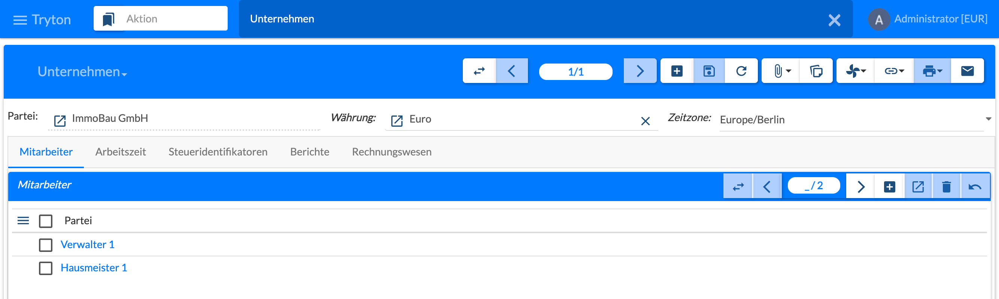
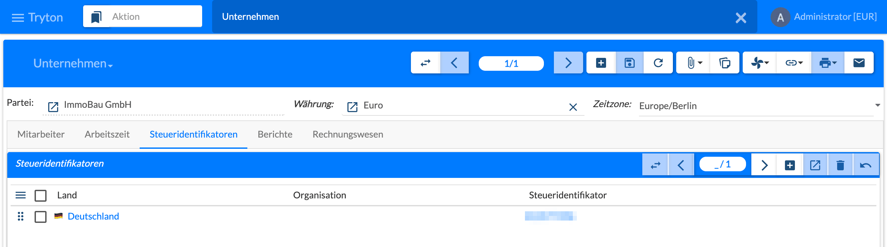
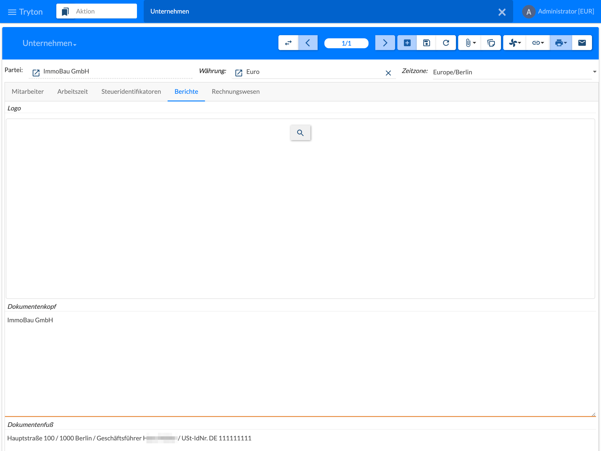
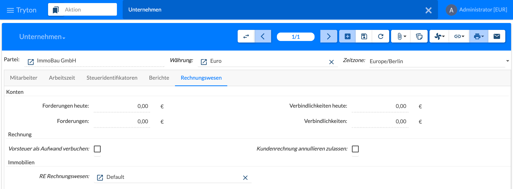

{}
Parteien und Unternehmen gehören zum Tryton-Standard, nicht zum Immobilien-Modul. Diese Seite gibt nur einen Überblick über die Masken und die Felder, die für die Immobilienverwaltung wichtig sind; die übrigen Reiter sind in der [Tryton-Dokumentation](https://docs.tryton.org) beschrieben.
{}

Ein **Unternehmen** (Gesellschaft, Mandant) ist in Tryton selbst eine [Partei](): Name, Anschrift, Sprache und Kontaktdaten werden an der Partei gepflegt, das Unternehmen ergänzt Währung, Zeitzone und die Einstellungen für Mitarbeiter, Steuern, Berichte und Rechnungswesen. Das erste Unternehmen wird bei der Ersteinrichtung angelegt, siehe [2.1 Systemvoraussetzungen und Installation](). Alle Immobilien-Daten – Wirtschaftseinheiten, Verträge, Buchungen – gehören zu genau einem Unternehmen.

## Maske Unternehmen

Menü **Unternehmen › Unternehmen**.

Im Kopf stehen **Partei** (die Partei des Unternehmens), **Währung** (Hauswährung, z. B. Euro) und **Zeitzone** (z. B. Europe/Berlin). Darunter folgen die Reiter **Mitarbeiter**, **Arbeitszeit**, **Steueridentifikatoren**, **Berichte** und **Rechnungswesen**.

## Mitarbeiter

Auch Mitarbeiter sind Parteien. Der Reiter **Mitarbeiter** listet die Mitarbeiter des Unternehmens – im Bild ein Verwalter und ein Hausmeister; ein Klick auf den Namen öffnet die Partei. Mit **+** wird ein Mitarbeiter zugeordnet. Alle Mitarbeiter stehen auch im Menü **Unternehmen › Mitarbeiter**.

Mitarbeiter werden einem Benutzer zugeordnet, siehe [2.3 Benutzer, Anmeldung und Berechtigungen](), und können über Partnerrollen für Objekte und Aufgaben zuständig sein, siehe [3.3 Partnerrollen]().

## Steueridentifikatoren

Der Reiter **Steueridentifikatoren** legt fest, welche Steuernummer das Unternehmen je **Land** (optional je **Organisation**) verwendet, z. B. auf Rechnungen. Ausgewählt wird ein **Steueridentifikator**, der an der Partei des Unternehmens im Reiter **Identifikatoren** erfasst ist – die Nummer selbst wird also an der Partei gepflegt, siehe [3.1 Partner verwalten]().

## Berichte

Im Reiter **Berichte** werden **Logo**, **Dokumentenkopf** und **Dokumentenfuß** für die Korrespondenz und die Berichte des Unternehmens hinterlegt, z. B. Mieterhöhungsschreiben, Abrechnungen und Rechnungen. In den Fuß gehören typischerweise Anschrift, Geschäftsführung und USt-IdNr.

## Rechnungswesen

Der Reiter **Rechnungswesen** zeigt unter **Konten** die aktuellen **Forderungen** und **Verbindlichkeiten** des Unternehmens (gesamt und heute fällig). Unter **Rechnung** stehen die Einstellungen **Vorsteuer als Aufwand verbuchen** und **Kundenrechnung annullieren zulassen**.

Unter **Immobilien** wird mit **RE Rechnungswesen** der Satz der Immobilien-Einstellungen gewählt, der für das Unternehmen gilt, im Bild „Default“. Er steuert u. a. Zahlungsbedingungen und Vorlaufzeiten des Moduls, siehe [2.5.1 Rechnungswesen]().
