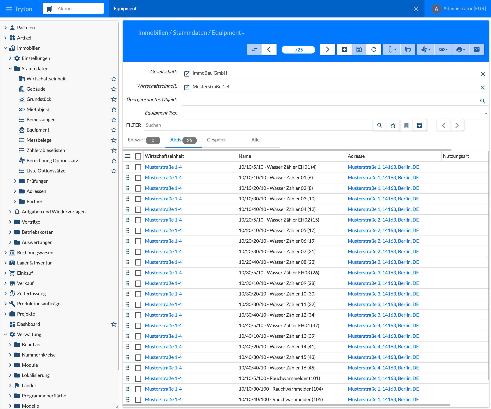
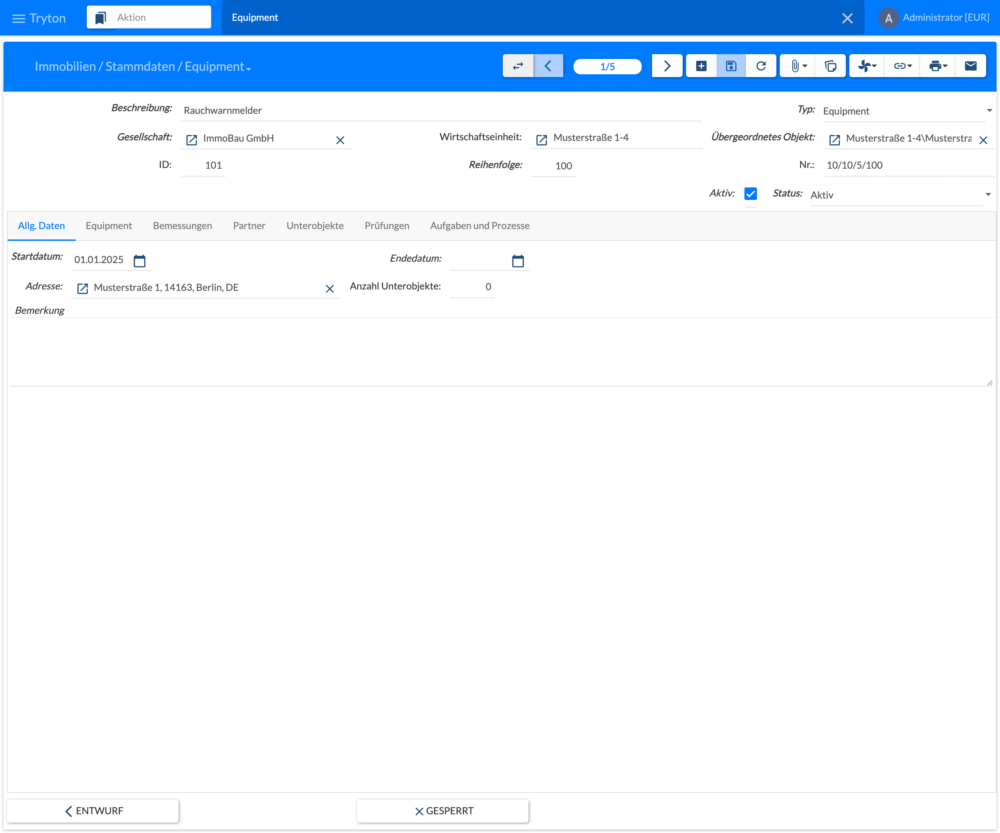
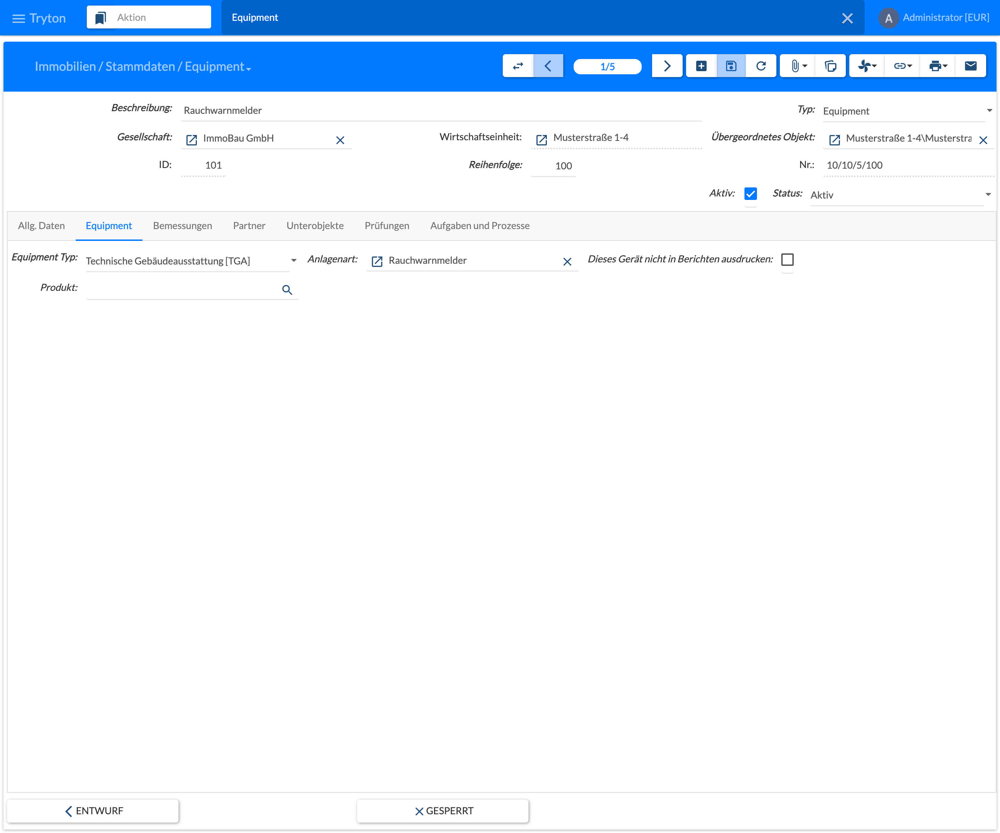
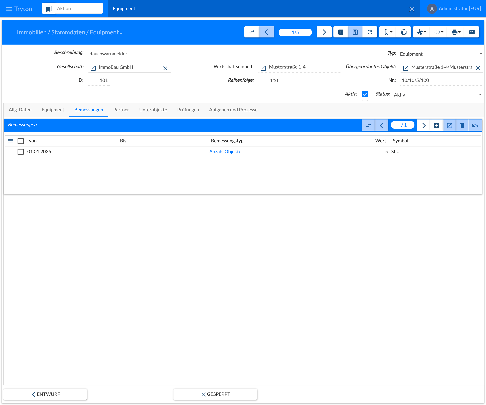

Equipment sind technische Anlagen und Ausstattungen eines Objekts, z. B. Rauchwarnmelder, Aufzüge, Heizungsanlagen, Einbauküchen oder Zähler. Equipment hängt unter einer Wirtschaftseinheit, einem Gebäude, einem Grundstück, einem Mietobjekt oder einem anderen Equipment und wird mit derselben Maske gepflegt wie die [Wirtschaftseinheit](). Hier sind nur die Unterschiede beschrieben. Zähler sind Equipment mit dem Equipment Typ **Zähler**; ihre Zählerdaten und Ablesungen beschreibt [5.5 Zähler und Messbelege]().

## Einstieg

Menü **Immobilien › Stammdaten › Equipment** öffnen. Die Liste zeigt das Equipment der oben angezeigten **Gesellschaft** mit Wirtschaftseinheit, Name, Adresse und Nutzungsart; der Name beginnt mit der Nummer des Equipments. Über die Felder **Wirtschaftseinheit**, **Übergeordnetes Objekt** und **Equipment Typ** lässt sich die Liste einschränken, z. B. auf alle Zähler eines Gebäudes. Die Reiter **Aktiv**, **Gesperrt** und **Alle** filtern nach Status. Neu anlegen und Bearbeiten wie bei der Wirtschaftseinheit.

## Anlegen und Bearbeiten

Der Kopf der Maske entspricht dem [Mietobjekt](). Abweichend:

| Feld | Beschreibung |
|------|--------------|
| Typ | Hier **Equipment**. |
| Übergeordnetes Objekt | Objekt, zu dem das Equipment gehört: Wirtschaftseinheit, Gebäude, Grundstück, Mietobjekt oder ein anderes Equipment. Pflichtfeld. |
| Nr. | Wird aus der Nummer des übergeordneten Objekts und der Reihenfolge gebildet, z. B. **10/10/5/100**. |

Der Reiter **Allg. Daten** enthält Startdatum, Endedatum, Adresse, Anzahl Unterobjekte und Bemerkung wie beim Gebäude.

### Reiter Equipment

| Feld | Beschreibung |
|------|--------------|
| Equipment Typ | Grobe Einordnung: **Technische Gebäudeausstattung [TGA]**, **Bauwerke** (z. B. Mauerwerk, Fenster, Türen), **Installation** (z. B. Möbel) oder **Zähler**. Pflichtfeld. Bei **Zähler** erscheint zusätzlich der Reiter **Zähler**, siehe [5.5 Zähler und Messbelege](). |
| Anlagenart | Art der Anlage, z. B. **Rauchwarnmelder** oder **Aufzug**. Die Anlagenart bestimmt, welches Equipment in eine Prüfung einbezogen wird, z. B. alle Rauchwarnmelder für die Rauchwarnmelderprüfung. |
| Dieses Gerät nicht in Berichten ausdrucken | Das Equipment wird in Berichten nicht aufgeführt. |
| Produkt | Optional: Artikel aus dem Tryton-Artikelstamm, z. B. ein bestimmtes Gerätemodell. |

Mit dem Modul werden diese Anlagenarten ausgeliefert: **Rauchwarnmelder**, **Aufzug**, **Spielplatz**, **Feuerlöscher**, **Rückstausicherung**, **Heizungsanlage** und **Rauch- und Wärmeabzugsanlage (RWA)**. Weitere Anlagenarten werden in [2.5.6 Instandhaltung]() angelegt.

### Reiter Bemessungen

Aufbau wie bei der [Wirtschaftseinheit](). Beim Equipment wird hier vor allem die **Anzahl Objekte** gepflegt: Gleichartige Geräte müssen nicht einzeln angelegt werden. Im Beispiel steht ein Equipment „Rauchwarnmelder“ für die 5 Rauchwarnmelder einer Wohnung. Bei Prüfungen wird diese Anzahl als erwartete Stückzahl je Wohnung vorgeschlagen.

### Weitere Reiter

Die Reiter **Partner**, **Unterobjekte**, **Prüfungen** und **Aufgaben und Prozesse** sind aufgebaut wie bei der [Wirtschaftseinheit](). Für Equipment gilt:

- **Partner:** Die ausgelieferten Rollen (Hausmeister, Verwalter, Eigentümer) sind für Equipment nicht vorgesehen. Für Equipment, z. B. eine Wartungsfirma, ist eine eigene Rolle mit dem Objekttyp **Equipment** nötig, siehe [2.5.2 Geschäftspartner]().
- **Unterobjekte:** Unter Equipment kann nur weiteres Equipment hängen, z. B. die Bauteile einer Heizungsanlage.
- **Prüfungen:** Statt der Prüfpläne zeigt der Reiter die **Prüfpositionen**, in denen das Equipment geprüft wurde, und seine **offenen Mängel**. Prüfpläne gibt es nur an Wirtschaftseinheit und Gebäude, siehe [8.1 Prüfpläne]().
- **Aufgaben und Prozesse:** Aufgaben und Prozesse zum Equipment selbst. Bei Zählern erzeugt die Regel **Eichfrist läuft ab** hier Aufgaben, siehe [5.5 Zähler und Messbelege]().

Einen Reiter **Optionssatz** und **Mietspiegel** gibt es beim Equipment nicht.

## Aktionen, Verknüpfungen und Drucken

| Menü | Eintrag | Bedeutung |
|------|---------|-----------|
| Aktionen | Neue Aufgabe | Legt eine Aufgabe zum Equipment an. |
| Aktionen | Prozess starten | Startet einen Prozess nach Vorlage. |
| Aktionen | Entwurf, Gesperrt | Statuswechsel, wie die Schaltflächen unten in der Maske. |
| Aktionen | Aktuelle Sicht übersetzen | Tryton-Standardfunktion zum Übersetzen der Bezeichnungen. |
| Verknüpfungen | E-Mail Archive, Objekt, Zählerableselisten | Öffnet zugehörige Datensätze in einem neuen Tab, wie bei der Wirtschaftseinheit. |
| Drucken | Datenblatt | Datenblatt des Equipments. |
