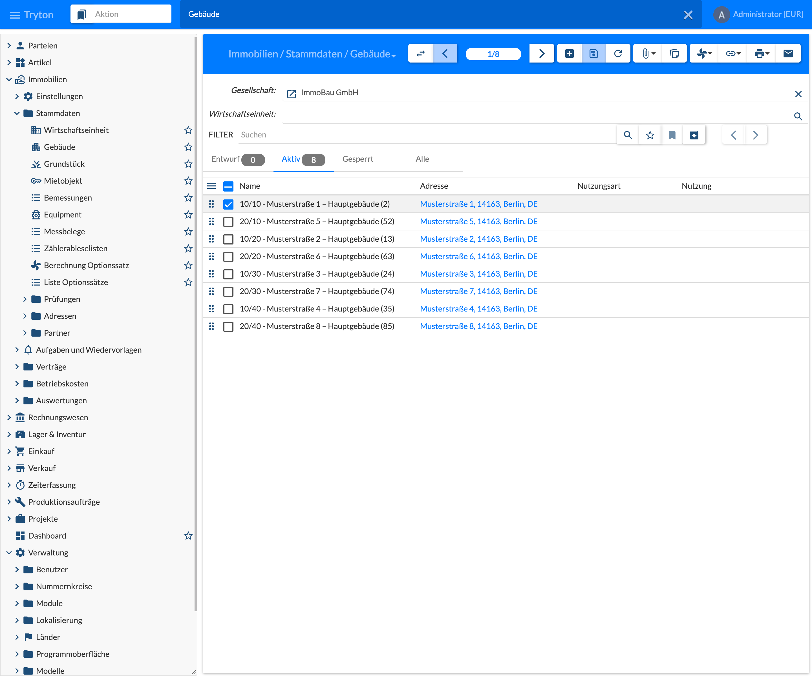
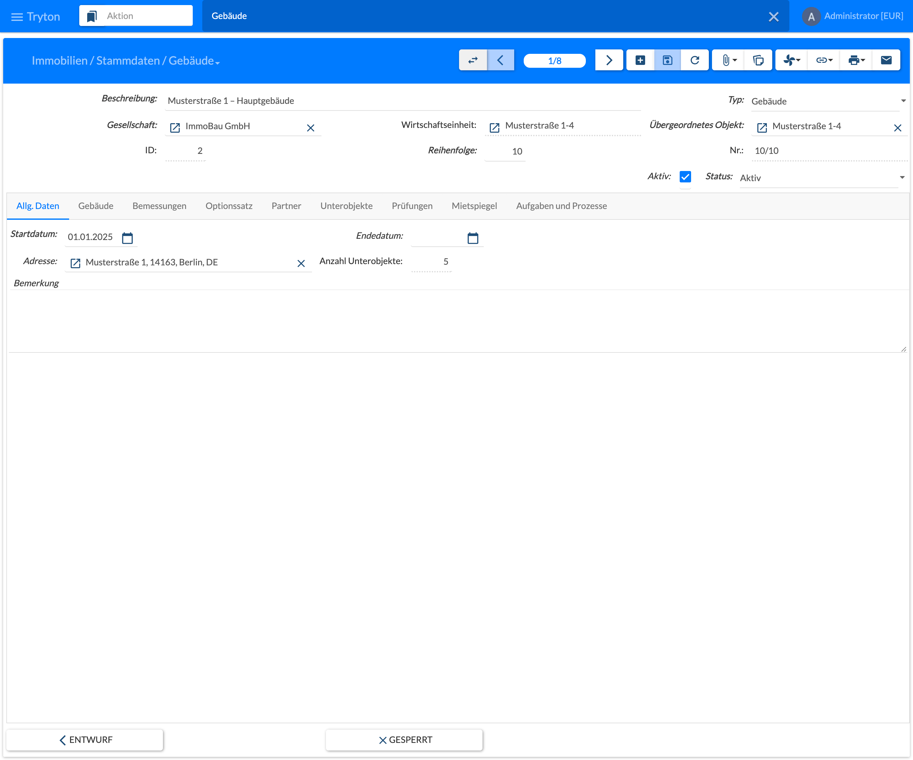
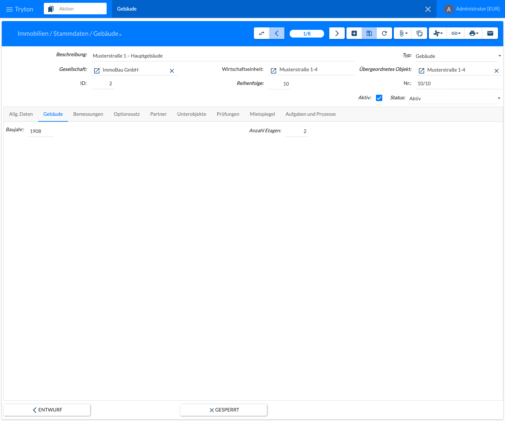
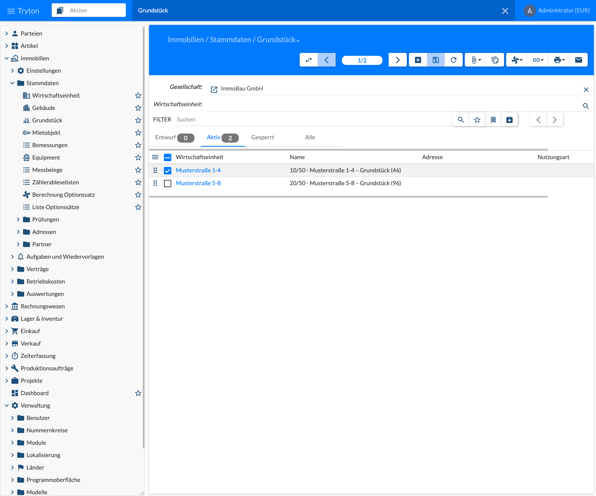
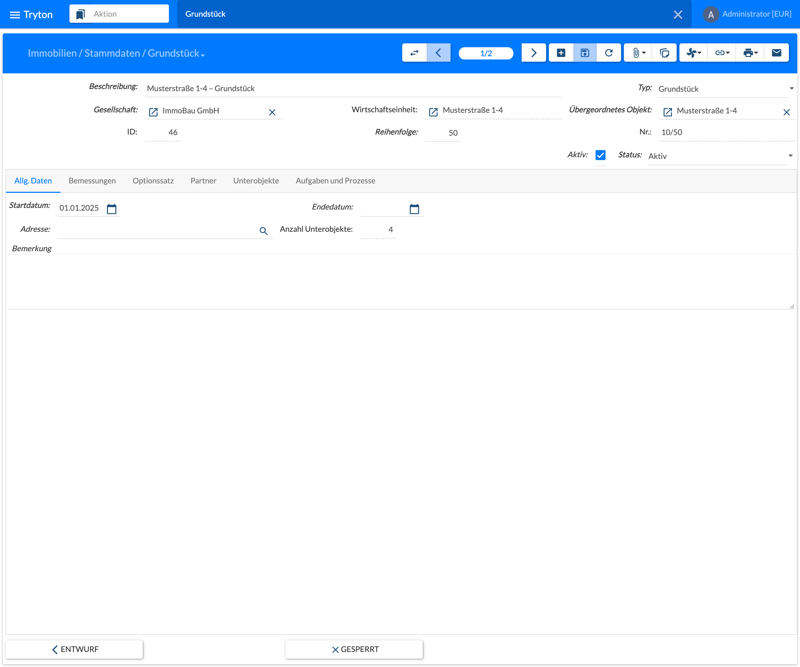

Buildings and land are the level below the [property](). Both are maintained with the same form as the property; only the differences are described here.

## Building

### Getting Started

Open the menu **Immobilien › Stammdaten › Gebäude** (Real Estate › Master Data › Building). The list shows the buildings of the **company** displayed at the top. The field **Wirtschaftseinheit** (Property) restricts the list to one property. Tabs, creating and editing as for the property.

### Create and Edit

The header of the form corresponds to the [property](). Additional or different:

| Field | Description |
|-------|-------------|
| Typ (Type) | Here **Gebäude** (Building). |
| Wirtschaftseinheit (Property) | Property the building belongs to; taken from the parent object, read-only. |
| Übergeordnetes Objekt (Parent) | Object the building belongs to: a property or another building. Required. |
| Nr. (No) | Built from the number of the parent object and the sequence, e.g. **10/10**. |

The tab **Allg. Daten** (General) contains start date, end date, address, number of sub-objects and comment as for the property; the fields on the housing market and the reduced cap only exist there.

#### Tab Gebäude (Building)

| Field | Description |
|-------|-------------|
| Baujahr (Year of Construction) | Year the building was constructed. |
| Anzahl Etagen (Number of Floors) | Number of floors of the building. |

#### Further Tabs

The tabs **Bemessungen**, **Optionssatz**, **Partner**, **Unterobjekte**, **Prüfungen**, **Mietspiegel** and **Aufgaben und Prozesse** are structured as for the [property](). For buildings:

- **Partner (Parties):** No role is shipped for buildings; caretaker and administrator are assigned on the property.
- **Unterobjekte (Sub-Objects):** Buildings (e.g. side wing or rear building), rental objects and equipment. Sub-objects of a building are mainly the rental objects, see [5.3 Rental Objects]().
- **Prüfungen (Inspections):** The inspection plans of the building are created here. Both shipped inspection types, annual walkthrough and smoke detector check, apply per building, see [8.1 Inspection Plans]().
- **Aufgaben und Prozesse (Tasks and Processes):** If an end date is entered, the rule **Objekt endet** (Object ends) creates a task here.

### Actions, Relate and Print

| Menu | Entry | Meaning |
|------|-------|---------|
| Actions | Neue Aufgabe (New Task) | Creates a task for the building. |
| Actions | Prozess starten (Start Process) | Starts a process from a template. |
| Actions | Merkmale erfassen (Assign Features) | Checklist of the rent survey features of the building, see tab Rent Survey. |
| Actions | Kopieren von Gebäude (Copy from Building) | Take over classes and features of another building of the property. |
| Actions | Entwurf, Gesperrt (Draft, Locked) | Change of state, same as the buttons at the bottom of the form. |
| Actions | Aktuelle Sicht übersetzen (Translate View) | Tryton standard function to translate the labels. |
| Relate | E-Mail Archive, Objekt, Zählerableselisten | Opens related records in a new tab, as for the property. |
| Print | Datenblatt (Fact Sheet) | Fact sheet of the building. |

## Land

### Getting Started

Open the menu **Immobilien › Stammdaten › Grundstück** (Real Estate › Master Data › Land). The list shows the land with its property; filter and tabs as for buildings.

### Create and Edit

Header and tab **Allg. Daten** (General) as for buildings. Different:

| Field | Description |
|-------|-------------|
| Typ (Type) | Here **Grundstück** (Land). |
| Übergeordnetes Objekt (Parent) | For land always a property. |

The tabs **Bemessungen**, **Optionssatz**, **Partner**, **Unterobjekte** and **Aufgaben und Prozesse** are structured as for the [property](). Land has no tab **Prüfungen** (Inspections). For land:

- **Partner (Parties):** No role is shipped for land.
- **Unterobjekte (Sub-Objects):** Rental objects (e.g. parking spaces) and equipment (e.g. a playground).

### Actions, Relate and Print

| Menu | Entry | Meaning |
|------|-------|---------|
| Actions | Neue Aufgabe (New Task) | Creates a task for the land. |
| Actions | Prozess starten (Start Process) | Starts a process from a template. |
| Actions | Entwurf, Gesperrt (Draft, Locked) | Change of state, same as the buttons at the bottom of the form. |
| Actions | Aktuelle Sicht übersetzen (Translate View) | Tryton standard function to translate the labels. |
| Relate | E-Mail Archive, Objekt, Zählerableselisten | Opens related records in a new tab, as for the property. |
| Print | Datenblatt (Fact Sheet) | Fact sheet of the land. |
