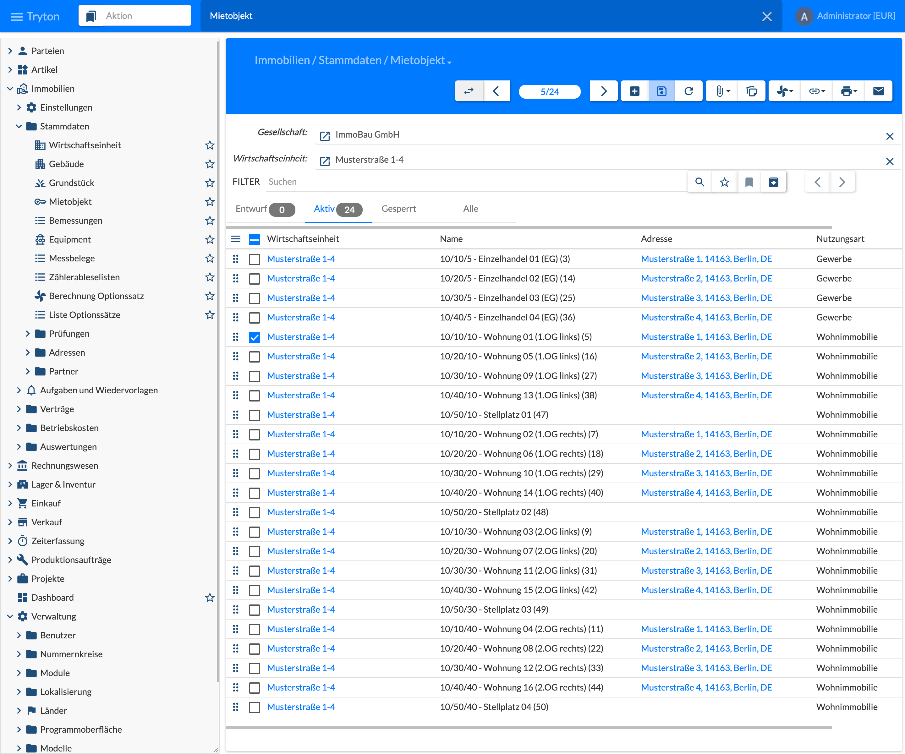
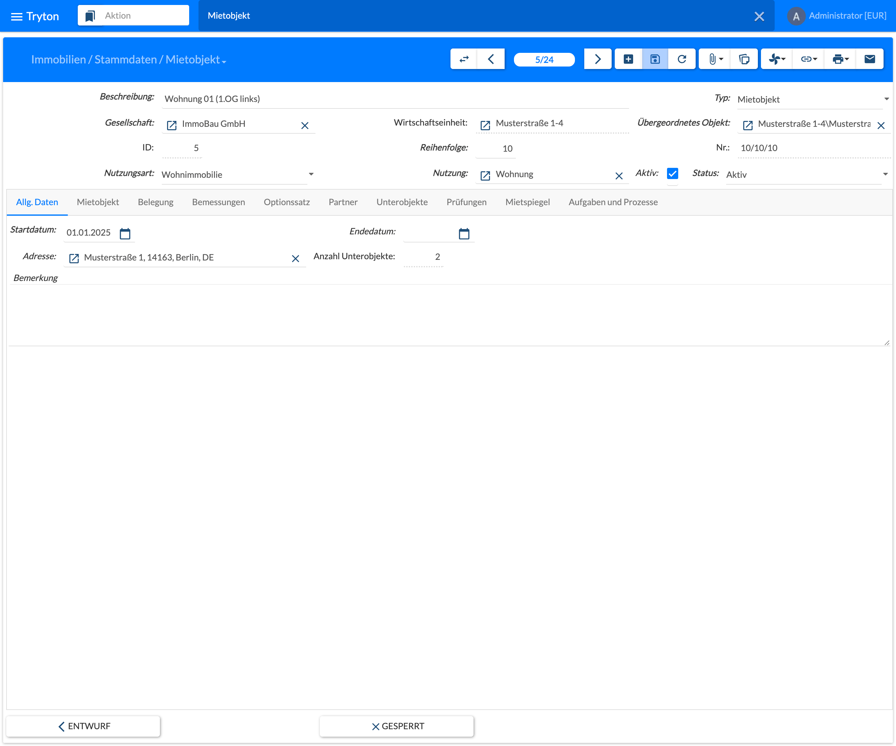
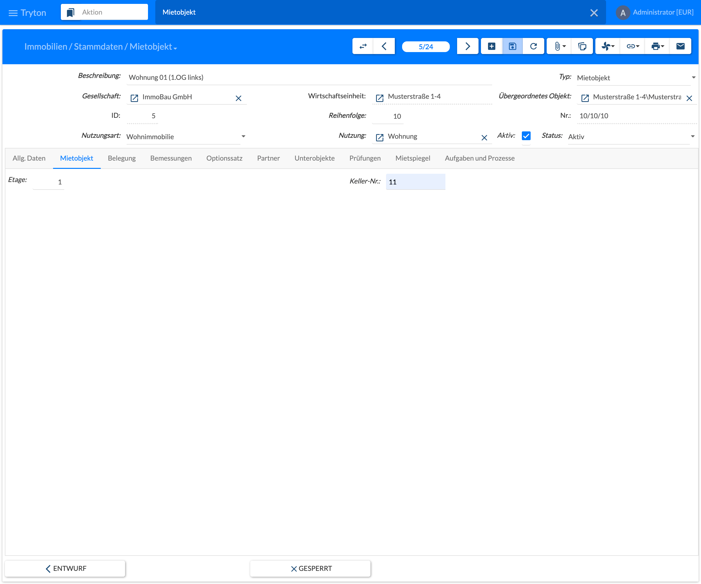
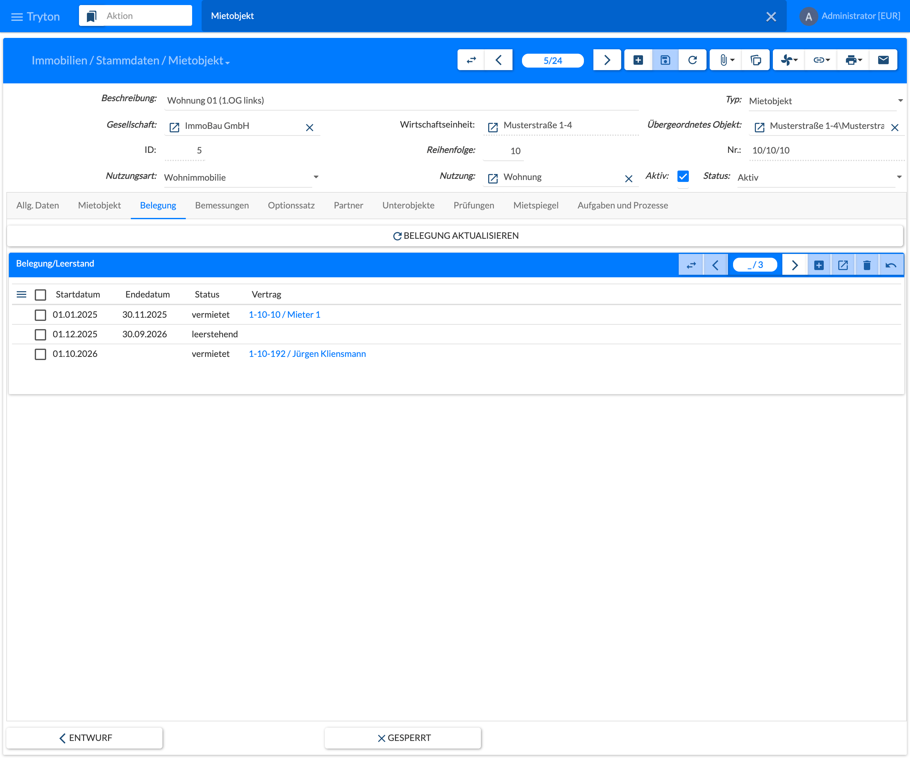

Mietobjekte sind die vermietbaren Einheiten, z. B. Wohnungen, Gewerbeeinheiten oder Stellplätze. Sie hängen unter einem Gebäude, einem Grundstück oder direkt unter der Wirtschaftseinheit und werden mit derselben Maske gepflegt wie die [Wirtschaftseinheit](); hier sind nur die Unterschiede beschrieben.

## Einstieg

Menü **Immobilien › Stammdaten › Mietobjekt** öffnen. Die Liste zeigt die Mietobjekte der oben angezeigten **Gesellschaft** mit Wirtschaftseinheit, Name, Adresse und Nutzungsart. Über das Feld **Wirtschaftseinheit** lässt sich die Liste auf eine Wirtschaftseinheit einschränken. Reiter, Neu anlegen und Bearbeiten wie bei der Wirtschaftseinheit.

## Anlegen und Bearbeiten

Der Kopf der Maske entspricht dem [Gebäude](). Zusätzlich bzw. abweichend:

| Feld | Beschreibung |
|------|--------------|
| Typ | Hier **Mietobjekt**. |
| Übergeordnetes Objekt | Wirtschaftseinheit, Gebäude oder Grundstück, unter dem das Mietobjekt hängt. Pflichtfeld. |
| Nr. | Wird aus der Nummer des übergeordneten Objekts und der Reihenfolge gebildet, z. B. **10/10/10**. |
| Nutzungsart | Wirtschaftliche Nutzung: **Wohnimmobilie**, **Gewerbe**, **Wohneigentum** (selbst genutzt) oder **Interne Nutzung**. Sie bestimmt, welche Vertragsarten zur Auswahl stehen, und setzt die Optionssatzmethode vor (Gewerbe: optiert 100 %, sonst 0 %). |
| Nutzung | Nutzungsklasse, z. B. **Wohnung**, **Büro**, **Einzelhandel**, **Lager**, **Garage** oder **Stellplatz**; die Klassen werden in [2.4.3 Immobilien-Stammdaten]() festgelegt. Sie steuert u. a., ob Keller-Nr. bzw. Stellplatz-Nr. erfasst werden. |

Der Reiter **Allg. Daten** enthält Startdatum, Endedatum, Adresse, Anzahl Unterobjekte und Bemerkung wie beim Gebäude.

### Reiter Mietobjekt

| Feld | Beschreibung |
|------|--------------|
| Etage | Etage, in der das Mietobjekt liegt. |
| Keller-Nr. | Nummer des zugehörigen Kellerabteils; nur sichtbar, wenn die Nutzung ein Kellerabteil vorsieht. |
| Stellplatz-Nr. | Nummer des Stellplatzes; nur sichtbar, wenn die Nutzung eine Stellplatznummer vorsieht (nicht im Bild). |

### Reiter Belegung

Zeitliche Übersicht, wann das Mietobjekt vermietet war bzw. leer stand. Die Belegung ergibt sich aus den Verträgen.

| Feld | Beschreibung |
|------|--------------|
| Belegung aktualisieren | Berechnet die Belegung des Mietobjekts aus den Verträgen neu. |
| Startdatum / Endedatum | Zeitraum des Abschnitts; leeres Endedatum = offen. |
| Status | **vermietet**, **leerstehend** oder **in Verhandlung**. |
| Vertrag | Mietvertrag des Zeitraums, siehe [6.1 Vertrag anlegen und pflegen](). |

Eine Übersicht über alle Mietobjekte bietet [6.5 Belegung und Leerstand]().

### Weitere Reiter

Die Reiter **Bemessungen**, **Optionssatz**, **Partner**, **Unterobjekte**, **Prüfungen**, **Mietspiegel** und **Aufgaben und Prozesse** sind aufgebaut wie bei der [Wirtschaftseinheit](). Beim Optionssatz ist für Mietobjekte die Methode „dynamisch über Bemessung“ nicht möglich. Außerdem gilt für Mietobjekte:

- **Partner:** Ausgeliefert ist die Rolle **Eigentümer**, z. B. für den Eigentümer einer Eigentumswohnung.
- **Unterobjekte:** Nur Equipment, z. B. Rauchwarnmelder, Einbauküche oder Zähler, siehe [5.4 Equipment und technische Anlagen]().
- **Prüfungen:** Statt der Prüfpläne zeigt der Reiter die **Prüfpositionen** des Mietobjekts, z. B. die Position der Wohnung in der Rauchwarnmelderprüfung, und seine **offenen Mängel**.
- **Aufgaben und Prozesse:** Neben den Aufgaben des Mietobjekts erscheinen die **Aufgaben der Verträge** des Mietobjekts. Steht das Mietobjekt leer, wird über **Aktionen › Prozess starten** der Prozess **Leerstand / Neuvermietung** gestartet. Er erzeugt sechs Aufgaben: Zählerstände erfassen und Einheit sichern, Einheit begehen und Instandsetzung beauftragen (beide für die Rolle Hausmeister), neue Miete festlegen, Einheit inserieren, Besichtigungen und Mieterauswahl, neuen Mietvertrag anlegen. Siehe [10.2 Prozesse]().

## Aktionen, Verknüpfungen und Drucken

| Menü | Eintrag | Bedeutung |
|------|---------|-----------|
| Aktionen | Neue Aufgabe | Legt eine Aufgabe zum Mietobjekt an. |
| Aktionen | Prozess starten | Startet einen Prozess nach Vorlage. |
| Aktionen | Belegung aktualisieren | Wie die Schaltfläche im Reiter Belegung. |
| Aktionen | Merkmale erfassen | Checkliste der Mietspiegel-Merkmale des Mietobjekts, siehe Reiter Mietspiegel. |
| Aktionen | Kopieren von Mietobjekt | Merkmale – optional auch Klassen – eines anderen Mietobjekts derselben Wirtschaftseinheit übernehmen. |
| Aktionen | Vergleichsmiete berechnen | Berechnet die ortsübliche Vergleichsmiete nach Mietspiegel (Wohnungen), siehe [6.7 Mietanpassungen](). |
| Aktionen | Entwurf, Gesperrt | Statuswechsel, wie die Schaltflächen unten in der Maske. |
| Aktionen | Aktuelle Sicht übersetzen | Tryton-Standardfunktion zum Übersetzen der Bezeichnungen. |
| Verknüpfungen | E-Mail Archive, Objekt, Zählerableselisten | Öffnet zugehörige Datensätze in einem neuen Tab, wie bei der Wirtschaftseinheit. |
| Drucken | Datenblatt | Datenblatt des Mietobjekts. |
