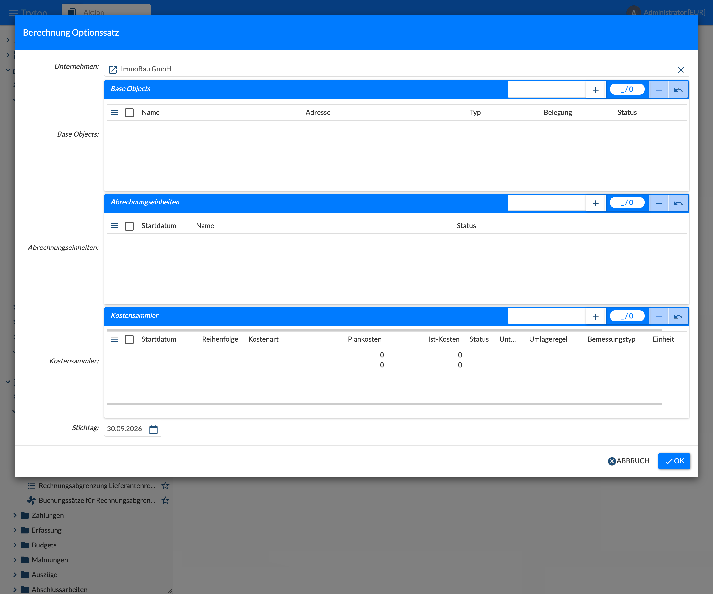
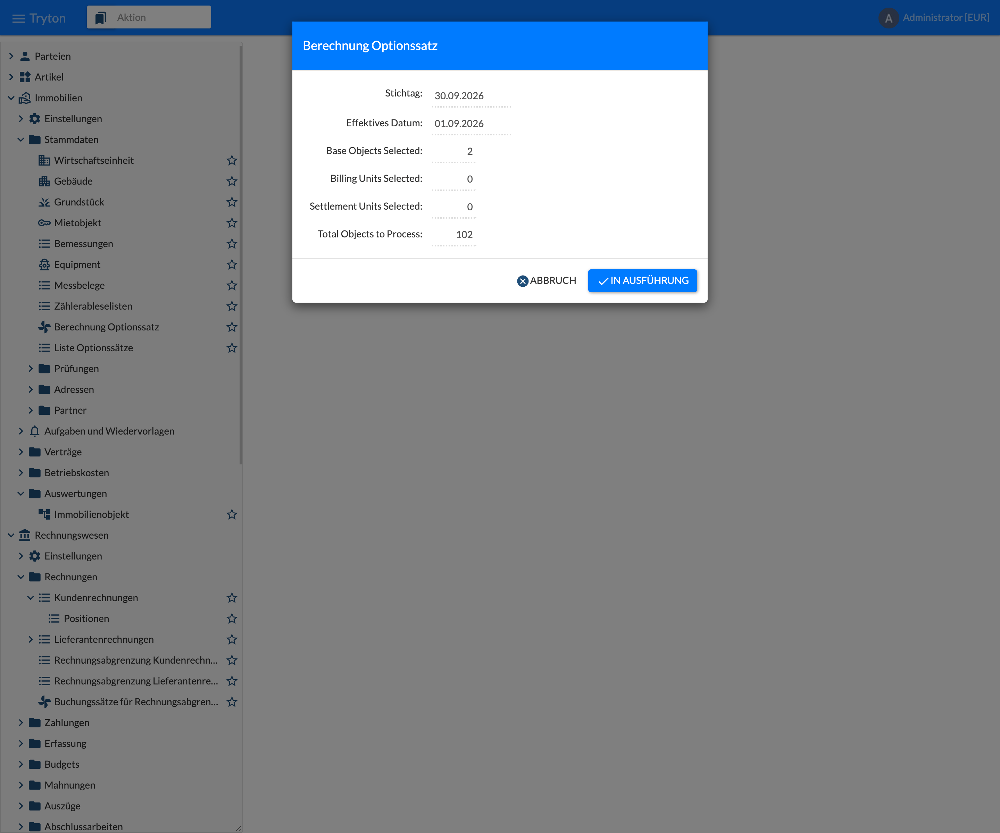
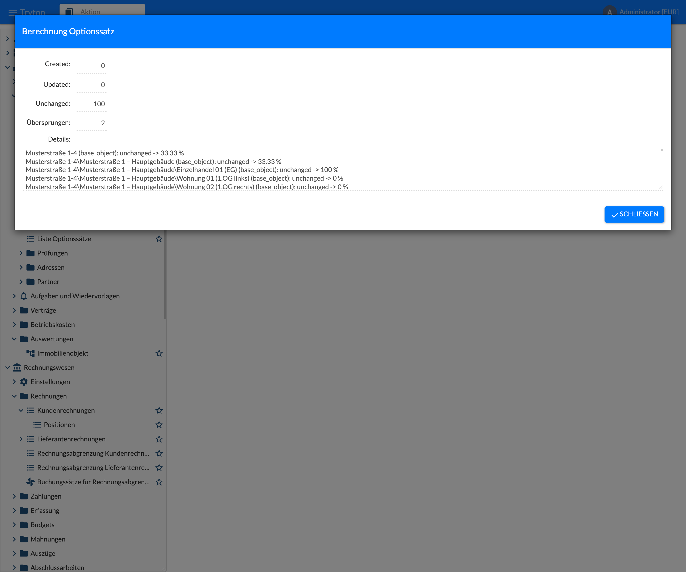
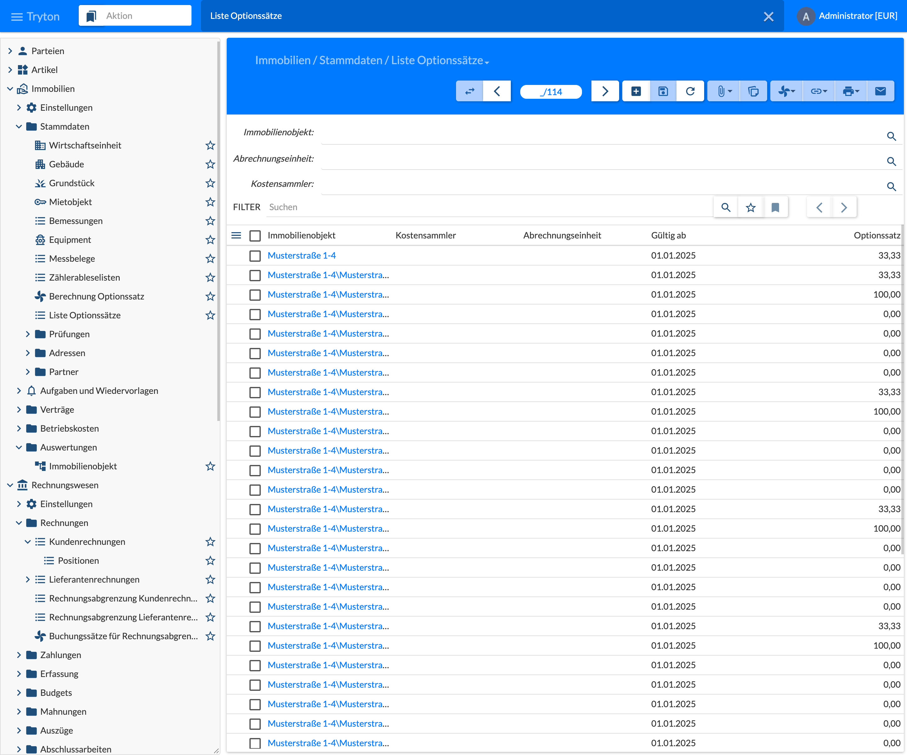

The option rate states which share of the input VAT on purchase invoices is deductible because the owner has opted for VAT on the letting (§ 9 UStG). It is kept per object, billing unit and settlement unit with a valid-from date and is proposed automatically when purchase invoices are entered. The method is maintained in the tab **Optionssatz** (Option Rate) of the object, see [5.1 Property]().

| Option rate method | Option rate |
|--------------------|-------------|
| optiert nicht (0,0 %) fix (not opted, fixed 0 %) | always 0 % – the input VAT is an expense |
| optiert (100,0 %) fix (opted, fixed 100 %) | always 100 % – the input VAT is fully deductible |
| Optionssatz fix nach Wert (fixed by value) | fixed percentage entered in the tab Option Rate |
| dynamisch über Bemessung (dynamic by measurement) | calculated: average of the option rates of the rental objects, weighted by a measurement (e.g. living/usable area); not for rental objects themselves |

If the company is set to always book input VAT as an expense, there is no option rate; the tab is hidden then.

## Berechnung Optionssatz (Update Option Rates)

The wizard recalculates the option rates for a selection and creates a new entry where the rate changes. It is run e.g. after a change between residential and commercial letting or after changed areas.

{}
The same calculation can also run periodically: as the job **Optionssatz aktualisieren** (Update Option Rate), e.g. monthly on the 1st. It calculates all properties of the company as of the current date; the new rate is valid from the first of the month. The job is set up in [2.5 Jobs and Periodic Tasks]().
{}

### Selection

Open the menu **Immobilien › Stammdaten › Berechnung Optionssatz** (Real Estate › Master Data › Update Option Rates).

| Field | Description |
|-------|-------------|
| Unternehmen (Company) | Company whose objects are calculated. Required. |
| Base Objects | Properties, buildings, land or rental objects. Selected properties, buildings and land are expanded to all objects below them, a property additionally to its billing units and settlement units. |
| Abrechnungseinheiten (Billing Units) | Billing units; they are expanded to their settlement units. |
| Kostensammler (Settlement Units) | Individual settlement units. |
| Stichtag (Cut-off Date) | Date of the calculation. The new option rate is valid from the **first of this month**. Default: today. |

If the three lists are left empty, **all properties** of the company are calculated.

### Confirm

The second step shows **Stichtag** and **Effektives Datum** (effective date: first of the month from which the new rate applies), the number of selected base objects, billing units and settlement units and the **total number of objects to process** after expansion. In the example 2 properties become 102 objects. **In Ausführung** (Process) starts the calculation.

Calculation per object:

- **fixed 0 % / fixed 100 % / fixed by value:** the rate is taken over directly.
- **dynamic by measurement:** every active rental object below contributes its measurement at the cut-off date as weight and its own option rate; the result is the weighted average, rounded to 2 decimals. An object that is not active excludes its whole subtree. For billing units and settlement units their assigned rental objects count.
- Objects that are not **Aktiv** (active) as well as billing units and settlement units in the state draft or billed are not processed.

### Result

| Field | Meaning |
|-------|---------|
| Created | New option rate entry, valid from the first of the month. |
| Updated | An entry for the same first of the month already existed; it was overwritten. |
| Unchanged | The calculated rate equals the current one; nothing is written. |
| Übersprungen (Skipped) | No rate could be calculated, e.g. for “dynamic by measurement” without measurements. |
| Details | One line per object with result and rate, e.g. “Musterstraße 1-4 (base_object): unchanged -> 33.33 %”. |

In the example the apartments have 0 %, the commercial unit 100 % and building and property the weighted rate of 33.33 %.

## Liste Optionssätze (Option Rates)

Open the menu **Immobilien › Stammdaten › Liste Optionssätze** (Real Estate › Master Data › Option Rates). The list shows all booked option rates with real estate object, settlement unit or billing unit, **Gültig ab** (valid from) and **Optionssatz** (option rate) in percent. The fields **Immobilienobjekt**, **Abrechnungseinheit** and **Kostensammler** restrict the list. The list is for reference only and cannot be edited; entries are created by the wizard or in the tab **Optionssatz** of the object.

Which option rate is proposed on a purchase invoice depends on the most specific reference of the invoice line – object before settlement unit before billing unit before property – and on the invoice date: the last entry with **Gültig ab** on or before that date applies. See [4.1 Invoices]().
