## Einstieg

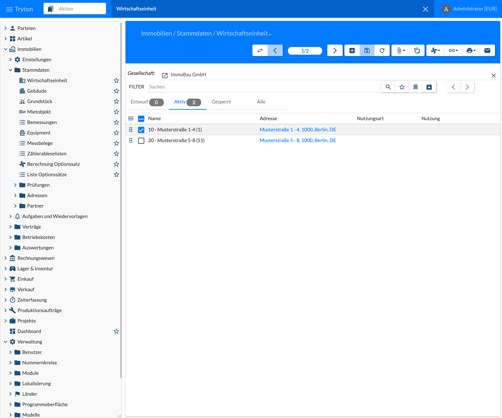

Die Wirtschaftseinheit ist die oberste Ebene der Immobilien-Stammdaten. Unter ihr hängen Gebäude, Grundstücke und Mietobjekte.

Menü **Immobilien › Stammdaten › Wirtschaftseinheit** öffnen. Die Liste zeigt die Wirtschaftseinheiten der oben angezeigten **Gesellschaft** mit Name, Adresse, Nutzungsart und Nutzung. Die Reiter **Entwurf**, **Aktiv**, **Gesperrt** und **Alle** filtern nach Status, die Zahl zeigt die Anzahl der Einträge.

- **Neu anlegen:** Schaltfläche **+** (Neu) in der Symbolleiste
- **Bearbeiten:** Zeile markieren und mit der Eingabetaste oder über die Schaltfläche **Ansicht wechseln** in die Maske wechseln

## Anlegen und Bearbeiten

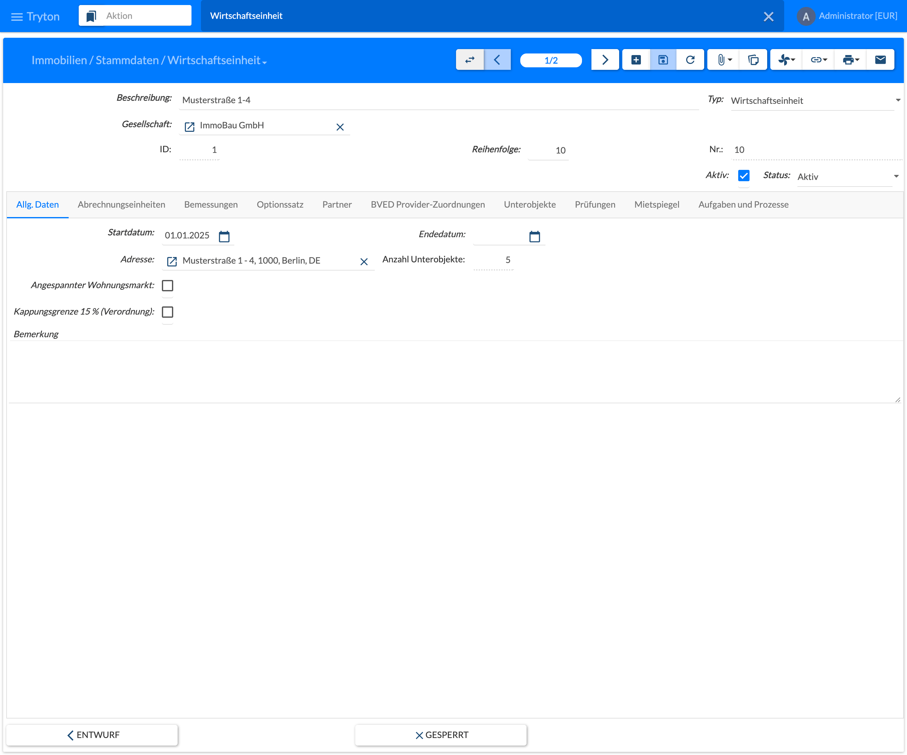

| Feld | Beschreibung |
|------|--------------|
| Beschreibung | Bezeichnung der Wirtschaftseinheit, z. B. die Anschrift. Pflichtfeld. |
| Typ | Art des Objekts, hier **Wirtschaftseinheit**. |
| Gesellschaft | Gesellschaft, zu der die Wirtschaftseinheit gehört. Pflichtfeld. |
| ID | Interne Datensatznummer, vergibt das System. |
| Reihenfolge | Position innerhalb der Ebene; muss größer als 0 und je Ebene eindeutig sein. |
| Nr. | Nummer der Wirtschaftseinheit, wird vom System gesetzt und kann nicht geändert werden. |
| Aktiv | Inaktive Wirtschaftseinheiten werden in Listen und Auswahlfeldern ausgeblendet. |
| Status | **Entwurf**, **Aktiv**, **Gesperrt** oder **Deaktiviert**. Der Status wird über die Schaltflächen unten in der Maske gewechselt (z. B. **Entwurf**, **Gesperrt**). |

### Reiter Allg. Daten

Der Reiter ist in der Abbildung oben zu sehen.

| Feld | Beschreibung |
|------|--------------|
| Startdatum | Beginn der Wirtschaftseinheit. Pflichtfeld. |
| Endedatum | Ende der Wirtschaftseinheit, leer = unbegrenzt. |
| Adresse | Anschrift der Wirtschaftseinheit, siehe [11.1 Auswertungen – Adressen](). |
| Anzahl Unterobjekte | Anzahl der direkt zugeordneten Gebäude und Grundstücke; wird berechnet. |
| Angespannter Wohnungsmarkt | Die Liegenschaft liegt in einem Gebiet mit angespanntem Wohnungsmarkt laut Landesverordnung (relevant für die Kappungsregel der Indexmiete). |
| Kappungsgrenze 15 % (Verordnung) | Die Wirtschaftseinheit liegt in einem Gebiet, in dem die Landesverordnung die Kappungsgrenze für Mieterhöhungen bis zur ortsüblichen Vergleichsmiete von 20 % auf 15 % in drei Jahren senkt (§ 558 Abs. 3 BGB). |
| Bemerkung | Freier Text. |

### Reiter Abrechnungseinheiten

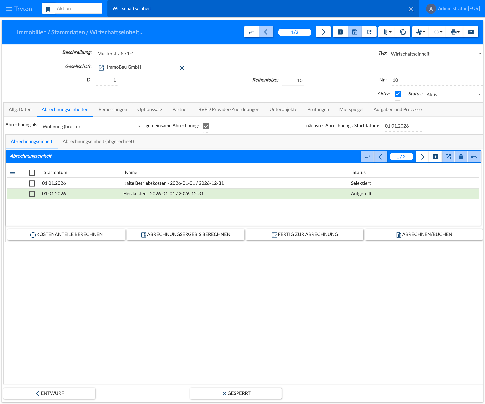

Der Reiter zeigt die Abrechnungseinheiten der Betriebskostenabrechnung, die zu dieser Wirtschaftseinheit gehören, und bietet die Schritte der Abrechnung für alle Abrechnungseinheiten auf einmal an.

| Feld | Beschreibung |
|------|--------------|
| Abrechnung als | **Wohnung (brutto)** oder **Gewerbe (netto)**: legt fest, wie die Betriebskosten abgerechnet werden. Nur im Status Entwurf änderbar. |
| gemeinsame Abrechnung | Alle Abrechnungseinheiten mit demselben Startdatum werden gemeinsam abgerechnet. Die Abrechnung wird dann hier an der Wirtschaftseinheit ausgelöst, nicht an der einzelnen Abrechnungseinheit. Nur im Status Entwurf änderbar. |
| nächstes Abrechnungs-Startdatum | Frühestes Startdatum aller noch nicht abgerechneten Abrechnungseinheiten; wird berechnet. Abrechnungseinheiten mit diesem Startdatum sind in der Liste grün hervorgehoben. |
| Abrechnungseinheit | Liste der offenen Abrechnungseinheiten mit Startdatum, Name und Status. |
| Abrechnungseinheit (abgerechnet) | Liste der bereits abgerechneten Abrechnungseinheiten. |

Die Schaltflächen unter der Liste wirken auf alle Abrechnungseinheiten mit dem **nächsten Abrechnungs-Startdatum**:

| Schaltfläche | Wirkung |
|--------------|---------|
| Kostenanteile berechnen | Berechnet die Kostenanteile, siehe [7.3 Kostenanteile und Umlageschlüssel](). |
| Abrechnungsergebnis berechnen | Berechnet das Abrechnungsergebnis. |
| Fertig zur Abrechnung | Setzt die Abrechnungseinheiten auf **fertig zur Abrechnung**. |
| Abrechnen/Buchen | Öffnet den Assistenten für die Abrechnung, siehe [7.5 Betriebskostenabrechnung durchführen](). Abgerechnet werden nur Abrechnungseinheiten im Status **fertig zur Abrechnung**. |

### Reiter Bemessungen

Bemessungen sind zeitabhängige Werte der Wirtschaftseinheit, z. B. Flächen oder der Immobilienwert. Sie dienen u. a. als Grundlage für Umlageschlüssel und Optionssatz.

| Spalte | Beschreibung |
|--------|--------------|
| von | Datum, ab dem der Wert gilt. |
| Bemessungstyp | Art der Bemessung, z. B. **Immobilienwert** oder **Wohn/Nutzfläche**; die Typen werden in [2.4.3 Immobilien-Stammdaten]() festgelegt. |
| Wert | Wert der Bemessung. |
| Symbol | Einheit des Werts, z. B. EUR oder m². |

Ausführlich: [11.1 Auswertungen – Bemessungen]().

### Reiter Optionssatz

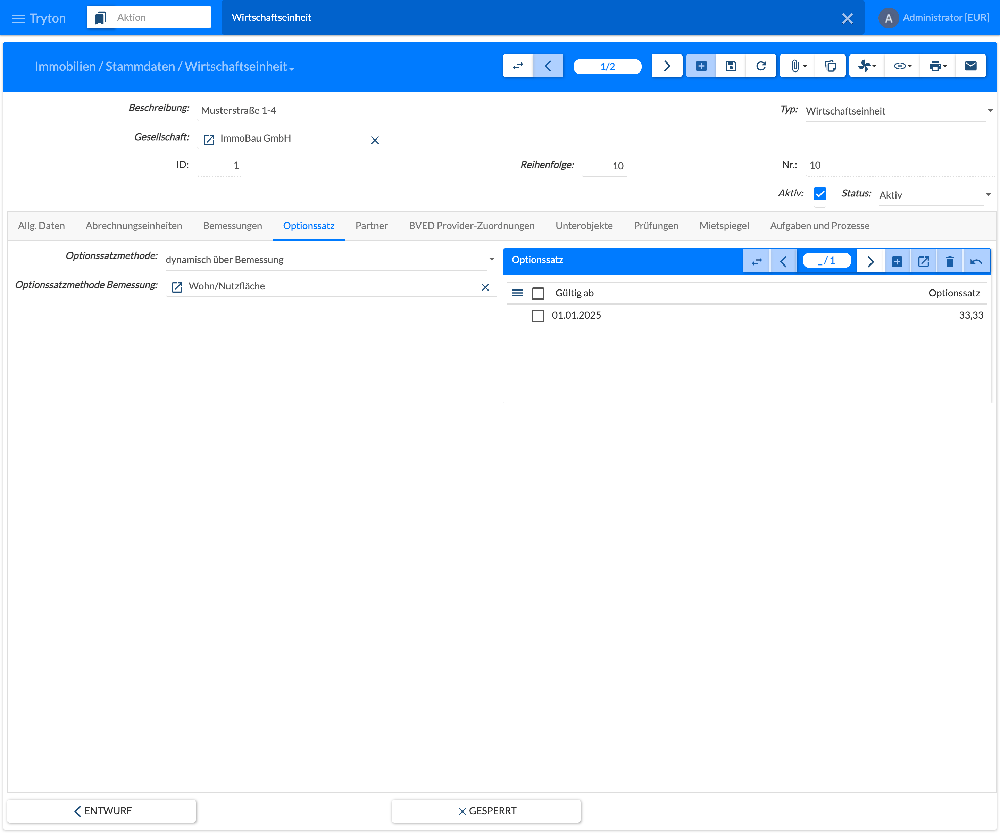

Der Optionssatz gibt an, zu welchem Anteil die Vorsteuer aus Eingangsrechnungen zur Wirtschaftseinheit abziehbar ist (Option zur Umsatzsteuer, § 9 UStG). Er wird bei Eingangsrechnungen automatisch vorgeschlagen. Ist bei der Gesellschaft eingestellt, dass die Vorsteuer immer als Aufwand gebucht wird, ist der Reiter ausgeblendet.

| Feld | Beschreibung |
|------|--------------|
| Optionssatzmethode | **optiert nicht (0,0 %) fix**, **optiert (100,0 %) fix**, **Optionssatz fix nach Wert** oder **dynamisch über Bemessung** (wird aus den Bemessungen der Mietobjekte berechnet). |
| Optionssatzmethode Bemessung | Nur bei „dynamisch über Bemessung“: Bemessungstyp, nach dem gerechnet wird, z. B. Wohn/Nutzfläche. Wenn eine Messgruppe ausgewählt ist, werden alle zugehörigen Messarten pro Mietobjekt summiert. |
| Optionssatz | Verlauf der Optionssätze mit **Gültig ab** und **Optionssatz** in Prozent. |

Ausführlich: [5.6 Optionssätze]().

### Reiter Partner

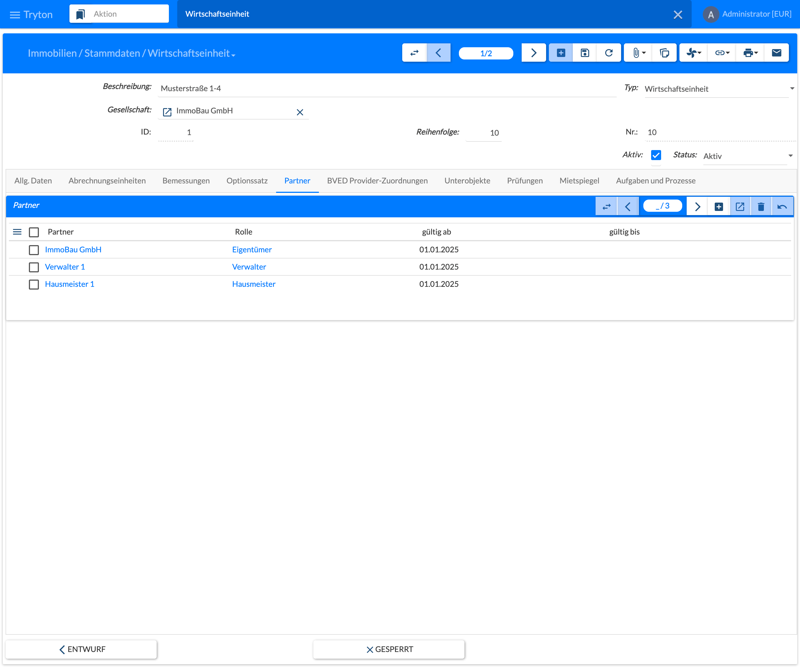

Hier werden der Wirtschaftseinheit Partner in einer Rolle zugeordnet, z. B. Eigentümer, Verwalter oder Hausmeister. Über die Rolle wird u. a. die Zuständigkeit für Aufgaben bestimmt.

| Spalte | Beschreibung |
|--------|--------------|
| Partner | Geschäftspartner, siehe [3.1 Partner verwalten](). |
| Rolle | Rolle des Partners; die Rollen werden in [2.4.2 Geschäftspartner]() festgelegt. |
| gültig ab / gültig bis | Zeitraum der Zuordnung; leer = unbegrenzt. |

Mit dem Modul werden diese Rollen ausgeliefert:

| Rolle | Objekttypen | Verwendung |
|-------|-------------|------------|
| Hausmeister | Wirtschaftseinheit | Vorbelegte Rolle. Zuständig für die Rauchwarnmelderprüfung und für die ersten beiden Schritte des Prozesses Leerstand / Neuvermietung. |
| Verwalter | Wirtschaftseinheit | Zuständig für die jährliche Objektbegehung. |
| Eigentümer | Wirtschaftseinheit, Mietobjekt | Eigentümer der Immobilie bzw. einer einzelnen Einheit, z. B. einer Eigentumswohnung. |

Für Gebäude, Grundstücke und Equipment ist keine Rolle ausgeliefert. Für welche Objekttypen eine Rolle verwendet werden kann, wird an der Rolle in [2.4.2 Geschäftspartner]() festgelegt.

Ausführlich: [3.3 Partnerrollen zur Immobilie und zum Vertrag]().

### Reiter BVED Provider-Zuordnungen

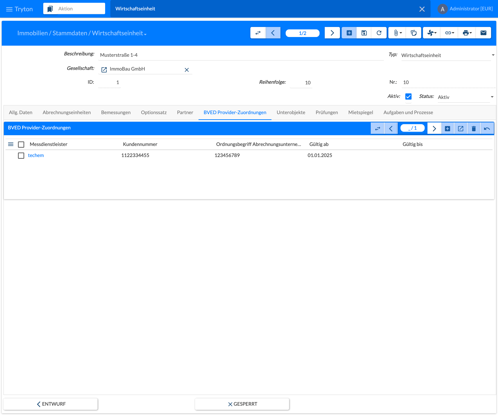

Übersicht der Zuordnungen zu Messdienstleistern für den Datenaustausch nach BVED. Der Reiter erscheint nur, wenn mindestens eine Zuordnung besteht. Gepflegt werden die Zuordnungen in [7.8 Externe Abrechnung (BVED)]().

| Spalte | Beschreibung |
|--------|--------------|
| Messdienstleister | BVED-Provider, z. B. techem. |
| Kundennummer | Kundennummer dieser Gesellschaft beim Messdienstleister (A-Satz Feld 3). |
| Ordnungsbegriff Abrechnungsunternehmen | 9-stellige Liegenschaftsnummer, die der Messdienstleister dieser Immobilie bzw. diesem Gebäude zugewiesen hat. |
| Gültig ab / Gültig bis | Zeitraum der Zuordnung. |

### Reiter Unterobjekte

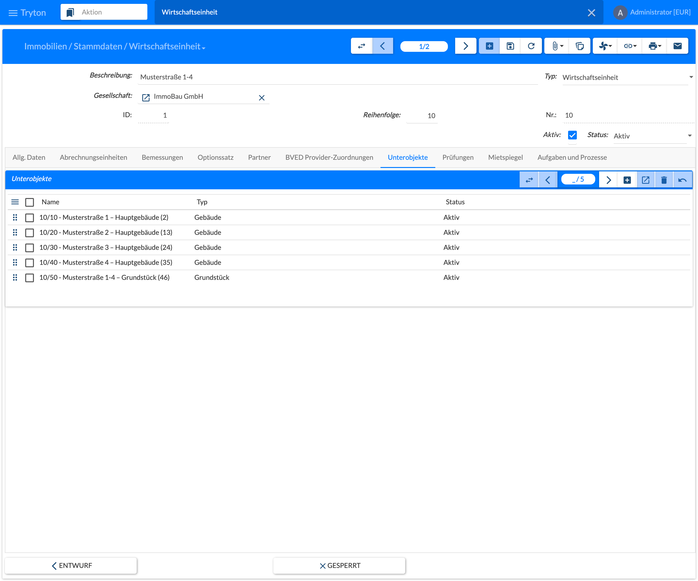

Die direkt untergeordneten Objekte der Wirtschaftseinheit, z. B. Gebäude und Grundstücke, mit Name, Typ und Status. Der Name enthält die Nummern der Ebenen, z. B. „10/20 - Musterstraße 2 – Hauptgebäude“.

Welche Objekttypen untereinander hängen dürfen, prüft das System beim Speichern:

| Objekt | Zulässige Unterobjekte |
|--------|------------------------|
| Wirtschaftseinheit | Gebäude, Grundstück, Mietobjekt, Equipment |
| Gebäude | Gebäude (z. B. Seitenflügel), Mietobjekt, Equipment |
| Grundstück | Mietobjekt, Equipment |
| Mietobjekt | Equipment |
| Equipment | Equipment |

Die Wirtschaftseinheit selbst hat kein übergeordnetes Objekt.

Ausführlich: [5.2 Gebäude und Grundstücke]().

### Reiter Prüfungen

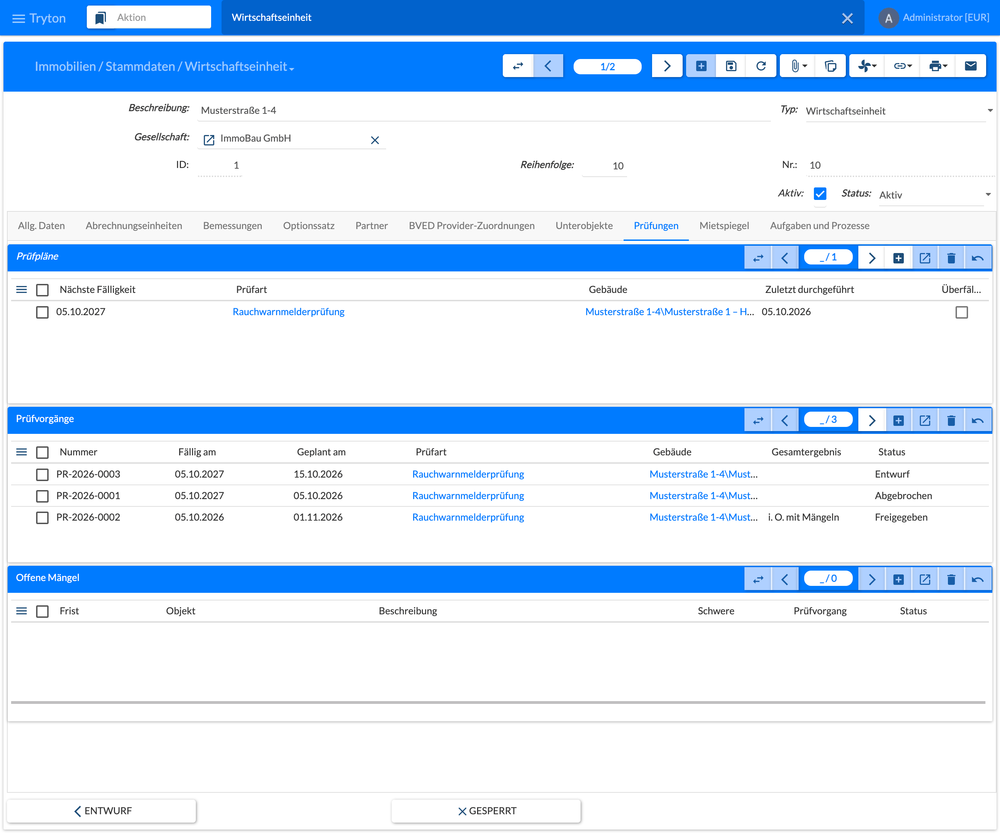

Übersicht über die wiederkehrenden Prüfungen der Wirtschaftseinheit, z. B. Rauchwarnmelderprüfung.

| Bereich | Inhalt |
|---------|--------|
| Prüfpläne | Nächste Fälligkeit, Prüfart, Gebäude, zuletzt durchgeführt, überfällig. |
| Prüfvorgänge | Nummer, fällig am, geplant am, Prüfart, Gebäude, Gesamtergebnis und Status der einzelnen Prüfungen. |
| Offene Mängel | Frist, Objekt, Beschreibung, Schwere, Prüfvorgang und Status der noch offenen Mängel. |

Mit dem Modul werden zwei Prüfarten ausgeliefert. Beide werden jährlich je Gebäude durchgeführt und müssen freigegeben werden:

| Prüfart | Inhalt |
|---------|--------|
| Jährliche Objektbegehung | Begehung des Gebäudes mit der Checkliste „Jährliche Objektbegehung - Gebäude“, z. B. Dach, Eingang, Treppenhaus, Fluchtwege, Keller und Außenanlagen. Zuständig ist der Verwalter. Grundlage ist die Verkehrssicherungspflicht (§ 823 BGB). |
| Rauchwarnmelderprüfung | Eine Prüfung je Gebäude mit einer Position je Wohnung (Nutzungsart Wohnimmobilie) und der Checkliste „Rauchwarnmelder - je Wohnung“. Einbezogen wird das Equipment mit der Anlagenart Rauchwarnmelder. Zuständig ist der Hausmeister, der Zugang zur Wohnung muss vereinbart werden. Grundlage sind die Landesbauordnung (z. B. § 48 Abs. 4 BauO Bln) und DIN 14676-1. |

Prüfpläne werden an der Wirtschaftseinheit und am Gebäude angelegt. Beim Grundstück gibt es den Reiter nicht; bei Mietobjekt und Equipment zeigt er die Prüfpositionen und offenen Mängel.

Ausführlich: [8 Instandhaltung]().

### Reiter Mietspiegel

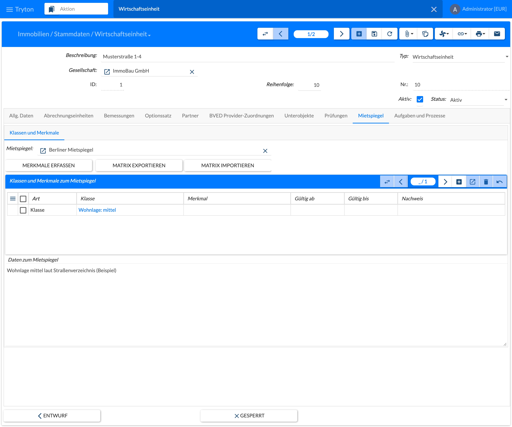

Angaben zum Mietspiegel für die Wohnungsmietverträge der Wirtschaftseinheit, z. B. die Wohnlage.

| Feld | Beschreibung |
|------|--------------|
| Mietspiegel | Mietspiegel für die Wohnungsmietverträge der Wirtschaftseinheit, z. B. Berliner Mietspiegel. |
| Merkmale erfassen | Checkliste der Merkmale dieser Ebene zum Ankreuzen. |
| Matrix exportieren / Matrix importieren | Klassen und Merkmale aller Wohnungen bzw. Gebäude als CSV-Datei exportieren, z. B. in einer Tabellenkalkulation bearbeiten und wieder importieren. |
| Klassen und Merkmale zum Mietspiegel | Art (Klasse oder Merkmal), Klasse, Merkmal, gültig ab, gültig bis und Nachweis. |
| Daten zum Mietspiegel | Bemerkungen und Begründungen (z. B. Fundstelle im Straßenverzeichnis) – werden im Protokoll gezeigt, fließen nicht in die Berechnung ein. |

Ausführlich: [6.7 Mietanpassungen]().

### Reiter Aufgaben und Prozesse

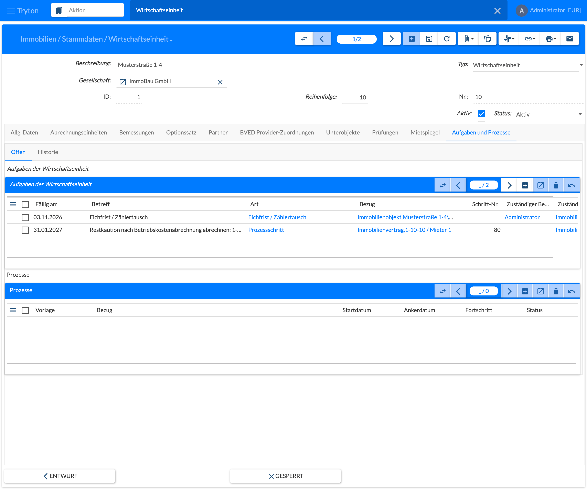

Die Unterreiter **Offen** und **Historie** zeigen offene bzw. erledigte und abgebrochene Aufgaben und Prozesse. An der Wirtschaftseinheit erscheinen auch die Aufgaben und Prozesse ihrer Objekte, Verträge und Abrechnungseinheiten.

| Bereich | Inhalt |
|---------|--------|
| Aufgaben der Wirtschaftseinheit | Fällig am, Betreff, Art, Bezug, Schritt-Nr. (bei Prozessschritten), zuständiger Benutzer und zuständige Rolle. |
| Prozesse | Vorlage, Bezug, Startdatum, Ankerdatum, Fortschritt und Status. |

Diese ausgelieferten Aufgabenregeln erzeugen Aufgaben an Objekten. Sie sind bei Auslieferung inaktiv und werden in [2.4.7 Aufgaben und Prozesse]() aktiviert:

| Regel | Objekte | Aufgabe |
|-------|---------|---------|
| Zählerstände erfassen | Wirtschaftseinheit | 7 Tage vor dem nächsten Ablesetermin: Ablesung beauftragen und die Zählerstände aller Zähler erfassen. |
| Gebietsverordnung endet | Wirtschaftseinheit mit angespanntem Wohnungsmarkt und Ablaufdatum | 2 Monate vor Ablauf: prüfen, ob die Verordnung verlängert wurde. |
| Eichfrist läuft ab | Zähler | 3 Monate vor Ablauf der Eichfrist: Zählertausch oder Nacheichung beauftragen, siehe [5.5 Zähler und Messbelege](). |
| Objekt endet | alle Objekte mit Endedatum | 3 Monate vor dem Endedatum: laufende Verträge, Zähler und Zuordnungen beenden oder übertragen. |

Prüfungen und Mängel erzeugen über die Regeln „Prüfung überfällig“ und „Prüfung: Mangel überfällig“ eigene Aufgaben. Als Prozess für Objekte wird **Leerstand / Neuvermietung** ausgeliefert; er wird am Mietobjekt gestartet, siehe [5.3 Mietobjekte]().

Ausführlich: [10 Aufgaben und Prozesse]().

## Aktionen

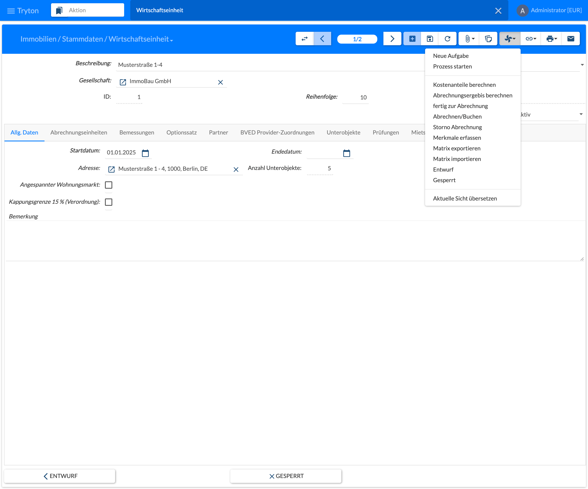

Über die Schaltfläche **Aktionen** (Symbol mit dem Propeller) in der Symbolleiste stehen zur Verfügung:

| Aktion | Wirkung |
|--------|---------|
| Neue Aufgabe | Legt eine Aufgabe zur Wirtschaftseinheit an. |
| Prozess starten | Startet einen Prozess nach Vorlage. |
| Kostenanteile berechnen, Abrechnungsergebnis berechnen, fertig zur Abrechnung, Abrechnen/Buchen | Wie die Schaltflächen im Reiter Abrechnungseinheiten. |
| Storno Abrechnung | Storniert eine Betriebskostenabrechnung. |
| Merkmale erfassen, Matrix exportieren, Matrix importieren | Wie die Schaltflächen im Reiter Mietspiegel. |
| Entwurf, Gesperrt | Statuswechsel, wie die Schaltflächen unten in der Maske. |
| Aktuelle Sicht übersetzen | Tryton-Standardfunktion zum Übersetzen der Bezeichnungen. |

## Verknüpfungen

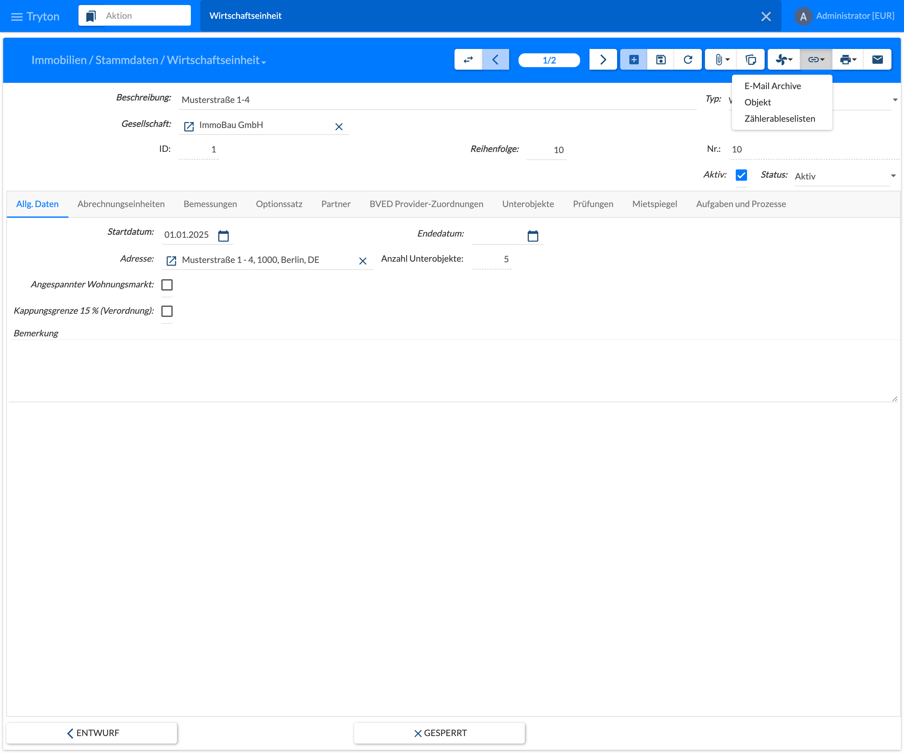

Die Schaltfläche **Verknüpfungen** (Symbol mit dem Kettenglied) öffnet zugehörige Datensätze in einem neuen Tab: **E-Mail Archive**, **Objekt** und **Zählerableselisten**.

## Drucken

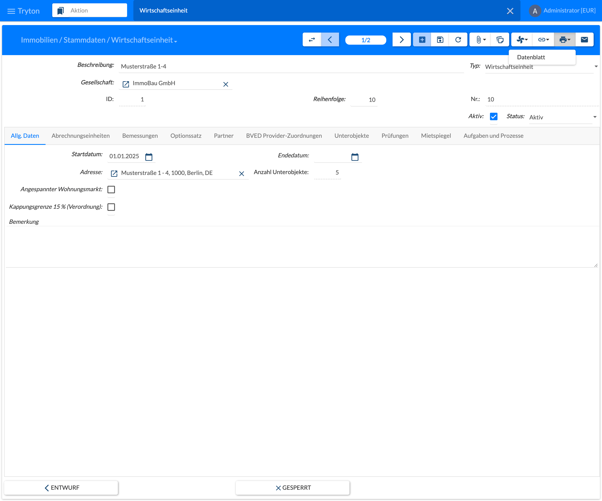

Über die Schaltfläche **Drucken** steht das **Datenblatt** der Wirtschaftseinheit zur Verfügung.
