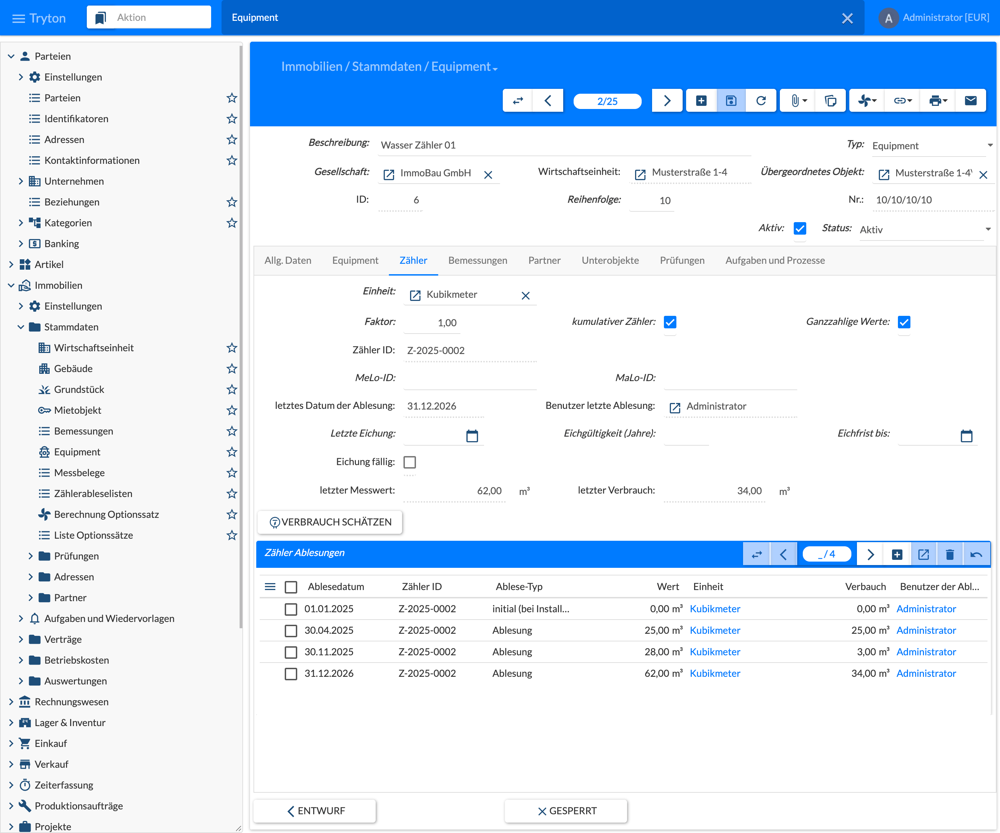
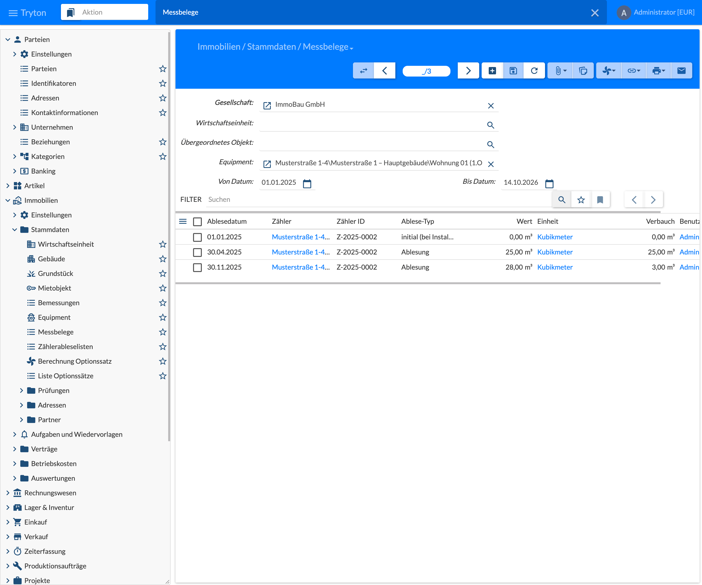
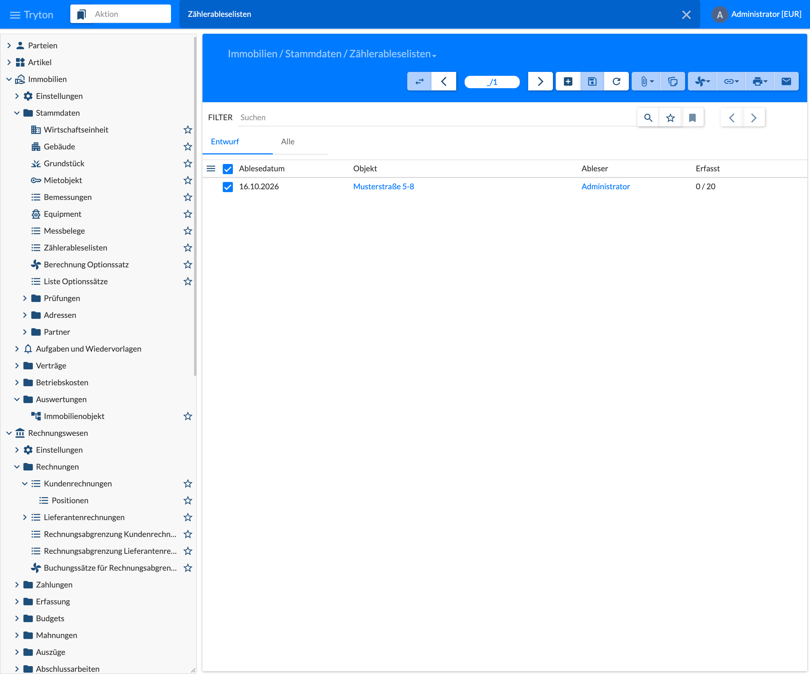
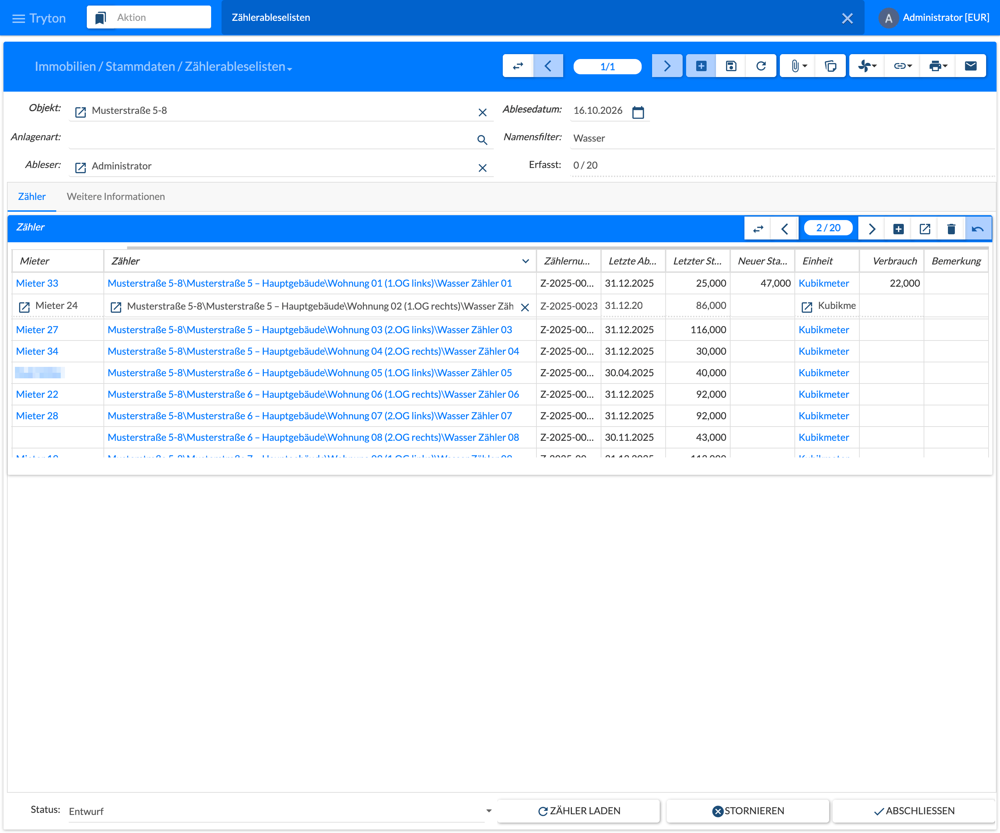

Meters are [equipment]() with the equipment type **Zähler** (Meters), e.g. water, heat, electricity or gas meters. They usually belong to the rental object, main meters to the building or property. Every reading is stored as a **Messbeleg** (meter reading); the meter readings are the basis for the consumption-based allocation in the operating cost settlement. For the regular reading of many meters there are the **Zählerableselisten** (meter reading sheets).

## Meters

Meters are created like any equipment via **Immobilien › Stammdaten › Equipment**, see [5.4 Equipment and Technical Installations](). In the tab **Equipment** the equipment type **Zähler** is selected; the tab **Zähler** then appears.

### Tab Zähler (Meters)

| Field | Description |
|-------|-------------|
| Einheit (Unit) | Unit of the meter values, e.g. cubic metre or kWh. |
| Faktor (Factor) | Factor the consumption is multiplied by, e.g. for an electricity meter with a transformer. |
| kumulativer Zähler (Is Counter) | The meter value increases continuously; the consumption is the difference of two values. If not set, the meter measures absolute values, e.g. a fill level. |
| Ganzzahlige Werte (Integer Values) | Meter values are recorded without decimals. |
| Zähler ID (Meter ID) | Number of the installed meter (device number). It changes on a meter exchange, see meter readings. |
| MeLo-ID / MaLo-ID | Metering point ID resp. market location ID, e.g. for electricity and gas meters. |
| letztes Datum der Ablesung, Benutzer letzte Ablesung (Last Reading Date, Last Reading User) | Date and reader of the last meter reading; computed. |
| Letzte Eichung (Last Calibration) | Date of the last calibration or of the installation of a calibrated meter. |
| Eichgültigkeit (Jahre) (Calibration Validity, Years) | Validity of the calibration in years. |
| Eichfrist bis (Calibration Valid to) | End of the calibration validity; proposed as 31 December of the year of the last calibration plus validity, can be overwritten. |
| Eichung fällig (Calibration Due) | The calibration validity ends within the next 3 months or has ended. |
| letzter Messwert / letzter Verbrauch (Last Value / Last Consumption) | Value and consumption of the last meter reading; computed. |
| Zähler Ablesungen (Meter Readings) | All meter readings of the meter with reading date, meter ID, reading type, value, unit, consumption and reader. New readings can also be entered here. |

The button **Verbrauch schätzen** (Estimate Consumption) opens a wizard that creates an estimated meter reading for a date. If readings exist before and after the date, the value is interpolated between them; otherwise it is extrapolated from the last two readings within one year. Meter ID, date and reason have to be entered.

With the task rule **Eichfrist läuft ab** (Meter calibration expires) a task for a meter exchange or recalibration is created 3 months before the calibration expires, see [10 Tasks and Processes]().

## Meter Readings

### Getting Started

Open the menu **Immobilien › Stammdaten › Messbelege** (Real Estate › Master Data › Meter Readings). The list shows the readings of all meters. The fields **Gesellschaft** (Company), **Wirtschaftseinheit** (Property), **Übergeordnetes Objekt** (Parent Object) and **Equipment** as well as **Von Datum** and **Bis Datum** (from / to date) restrict the list, e.g. to the meters of an apartment in a billing period. New meter readings can be entered directly in the list with **+** (New).

### Fields

| Column | Description |
|--------|-------------|
| Ablesedatum (Reading Date) | Date of the meter value. |
| Zähler (Meter) | Meter (equipment) the reading belongs to. |
| Zähler ID (Meter ID) | Number of the meter read. |
| Ablese-Typ (Reading Type) | **initial (bei Installation)** (initial, installation), **Ablesung** (reading), **geschätzt** (estimate), **lineare Interpolation** (linear interpolation) or **Endablesung vor Ausbau** (final reading, removal). |
| Wert (Value) | Meter value read. |
| Einheit (Unit) | Unit of the meter. |
| Verbrauch (Consumption) | Consumption since the previous reading; computed. |
| Benutzer der Ablesung (Reading User) | Reader. |

### Rules When Entering

- The first reading of a meter must have the reading type **initial (bei Installation)**.
- Readings and estimates must have the same meter ID as the previous reading.
- For a cumulative meter the value must not be lower than the previous one.
- **Meter exchange:** for the old meter a **Endablesung vor Ausbau** (final reading) with the old meter ID is entered, for the new meter on the same day a reading **initial (bei Installation)** with the new meter ID.
- Only one reading per meter, date and meter ID is allowed.
- With **Ganzzahlige Werte** (integer values) no decimals are allowed.

Readings of the type **lineare Interpolation** are created by the operating cost settlement itself when a meter value between two readings is needed for the start or end of a billing period.

## Meter Reading Sheets

A meter reading sheet collects all meters below an object for one reading date. It is printed, filled in while reading and then entered. On completion the system creates the meter readings.

### Getting Started

Open the menu **Immobilien › Stammdaten › Zählerableselisten** (Real Estate › Master Data › Meter Reading Sheets). The tab **Entwurf** (Draft) shows the open sheets with reading date, object, reader and progress (**Erfasst**: meters with a value entered / all meters, e.g. 0 / 20 for a new sheet). The tab **Alle** (All) also shows completed and cancelled sheets with their state.

- **Create:** button **+** (New) in the toolbar
- **Edit:** select the row and switch to the form

### Create and Edit

| Field | Description |
|-------|-------------|
| Objekt (Object) | Property, building or rental object; the meters below it are listed. Required. |
| Ablesedatum (Reading Date) | Date of the reading; date of the meter readings created. Required. |
| Anlagenart (Equipment Kind) | Optional: only meters of this equipment kind. |
| Namensfilter (Name Filter) | Optional: only meters whose name contains this text, e.g. “Wasser” or “Warmwasser”. |
| Ableser (Reader) | User entered as reader in the meter readings created. |
| Erfasst (Progress) | Number of meters with a value entered / number of all meters of the sheet. |
| Status (State) | **Entwurf** (Draft), **Abgeschlossen** (Done) or **Storniert** (Cancelled). The sheet can be edited in draft. |

The tab **Zähler** (Meters) contains one line per meter; only the **Neuer Stand** (new value) is entered:

| Column | Description |
|--------|-------------|
| Mieteinheit (Rental Unit) | Rental object the meter belongs to. |
| Mieter (Tenant) | Main tenant of the rental object on the reading date (from the occupancy). |
| Zähler (Meter) | Meter (equipment). |
| Zählernummer (Meter ID) | Meter ID; proposed from the last meter reading. |
| Letzte Ablesung / Letzter Stand (Previous Date / Value) | Date and value of the last reading before the reading date. |
| Neuer Stand (Value) | Meter value read. |
| Einheit, Verbrauch (Unit, Consumption) | Unit of the meter and consumption since the last value. |
| Bemerkung (Remarks) | Note on the reading, e.g. “meter not accessible”. |

The new value is entered directly in the line; the consumption is calculated immediately (in the figure for the first meter 47 − 25 = 22 m³). With many columns the table can be scrolled sideways. Via **≡** the columns **Zählerablesung** (meter reading created) and **Ablesung erzeugt** (reading created) can be shown in addition.

The tab **Weitere Informationen** (Other Info) contains property and company (set automatically), **Abgeschlossen von** (done by), **Abgeschlossen am** (done on) and **Notizen** (notes).

### Procedure

1. Create the sheet: choose object, reading date and, if needed, equipment kind or name filter.
2. **Zähler laden** (Load Meters): the meters below the object are entered with rental unit, tenant and last value. Loading again adds new meters and refreshes the data; values already entered are kept.
3. Print the sheet via **Drucken › Ableseliste (de)** and read the meters.
4. Enter the new values.
5. **Abschließen** (Complete): for every line with a new value a meter reading of the type **Ablesung** is created. If the meter already has a reading on the reading date, that one is linked. If values are missing, a warning appears that can be confirmed.
6. **Folgeliste** (Follow-up Sheet): creates the sheet for the next date – same object and filters, reading date one year later – and opens it.

**Auf Entwurf zurücksetzen** (Reset to Draft) deletes the meter readings created by the sheet; linked, already existing readings are kept.

### Actions, Relate and Print

| Menu | Entry | Meaning |
|------|-------|---------|
| Actions | Zähler laden, Abschließen, Stornieren (Load Meters, Complete, Cancel) | Only in the state draft, see procedure. |
| Actions | Auf Entwurf zurücksetzen (Reset to Draft) | For a completed or cancelled sheet, same as the button at the bottom of the form. |
| Actions | Folgeliste (Follow-up Sheet) | Only for a completed sheet, see procedure. |
| Actions | Aktuelle Sicht übersetzen (Translate View) | Tryton standard function to translate the labels. |
| Relate | E-Mail Archive | E-mails of the reading sheet. |
| Print | Ableseliste (de) (Reading Sheet) | Reading sheet to fill in while reading. |

From every object, **Verknüpfungen › Zählerableselisten** (Relate › Meter Reading Sheets) opens the reading sheets of that object.
