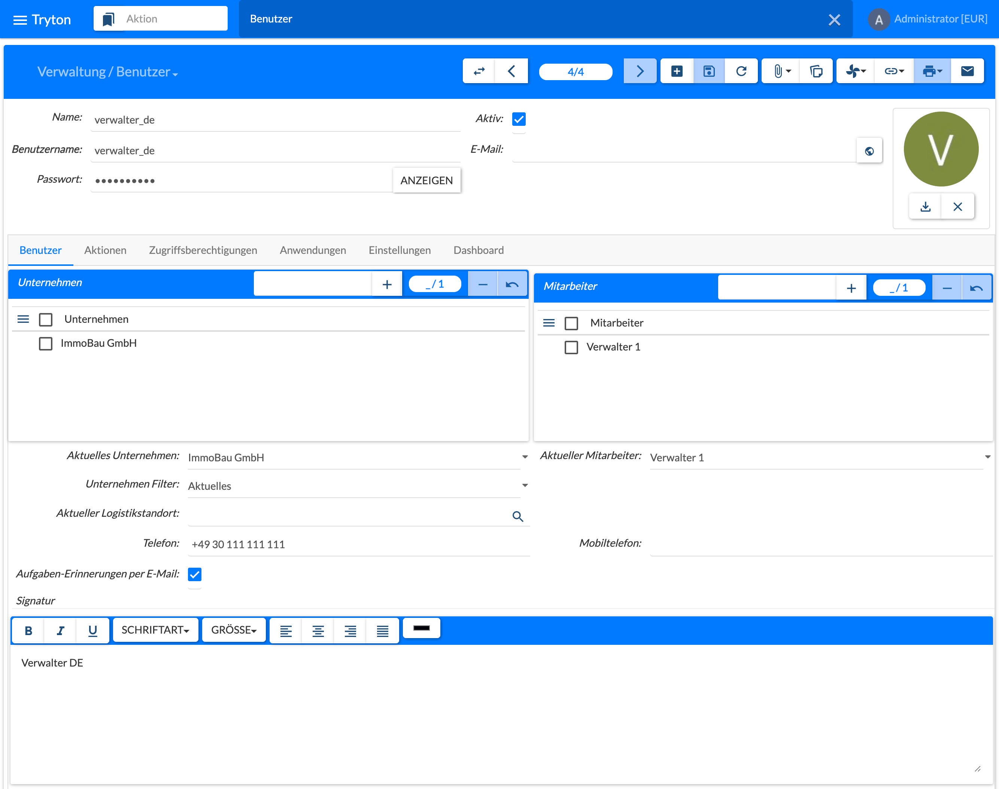
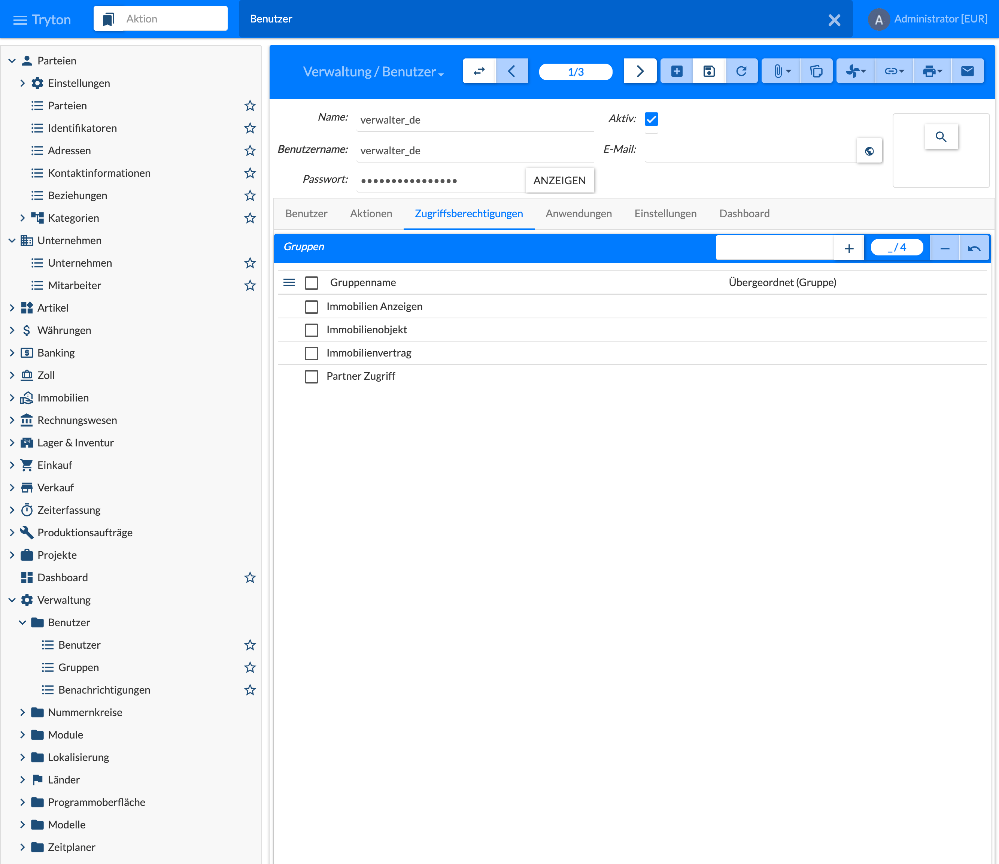

{}
Benutzer und Gruppen gehören zum Tryton-Standard. Diese Seite gibt nur einen Überblick über das, was für die Immobilienverwaltung wichtig ist; die übrigen Reiter sind in der [Tryton-Dokumentation](https://docs.tryton.org) beschrieben.
{}

Jede Person, die mit dem System arbeitet, wird **zweimal** angelegt:

1. als **Benutzer** unter **Verwaltung › Benutzer › Benutzer** – für die Anmeldung und die Zugriffsrechte;
2. als **Partei** (Geschäftspartner) und als **Mitarbeiter** des Unternehmens – für Zuständigkeiten, Aufgaben und Korrespondenz, siehe [3.2 Unternehmen und Mitarbeiter]().

## Benutzer anlegen

Im Kopf der Maske stehen **Name**, **Benutzername** (für die Anmeldung), **Passwort** (mit **Anzeigen** sichtbar zu machen), **Aktiv**, **E-Mail** und ein Bild. Darunter folgen die Reiter **Benutzer**, **Aktionen**, **Zugriffsberechtigungen**, **Anwendungen**, **Einstellungen** und **Dashboard**.

## Reiter Benutzer: Unternehmen und Mitarbeiter

Im Reiter **Benutzer** wird der Benutzer des Systems mit seinem **Mitarbeiter** verbunden, also mit der Partei (Geschäftspartner) aus [3.2 Unternehmen und Mitarbeiter](). Erst dann kann der Mitarbeiter in Prozessen und Aufgaben verwendet werden, und der Benutzer erhält und bearbeitet seine Aufgaben, siehe [10 Aufgaben und Prozesse]().

- **Unternehmen:** die Unternehmen, für die der Benutzer arbeiten darf.
- **Mitarbeiter:** die Mitarbeiter-Parteien des Benutzers. Über diese Liste ermittelt das Modul, welcher Benutzer für eine Aufgabe zuständig ist: Hat ein Mitarbeiter am Objekt die zuständige Partnerrolle, erhält der Benutzer die Aufgabe, siehe [5.1 Wirtschaftseinheit – Reiter Partner](). Ein Mitarbeiter sollte deshalb genau einem Benutzer zugeordnet sein.
- **Aktuelles Unternehmen** und **Aktueller Mitarbeiter:** womit der Benutzer gerade arbeitet. Der **Aktuelle Mitarbeiter** wird gesetzt (im Bild Verwalter 1) und z. B. beim Erledigen einer Aufgabe als **Erledigt von** eingetragen. **Unternehmen Filter** legt fest, ob nur Daten des aktuellen Unternehmens angezeigt werden.
- **Aktueller Logistikstandort:** für Lager und Inventur.
- **Telefon** und **Mobiltelefon** des Benutzers.
- **Aufgaben-Erinnerungen per E-Mail:** Der Benutzer erhält zusätzlich zur Benachrichtigung im Client E-Mail-Erinnerungen für Aufgaben, deren Art E-Mails versendet.
- **Signatur:** formatierter Text, z. B. für E-Mails.

## Gruppen und Berechtigungen

Im Reiter **Zugriffsberechtigungen** werden dem Benutzer **Gruppen** zugeordnet; mit **+** wird eine Gruppe hinzugefügt, mit **−** entfernt. Die Gruppen steuern, welche Menüs sichtbar sind und welche Daten gelesen oder geändert werden dürfen. Das Modul bringt diese Gruppen mit:

| Gruppe | Zweck |
|--------|-------|
| Immobilien Administration | Einstellungen und Stammdaten des Moduls pflegen |
| Immobilienobjekt | Immobilien-Objekte bearbeiten |
| Immobilienvertrag | Verträge bearbeiten |
| Immobilien Abrechnung | Betriebskostenabrechnung durchführen |
| Immobilien Anzeigen | alles im Modul lesen, nichts ändern |
| Rechnungswesen Anzeigen | Buchhaltungsdaten lesen, nichts ändern |
| Partner Zugriff | Parteien anlegen, ändern und löschen – alle anderen Gruppen sehen Parteien nur lesend |

Im Bild hat der Benutzer die Gruppen Immobilien Anzeigen, Immobilienobjekt, Immobilienvertrag und Partner Zugriff. Die Gruppen selbst stehen unter **Verwaltung › Benutzer › Gruppen**.
