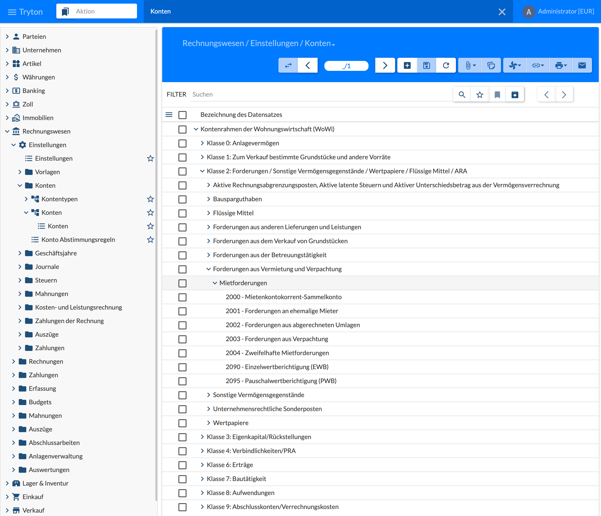
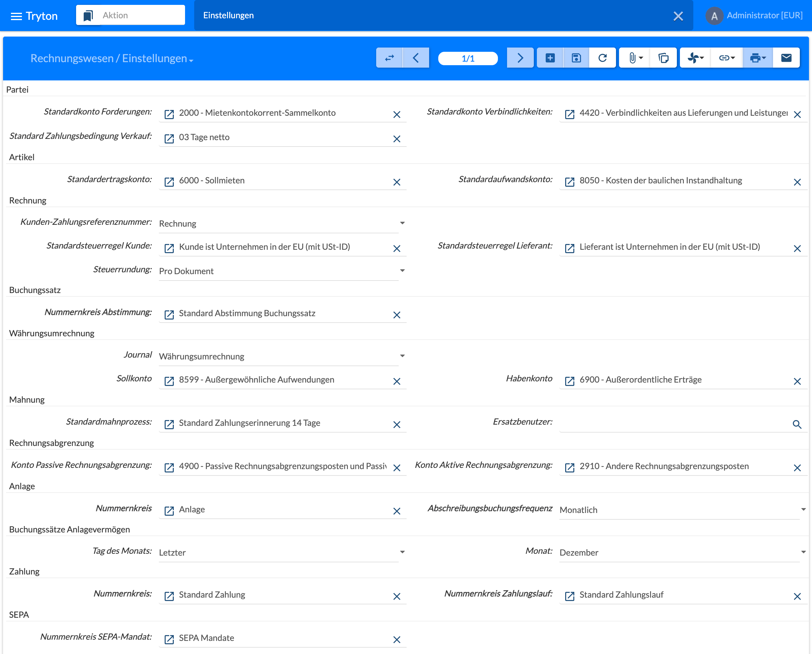
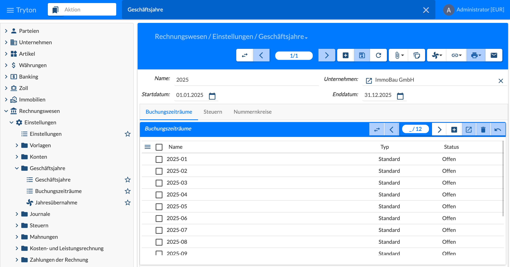
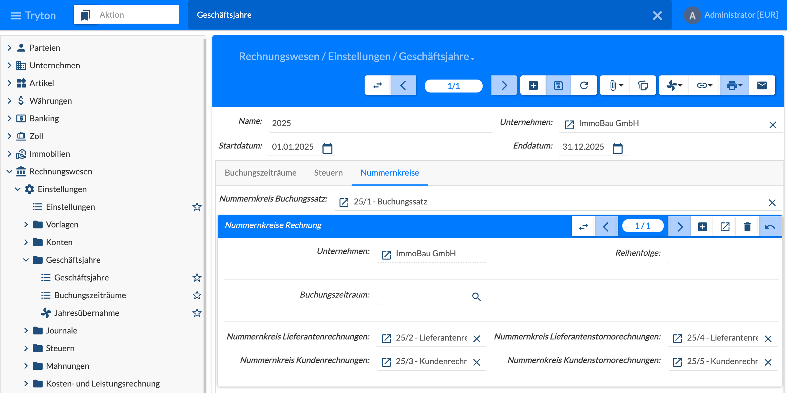
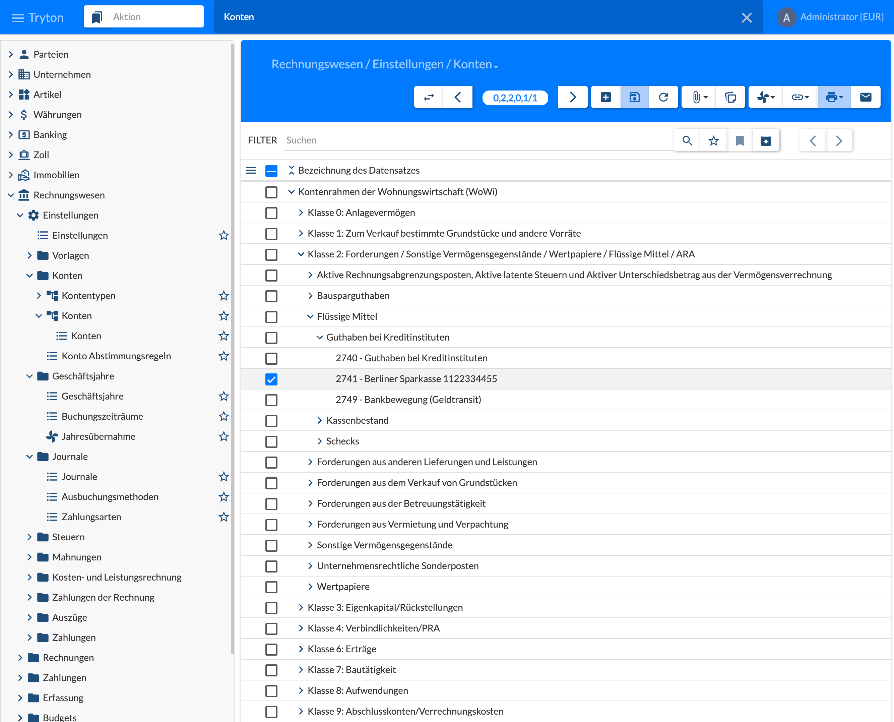

{}
This page is not complete yet: taxes, payment terms, journals, bank and payments and real estate accounting will be added.
{}

## Chart of Accounts

Menu **Rechnungswesen › Einstellungen › Konten › Konten** (Accounting › Configuration › Accounts › Accounts). The chart of accounts is created from a template during the initial setup, for real estate management from the **Kontenrahmen der Wohnungswirtschaft (WoWi)** (chart of accounts of the German housing industry), see [2.1 System Requirements and Installation]().

The accounts are structured as a tree: account classes 0 to 9, below them groups and the individual accounts. In the figure class 2 is expanded with the **Mietforderungen** (rent receivables), among them 2000 Mietenkontokorrent-Sammelkonto, 2001 receivables from former tenants, 2002 receivables from settled apportionments and the value adjustments 2090 and 2095. **Kontentypen** (account types) hold the structure for balance sheet and income statement, **Konto Abstimmungsregeln** (account reconciliation rules) the rules for clearing open items.

## Configuration

Menu **Rechnungswesen › Einstellungen › Einstellungen** (Accounting › Configuration › Configuration). It holds the accounting defaults of the company; most of them are set with the chart of accounts during the initial setup, see [2.1 System Requirements and Installation]().

| Area | Settings (example in the figure) |
|------|----------------------------------|
| Partei (party) | default receivable account (2000 Mietenkontokorrent-Sammelkonto) and payable account (4420), default customer payment term |
| Artikel (product) | default revenue account (6000 Sollmieten) and expense account (8050) |
| Rechnung (invoice) | customer payment reference, default tax rule customer and supplier, tax rounding (per document) |
| Buchungssatz (move) | reconciliation sequence |
| Währungsumrechnung (currency exchange) | journal, debit and credit account for exchange differences |
| Mahnung (dunning) | default dunning procedure, fallback user |
| Rechnungsabgrenzung (deferral) | accounts for deferred revenue and expense |
| Anlage (asset) | sequence, depreciation frequency; day and month of asset moves |
| Zahlung, SEPA (payment) | sequences for payment, payment group and SEPA mandate |

The sequences are described in [2.4 Sequences]().

## Sequences

Account moves and invoices need **strict sequences** per company, see [2.4 Sequences](). They are assigned in the fiscal year.

## Fiscal Year

Menu **Rechnungswesen › Einstellungen › Geschäftsjahre › Geschäftsjahre** (Accounting › Configuration › Fiscal Years). A fiscal year is created for each year and company before postings are possible in it – the periodic posting of the contracts also needs an open fiscal year.

- Header: **Name** (e.g. 2025), **Unternehmen** (company), **Startdatum** and **Enddatum** (start and end date); at the bottom the **Status** (open, later closed or locked).
- Tab **Buchungszeiträume** (periods): the periods of the year, usually monthly (2025-01 to 2025-12) with type **Standard** and state **Offen** (open). Postings are only possible in open periods; finished months are closed.
- Tab **Nummernkreise** (sequences), see below; next to it the tab **Steuern** (taxes).

The tab **Nummernkreise** assigns the strict sequences of the year, see [2.4 Sequences]():

- **Nummernkreis Buchungssatz** (move sequence) for the numbers of posted account moves (in the figure 25/1);
- **Nummernkreise Rechnung** (invoice sequences) per company and optionally per period: supplier invoices, supplier credit notes, customer invoices and customer credit notes (25/2 to 25/5).

**Buchungszeiträume** lists all periods of all years; **Jahresübernahme** (renew fiscal year) creates the next fiscal year based on the previous one at year end, with periods and new sequences.

## Taxes

## Payment Terms

## Journals

## Bank and Payments

Credit transfers and direct debits are first posted against a transit account **Bankbewegung (Geldtransit)**; only the bank statement posts from the transit account to the bank account. Open items on the transit account are payments not yet confirmed by the bank. Setup in the right order and posting flow: see [4.2 Payments]().

### Bank Accounts in the Chart of Accounts

Under **Klasse 2 › Flüssige Mittel › Guthaben bei Kreditinstituten** (class 2 › liquid funds › bank balances) own accounts are created besides the template account 2740 (menu **Rechnungswesen › Einstellungen › Konten › Konten**, **+**):

| Account | Purpose | Important settings |
|---------|---------|--------------------|
| 2741 bank account (one per bank, in the figure Berliner Sparkasse) | Movements according to the bank statement | Account type as 2740 |
| 2749 Bankbewegung (Geldtransit, transit) | Transit account for credit transfers and direct debits | Account type as 2740, **Abstimmen** (reconcile) checked, no party required |

Template accounts such as 2740 are not renamed: when the chart of accounts is updated after a module update, Tryton takes name and settings from the template again.

## Real Estate Accounting
