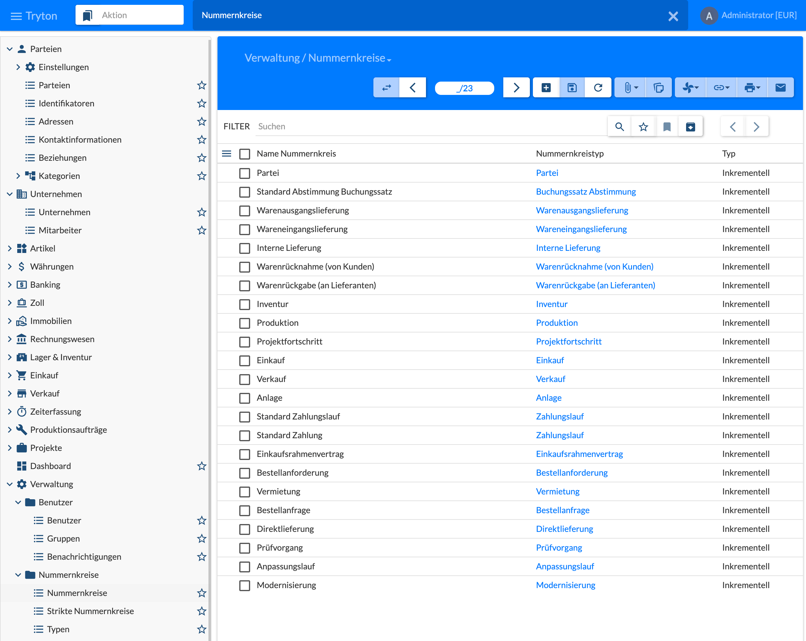
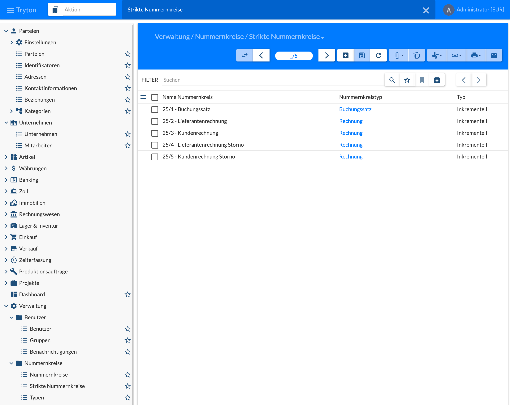
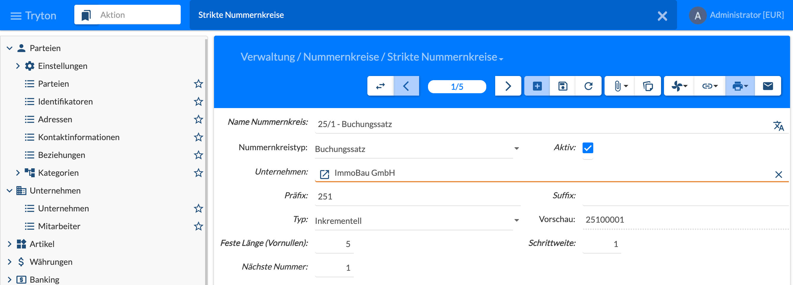

## Nummernkreise

Nummernkreise vergeben die Nummern für Belege, Vorgänge und Stammdaten aller Module.

Normale Nummernkreise stehen unter **Verwaltung › Nummernkreise › Nummernkreise**. Neben denen der Tryton-Module (Partei, Lieferungen, Einkauf, Verkauf, Zahlungslauf usw.) liefert das Immobilien-Modul eigene Nummernkreise aus und stellt sie ein:

| Nummernkreis | Präfix | Beispiel |
|--------------|--------|----------|
| Anpassungslauf | `AL-${year}-` | AL-2026-0001, siehe [6.7 Mietanpassungen]() |
| Modernisierung | `MOD-${year}-` | MOD-2026-0001, siehe [6.7.4 Modernisierung]() |
| Prüfvorgang | `PR-${year}-` | PR-2026-0001, siehe [8.2 Prüfungen durchführen]() |

`${year}` wird durch das aktuelle Jahr ersetzt, die laufende Nummer ist vierstellig mit Vornullen. Präfix und Länge lassen sich bei Bedarf anpassen.

## Strikte Nummernkreise

Für die Buchhaltung werden **strikte Nummernkreise** benötigt: Sie vergeben fortlaufende Nummern ohne Lücken, wie es für Buchungssätze und Rechnungen vorgeschrieben ist. Sie stehen unter **Verwaltung › Nummernkreise › Strikte Nummernkreise**; normale Nummernkreise unter **Nummernkreise**, die Arten unter **Typen**.

Typisch ist je Geschäftsjahr ein strikter Nummernkreis für:

| Nummernkreis | Nummernkreistyp |
|--------------|-----------------|
| Buchungssatz | Buchungssatz |
| Lieferantenrechnung | Rechnung |
| Kundenrechnung | Rechnung |
| Lieferantenrechnung Storno | Rechnung |
| Kundenrechnung Storno | Rechnung |

Im Bild tragen die Namen das Jahr und eine laufende Nummer (25/1 … 25/5), alle mit Typ **Inkrementell**.

Ein strikter Nummernkreis hat:

- **Name Nummernkreis** und **Nummernkreistyp** (z. B. Buchungssatz oder Rechnung), **Aktiv**;
- **Unternehmen:** Jeder Nummernkreis wird einem Unternehmen (Gesellschaft) zugeordnet; bei mehreren Gesellschaften hat jede ihre eigenen Nummernkreise;
- **Präfix** und **Suffix**, z. B. Präfix 251 für Jahr 25, Nummernkreis 1;
- **Typ** (Inkrementell), **Feste Länge (Vornullen)**, **Schrittweite** und **Nächste Nummer**;
- **Vorschau** der nächsten Nummer, im Bild 25100001.

Die strikten Nummernkreise für die Buchhaltung werden im Geschäftsjahr zugeordnet, siehe [2.5.1 Rechnungswesen]().
