Diese Seite beschreibt die Installation des Tryton-Servers (trytond) und des Web-Clients **sao**, die Konfiguration und das Einrichten der Datenbank. Vorausgesetzt werden Python 3.13, Node.js mit npm, git und ein PostgreSQL-Server mit einem Datenbank-Benutzer `tryton`.

{}
Die Darstellungen auf dieser Seite beschreiben ein Entwicklungs- bzw. Testsystem. Für den produktiven Betrieb sind zusätzliche Maßnahmen nötig (u. a. Absicherung von Server, Datenbank und Zugängen, Verschlüsselung, Sicherungen). Für die Sicherheit seiner Systeme ist jeder Betreiber selbst verantwortlich.
{}

## Tryton-Server installieren

1. Projektverzeichnis anlegen und aufrufen:

   ```sh
   cd /pfad/zu/deinem/projektverzeichnis/tryton
   ```

2. Eine neue virtuelle Python-Umgebung anlegen:

   ```sh
   python3.13 -m venv .venv
   ```

3. Die Umgebung laden:

   ```sh
   source .venv/bin/activate
   ```

4. Tryton mit allen Modulen über die `requirements.txt` installieren:

   ```sh
   pip install -r requirements.txt
   ```

## Web-Client sao installieren

1. Projektverzeichnis aufrufen; sao wird in ein eigenes Verzeichnis darunter installiert:

   ```sh
   cd /pfad/zu/deinem/projektverzeichnis
   git clone --single-branch --branch 8.0 https://github.com/tryton/sao.git
   ```

   Die Version von sao (hier 8.0) muss zur Version von trytond passen.

2. Mit Node die Web-App im Verzeichnis installieren:

   ```sh
   cd sao
   npm install --production --legacy-peer-deps
   ```

3. Die Web-App mit Grunt bauen:

   ```sh
   npx grunt
   ```

## Server konfigurieren

### trytond.conf

Die Datei `trytond.conf` enthält die Verbindung zur Datenbank, den Web-Server mit dem Verzeichnis von sao und die Einstellungen des Moduls, z. B.:

```ini
[database]
# SQLite statt PostgreSQL:
# uri = sqlite://
# path = /pfad/zu/den/datenbanken
uri = postgresql://tryton:<passwort>@localhost:5432/tryton

[attachment]
# filestore = True      (False = Inhalt direkt in der Datenbank)
# store_prefix =        (Unterverzeichnis, Standard: Name der Datenbank)
# retention_days = 90   (gelöschte Dateien werden erst nach x Tagen entfernt)

[web]
listen = 0.0.0.0:8000
# Verzeichnis sao aus der Installation oben
root = /pfad/zu/deinem/projektverzeichnis/sao

[queue]
worker = True

[bus]
allow_subscribe = True

[real_estate]
genesis_token = <zugangsschlüssel>
```

- **[queue] worker** führt Hintergrund-Aufgaben aus, z. B. **Ausführen** eines Anpassungslaufs.
- **[bus] allow_subscribe** wird für Benachrichtigungen im Client gebraucht.
- **[real_estate] genesis_token** ist der Zugangsschlüssel für GENESIS-Online (Destatis), mit dem die Preisindizes abgerufen werden, siehe [6.7.2 Indexmiete]().

{}
Kommentare stehen in einer eigenen Zeile, die mit `#` beginnt. Ein Kommentar hinter einem Wert (`root = /pfad  # Kommentar`) wird als Teil des Werts gelesen. Passwort und Zugangsschlüssel gehören nur in die lokale Datei, nicht in ein Repository.
{}

### Passwörter schützen

Passwörter und Zugangsschlüssel müssen nicht in der `trytond.conf` stehen:

- **Datenbank ohne Passwort:** Laufen Tryton und PostgreSQL auf demselben Rechner, meldet sich trytond über den Unix-Socket an (`uri = postgresql:///`); PostgreSQL prüft per `peer` den Betriebssystem-Benutzer (Eintrag `local … peer` in der `pg_hba.conf`).
- **`~/.pgpass`:** In der URI steht nur `postgresql://tryton@localhost:5432/`, das Passwort in der Datei `~/.pgpass` des Benutzers, unter dem trytond läuft (`localhost:5432:*:tryton:<passwort>`, Rechte `600`).
- **Umgebungsvariablen:** trytond übernimmt Werte aus Variablen nach dem Muster `TRYTOND_<ABSCHNITT>__<OPTION>`, z. B. `TRYTOND_DATABASE__URI` oder `TRYTOND_REAL_ESTATE__GENESIS_TOKEN`. Sie werden im Startskript gesetzt, z. B. aus dem Schlüsselbund des Mac (`security find-generic-password … -w`) oder einem Passwortmanager.
- **Container:** Geheimnisse als *Docker Secrets* bzw. Kubernetes-`Secret` zur Laufzeit einhängen und daraus die Umgebungsvariablen setzen – nie ins Image oder Dockerfile schreiben.

Grundsätzlich gehört die `trytond.conf` nur dem Benutzer, unter dem trytond läuft (Rechte `600`), und nie in ein Repository. Der Datenbank-Benutzer braucht nur Rechte auf seine eigene Datenbank.

### logconf.conf

Das Logging wird in einer eigenen Datei festgelegt, hier täglich rotierend in `tryton.log` (30 Dateien) und zusätzlich auf die Konsole:

```ini
[formatters]
keys=simple

[handlers]
keys=rotate,console

[loggers]
keys=root

[formatter_simple]
format=[%(asctime)s] %(levelname)s:%(name)s:%(message)s
datefmt=%a %b %d %H:%M:%S %Y

[handler_rotate]
class=handlers.TimedRotatingFileHandler
args=('tryton.log', 'D', 1, 30)
formatter=simple

[handler_console]
class=StreamHandler
formatter=simple
args=(sys.stdout,)

[logger_root]
level=INFO
handlers=rotate,console
```

## Datenbank verwalten

Die Datenbank wird mit den Werkzeugen von PostgreSQL verwaltet; Benutzer und Name (hier jeweils `tryton`) müssen zur `trytond.conf` passen.

{}
Die folgenden Aktionen sind mit Bedacht auszuführen – vor allem das Löschen und das Zurückladen überschreiben Daten unwiderruflich.
{}

| Aktion | Kommando |
|--------|----------|
| Datenbank neu anlegen | `createdb -U tryton tryton` |
| Datenbank löschen | `dropdb -U tryton tryton` |
| Datenbank sichern | `pg_dump -U tryton -Fc -d tryton > tryton_$(date +%Y%m%d_%H%M%S).dump` |
| Datenbank zurückladen | `pg_restore -U tryton -d tryton tryton_<datum_uhrzeit>.dump` |

Die Sicherung erzeugt einen Dump im PostgreSQL-Format mit dem Namen der Datenbank und Datum/Uhrzeit im Dateinamen.

Danach ist trytond installiert, die Konfiguration eingestellt und eine leere Datenbank eingerichtet.

## Datenbank initialisieren und Server starten

1. Auf einer neuen Datenbank legt `trytond-admin` alle Tabellen an und initialisiert Tryton:

   ```sh
   trytond-admin -c trytond.conf -d tryton --all
   ```

   Dabei werden in der Shell die E-Mail-Adresse und das Passwort des Benutzers **admin** abgefragt:

   ```text
   email for "admin" of "tryton" (empty for none): <email>
   password for "admin" of "tryton": <passwort>
   password confirmation for "admin": <passwort>
   ```

2. Den Server starten:

   ```sh
   .venv/bin/trytond -c trytond.conf --logconf logconf.conf -d tryton --dev
   ```

   `--dev` ist der Entwicklungsmodus (u. a. werden geänderte Dateien neu geladen); für den produktiven Betrieb ohne `--dev` starten.

3. Im Browser die Adresse **http://localhost:8000/#tryton** aufrufen und mit **admin** anmelden.

## Ersteinrichtung im Client

Nach dem ersten Anmelden führt der Assistent **Module Configuration** durch die Ersteinrichtung. Die Masken sind zu Beginn englisch.

1. **Anmelden** mit Datenbank `tryton`, Benutzer **admin** und dem Passwort aus `trytond-admin`.

   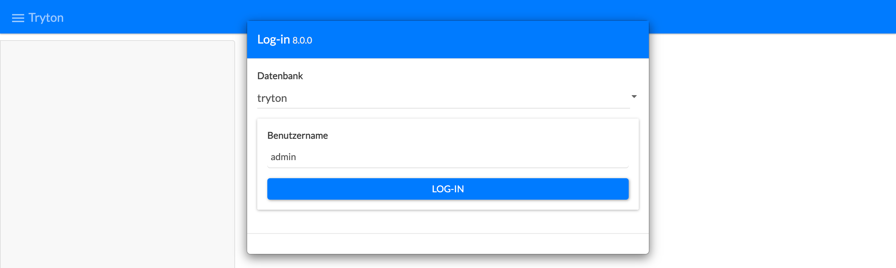

2. Der Assistent **Module Configuration** startet; mit **OK** weiter.

   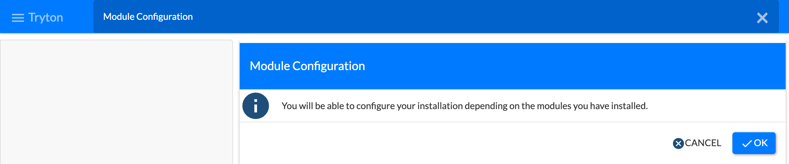

3. **Configure Languages:** die Sprachen markieren, deren Übersetzungen geladen werden sollen, z. B. English und German, dann **Load**.

   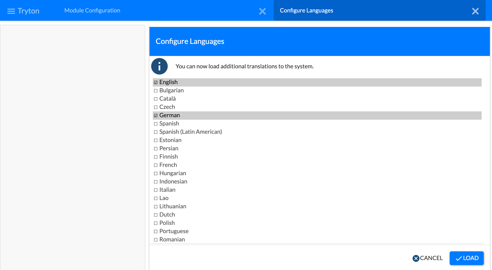

4. **Configure Modules:** die gewünschten Module markieren, z. B. `real_estate` – abhängige Module werden mit aktiviert –, dann **Activate**.

   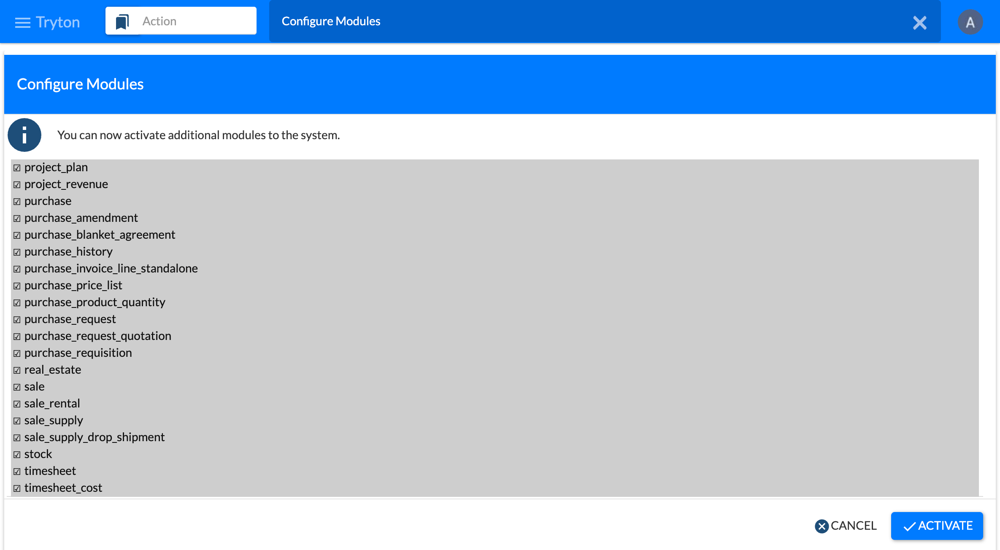

5. **Perform Pending Activation/Upgrade** listet alle zu aktivierenden Module (hier 73); mit **OK** starten. Der Server legt dabei die Tabellen an, im Log erscheinen die registrierten Modelle. Am Ende meldet der Client „The modules have been upgraded / activated.“

   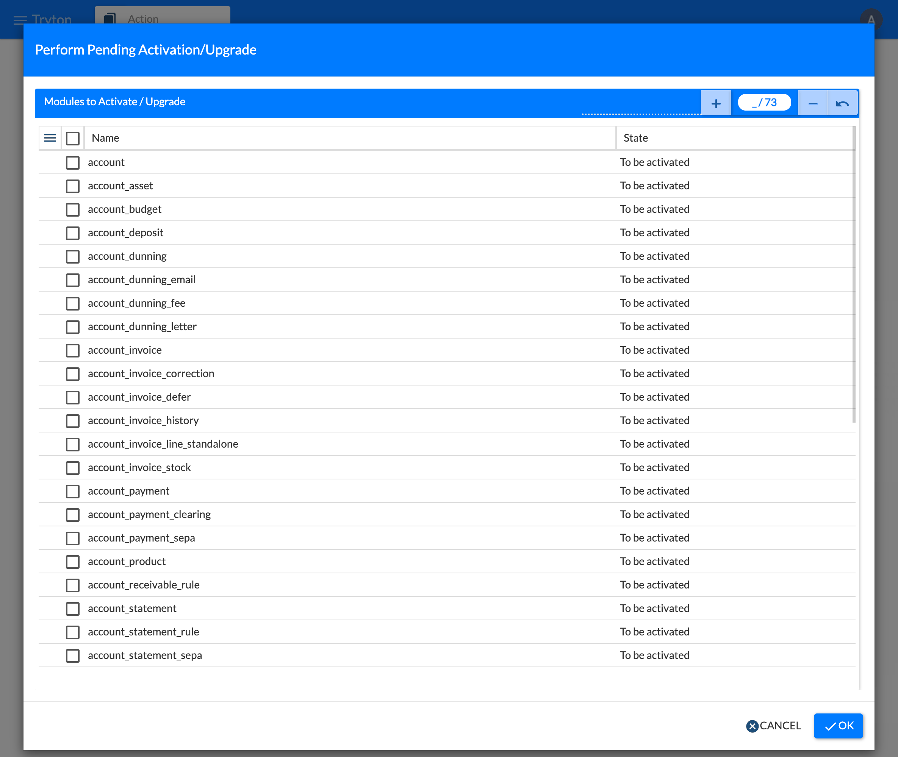

   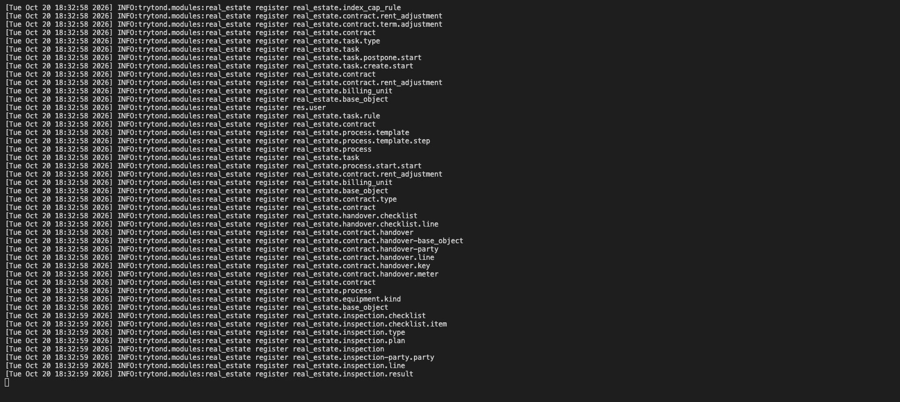

   

6. Die **Module Configuration** wird fortgesetzt; mit **OK** weiter.

   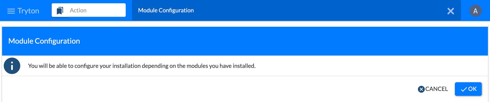

7. **Configure Company:** Nach dem Hinweis wird das Unternehmen angelegt. Im Feld **Party** eine neue Partei mit Name, Sprache und Adresse erfassen und speichern; dazu Währung (Euro) und Zeitzone (Europe/Berlin) wählen. Mitarbeiter sind optional. Mit **Add** anlegen.

   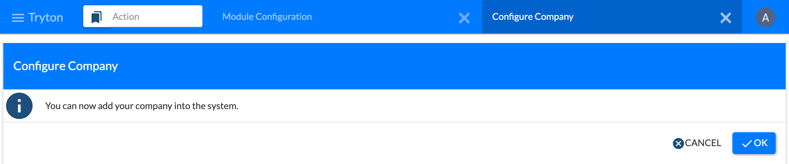

   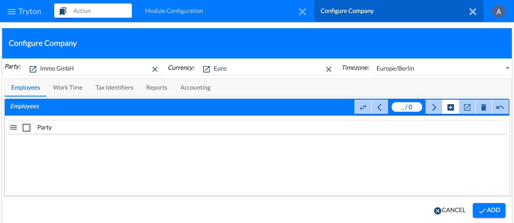

   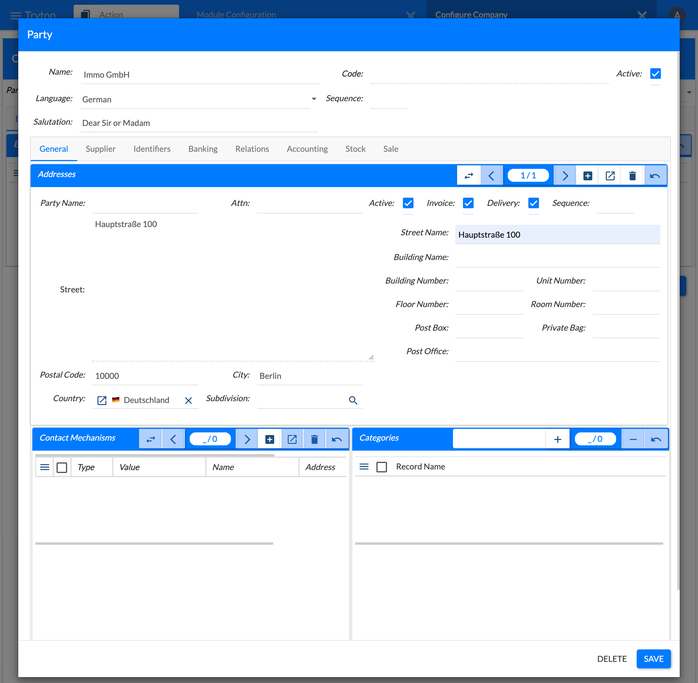

8. Der Fortschritt wird angezeigt; mit **Next** weiter.

   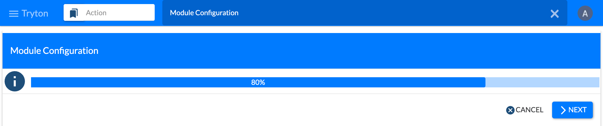

9. **Create Chart of Accounts from Template:** Nach dem Hinweis Unternehmen und Kontenrahmen wählen, z. B. **Kontenrahmen der Wohnungswirtschaft (WoWi)**, dann die Standardkonten für Forderungen, Verbindlichkeiten, Erlöse und Aufwand festlegen und mit **Create** anlegen.

   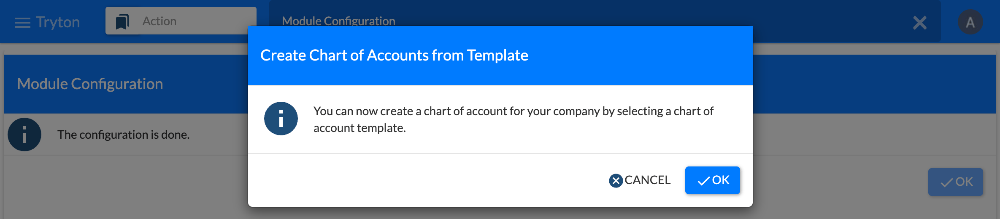

   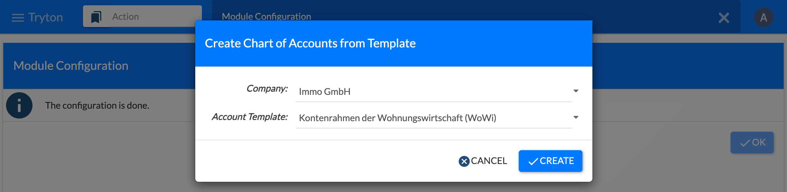

   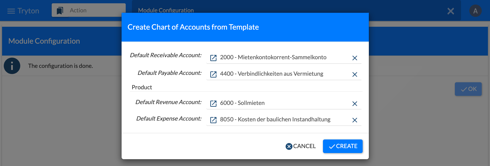

10. „The configuration is done.“ – mit **OK** abschließen.

    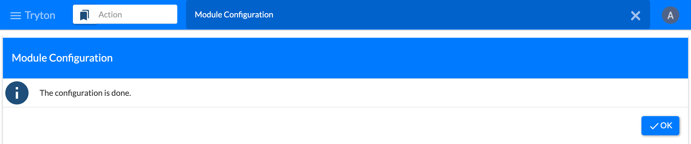

Danach steht das Menü mit **Immobilien** zur Verfügung. Über das Benutzermenü oben rechts (**Einstellungen…**) lässt sich u. a. die Sprache des Benutzers einstellen.

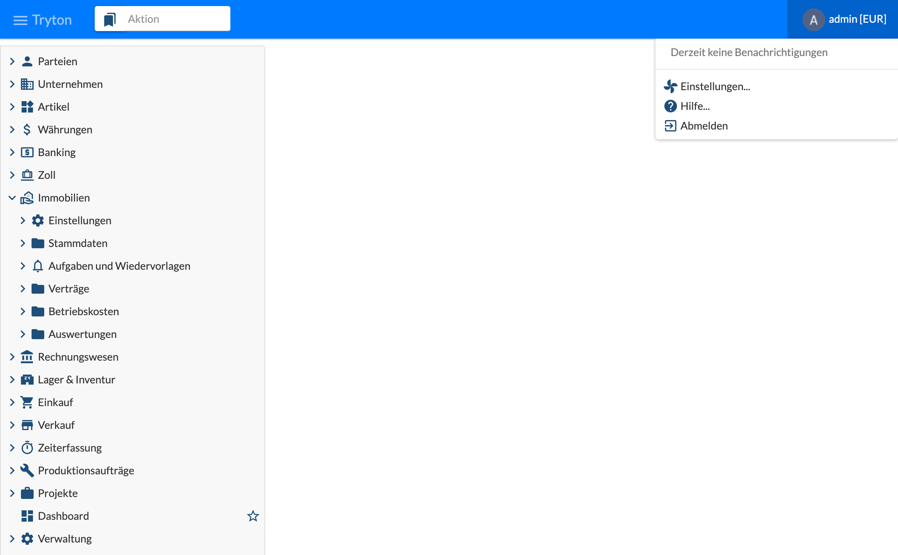

Weitere Module lassen sich später aktivieren, siehe [2.2 Module aktivieren]().

## Server, Worker und Cron starten

Für den vollen Betrieb laufen drei Prozesse nebeneinander, jeder in einem eigenen Terminal im Projektverzeichnis:

| Prozess | Aufgabe |
|---------|---------|
| Server (`trytond`) | Anmeldung und Bedienung über den Client |
| Worker (`trytond-worker`) | Hintergrundverarbeitung (Warteschlange), z. B. **Ausführen** eines Anpassungslaufs; setzt `[queue] worker = True` voraus |
| Cron (`trytond-cron`) | Zeitgesteuerte Jobs, z. B. Abruf der Preisindizes, siehe [2.6 Jobs und periodische Arbeiten]() |

Der **Server** wird wie oben beschrieben gestartet:

```sh
.venv/bin/trytond -c trytond.conf --logconf logconf.conf -d tryton --dev
```

Der **Worker** für die Hintergrundverarbeitung:

```sh
export TRYTOND_CONFIG=/pfad/zu/deinem/projektverzeichnis/tryton/trytond.conf
.venv/bin/trytond-worker -c trytond.conf --logconf logconf.conf -d tryton --dev
```

Der **Cron** für die zeitgesteuerten Jobs:

```sh
export TRYTOND_CONFIG=/pfad/zu/deinem/projektverzeichnis/tryton/trytond.conf
.venv/bin/trytond-cron -c trytond.conf --logconf logconf.conf -d tryton --dev
```

Läuft der Worker nicht, bleiben Hintergrundaufgaben in der Warteschlange liegen; läuft der Cron nicht, werden keine Jobs ausgeführt.
