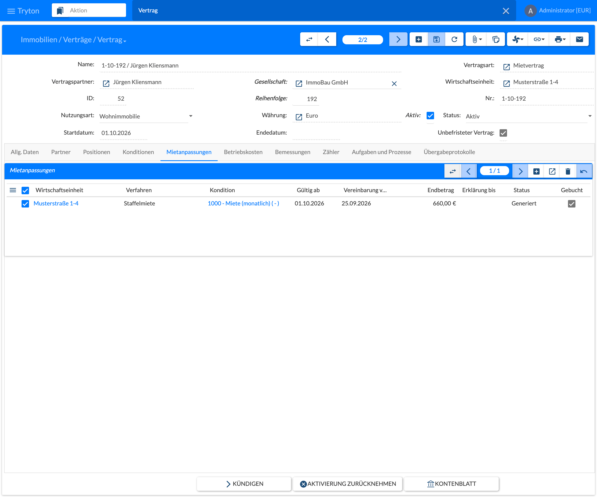
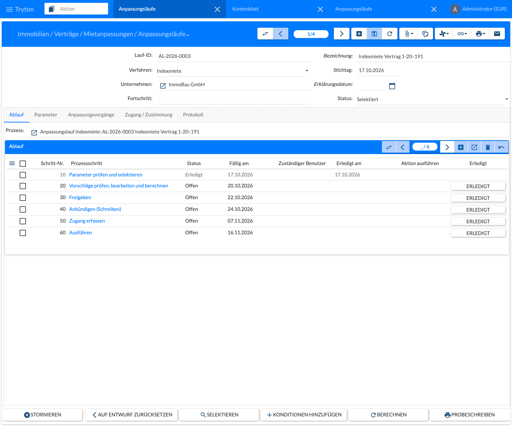
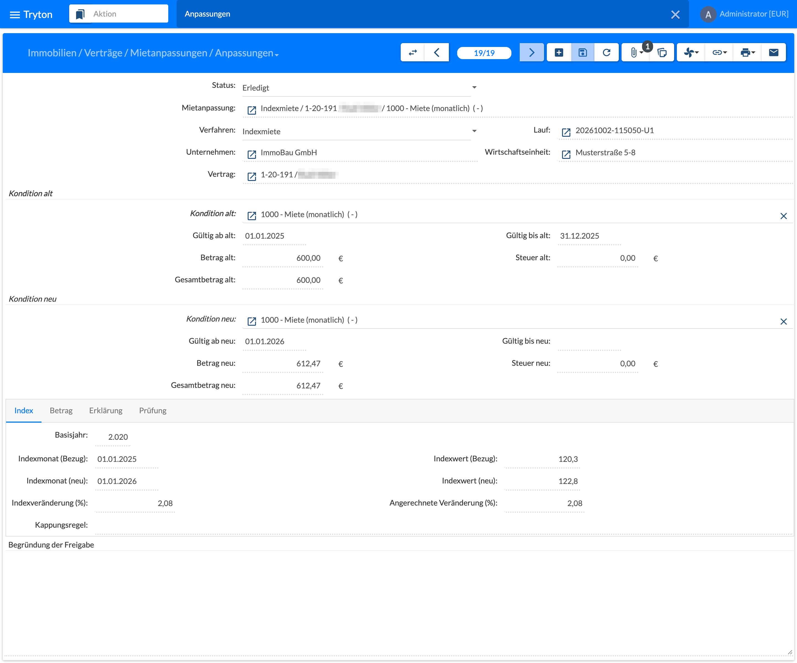

A rent adjustment changes exactly one term of a contract by a specific procedure. This page describes what applies to all procedures; the individual procedures are on the sub-pages.

## Procedures

| Procedure | Legal basis | Process |
|-----------|-------------|---------|
| [6.7.1 Graduated Rent]() | § 557a BGB | All steps are generated as terms of their own when the contract is concluded. |
| [6.7.2 Index Rent]() | § 557b BGB | Agreement on the contract; every increase by adjustment run with declaration, receipt and execution. |
| [6.7.3 Comparative Rent]() | §§ 558–558b BGB | Adjustment run based on the rent survey calculations, with cap and consent of the tenant. |
| [6.7.4 Modernisation]() | §§ 555b–559e BGB | Measure with costs and announcement; increase by adjustment run. |
| [6.7.5 Operating Costs and Free Adjustment]() | § 560 BGB | Adjustment of prepayments and flat rates; free adjustment. |

## Permission

A procedure is only possible if it is entered under **Zulässige Anpassungsverfahren** (Allowed Adjustment Procedures) on the **contract type**, on the **term type** and for the **type of use** of at least one rental object of the contract item, see [2.4.4 Contracts](). In the default data the type of use apartment allows all procedures; office, shop, warehouse, parking space and garage all except comparative rent and modernisation – the comparative rent (§ 558 BGB) exists only for apartments. At most one agreed procedure per term is possible, i.e. graduated **or** index rent.

## Menus

Under **Immobilien › Verträge › Mietanpassungen** (Real Estate › Contracts › Rent Adjustments), in the order of the work:

| Menu | Content |
|------|---------|
| Vereinbarungen (Agreements) | The rent adjustments of all procedures. |
| Indexmieten - Wiedervorlage (Index Rents – Follow-up) | Active index rents with the tabs Due, Next 3 Months and All, see 6.7.2. |
| Anpassungsläufe (Adjustment Runs) | The central entry for index rent, comparative rent and modernisation, see below. |
| Anpassungen (Adjustments) | All adjustments, see below. |
| Mietspiegel-Berechnungen (Comparative Rent Calculations) | Calculations of the comparative rent, see 6.7.3. |
| Modernisierungen (Modernisations) | Modernisation measures, see 6.7.4. |

All lists have the selection **Gesellschaft** (company, required) and **Wirtschaftseinheit** (property, optional) at the top. The settings – price indices, import index values, index rent cap rules, modernisation rules – are under **Immobilien › Einstellungen**.

## Tab Mietanpassungen on the Contract

The tab **Mietanpassungen** (Rent Adjustments) of the contract lists all rent adjustments with property, procedure, term, **Gültig ab** (valid from), **Vereinbarung vom** (agreement date), **Endbetrag** (final amount; for graduated rent the amount of the last step), **Erklärung bis** (declaration until; for index rent the latest dispatch date of the declaration), **Status** and **Gebucht** (booked: at least one step has already been posted). **+** creates a new rent adjustment, a double click opens it. Header and tabs of the rent adjustment depend on the procedure.

## Adjustment Run

Index rent, comparative rent and modernisation are carried out by an **adjustment run**: menu **Verträge › Mietanpassungen › Anpassungsläufe**, **New**, choose the procedure. A run (number AL-year-no.) has procedure, company, optionally properties and contracts as filter, key date, planned declaration date and the parameters of the procedure.

The run has the tabs **Ablauf** (workflow), **Parameter**, **Anpassungsvorgänge** (adjustments), **Zugang / Zustimmung** (receipts / consents) and **Protokoll** (protocol); **Fortschritt** (progress) counts the adjustments per state. The first selection starts the process **Anpassungslauf Indexmiete** or **Vergleichsmiete**; the tab **Ablauf** shows its six steps with due dates – check parameters and select, review, edit and calculate proposals, approve, announce (letters), capture receipts, execute. The steps are completed automatically with the state of the run (in the figure the run is **Selektiert**, selected, step 10 done).

| Step | Effect |
|------|--------|
| Selektieren (Select) | One draft adjustment per matching agreement or term; every candidate gets a protocol line with the result or the reason for skipping. |
| Konditionen hinzufügen (Add Terms) | Add single terms with the checks of the selection. |
| Berechnen (Calculate) | Recalculate values and checks of the adjustments. A manual amount with a reason is possible, but only between the previous and the calculated amount. |
| Freigeben (Approve) | Adjustments without findings are approved, with a warning only with **Begründung der Freigabe** (approval reason); the others are cancelled. |
| Probeschreiben (Sample Letter) | Shows the letter of one adjustment marked ENTWURF without archiving it. |
| Ankündigen (Announce) | Creates and archives the letters; **Schreiben drucken** (Print Letters) prints all letters still to be sent in one document. |
| Zugang / Zustimmung | Receipt date, dispatch method and – for the comparative rent – consent per adjustment, or all at once with **Zugang erfassen** (Capture Receipts). When everything is entered the run is **Bereit zur Ausführung** (ready). |
| Ausführen (Execute) | Runs in the background: splits the term at the effective date; errors are written to the protocol. Reload the run afterwards. |
| Auf Entwurf zurücksetzen / Stornieren (Reset to Draft / Cancel) | Deletes the drafts resp. cancels the open adjustments and the process. |

## Adjustment

All adjustments are listed in the menu **Verträge › Mietanpassungen › Anpassungen** (Adjustments); an adjustment can also be opened from the run or on the contract (rent adjustment, tab **Anpassungen**). It shows the state, the rent adjustment, the run, **Kondition alt** and **Kondition neu** (old and new term) with validity and amount, and tabs per procedure – in the figure for the index rent **Index**, **Betrag** (amount), **Erklärung** (declaration) and **Prüfung** (check protocol). The announced letter is attached to the adjustment (paper clip in the toolbar). The states are Entwurf (draft), Genehmigt (approved), Erklärt (declared), Erledigt (done), Storniert (cancelled) and – for the comparative rent – Abgelehnt (refused).
