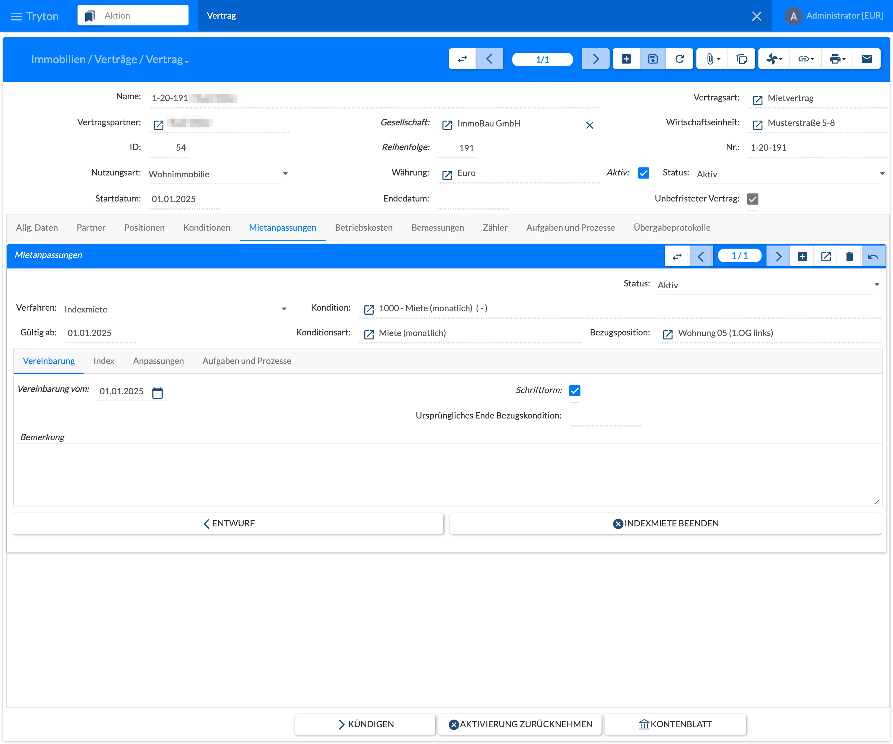
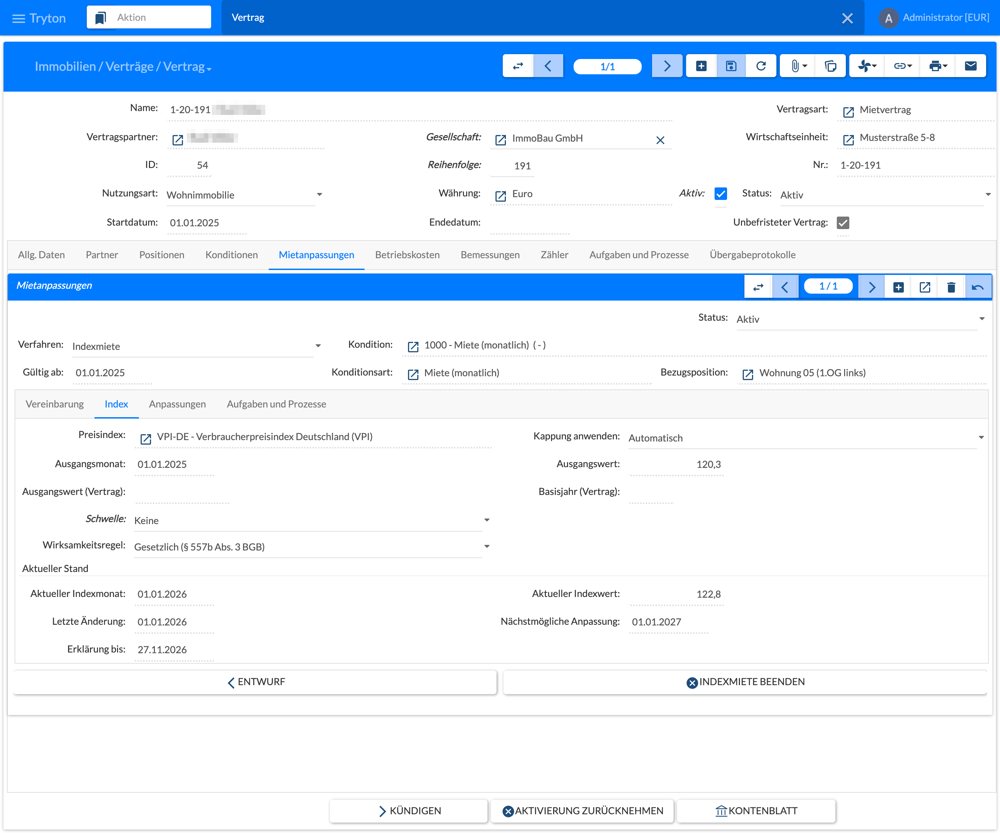
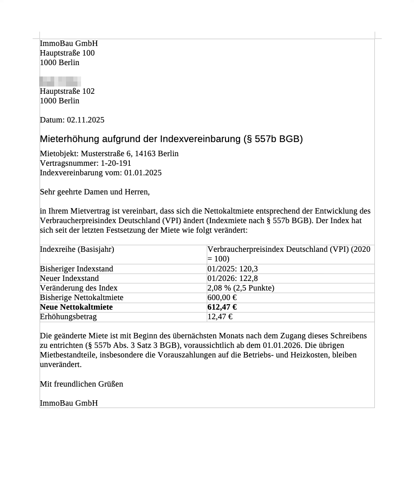
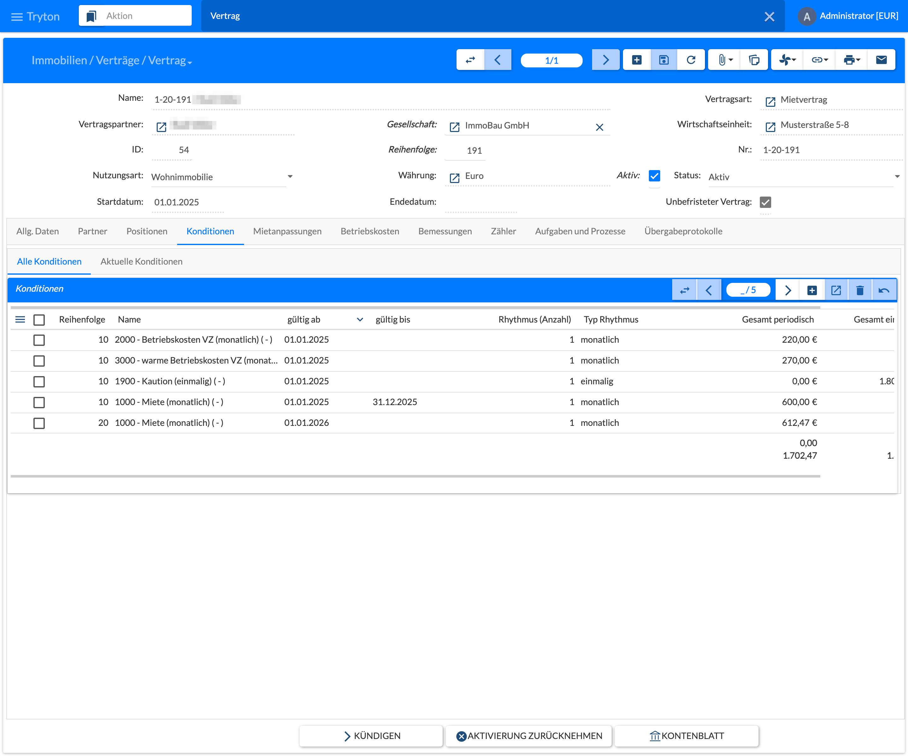

Anders als die Staffelmiete wird eine Indexmiete nicht im Voraus erzeugt. Im Vertrag wird nur die Vereinbarung hinterlegt; jede spätere Erhöhung läuft als **Anpassungslauf** mit Schreiben an den Mieter, Zugang und Ausführung.

## Voraussetzungen (einmalig)

- **Verfahren zulassen:** Die Indexmiete muss an der Vertragsart, an der Konditionsart der Miete (z. B. 1000) und bei der Nutzungsart des Mietobjekts zugelassen sein. Die Standarddaten erlauben sie bei Wohnung, Büro, Laden usw.
- **Indexreihe:** Menü **Immobilien › Einstellungen › Preisindizes**, Reihe **VPI-DE** (Verbraucherpreisindex Deutschland, Destatis 61111-0002, Basis 2020). Bei Wohnraum ist nur diese Reihe zulässig. Für Gewerbe gibt es zusätzlich **HVPI-DE**; sie wird von Hand gepflegt.
- **Indexwerte pflegen**, auf einem von drei Wegen:
  - automatisch über GENESIS-Online: in der Reihe die Schaltflächen **Werte abrufen** bzw. **Ab Basisjahr abrufen**, oder als Job `price_index_import`, z. B. am 20. jedes Monats, weil Destatis Mitte des Folgemonats veröffentlicht (siehe [2.5 Jobs und periodische Arbeiten]()). Dafür muss der Administrator den Zugangsschlüssel `genesis_token` in der `trytond.conf` eintragen;
  - per CSV-Datei mit **Immobilien › Einstellungen › Indexwerte importieren** (auch ein Download aus GENESIS-Online);
  - von Hand in der Werteliste der Reihe.

  Es zählen nur endgültige Werte des aktuellen Basisjahres. Werte, die eine angekündigte oder ausgeführte Anpassung bereits verwendet, lassen sich nicht mehr ändern.

## Vertrag und Vereinbarung anlegen

Die Indexmiete hat die Reiter **Vereinbarung**, **Index**, **Anpassungen** (die Vorgänge aus den Anpassungsläufen) sowie **Aufgaben und Prozesse**. Im Bild ist die Vereinbarung aktiv; mit **Entwurf** wird sie zurückgesetzt (nicht mehr möglich, sobald eine Anpassung freigegeben, angekündigt oder ausgeführt ist), mit **Indexmiete beenden** geschlossen.

1. Den Vertrag mit der Miet-Kondition als absolutem Betrag wie gewohnt anlegen. Optional bei Wohnraum die Ausgangsmiete mit **Prüfung Vergleichsmiete Neuvermietung** prüfen (Mietpreisbremse).
2. Im Reiter **Mietanpassungen** auf **Neu** klicken, Verfahren **Indexmiete** wählen, dann die Miet-Kondition.
3. Im Reiter **Vereinbarung**: **Vereinbarung vom** und **Schriftform** eintragen; bei Wohnraum sind beide Pflicht.
4. Im Reiter **Index**:
   - **Preisindex:** VPI-DE.
   - **Ausgangsmonat:** der im Vertrag genannte Indexmonat. **Ausgangswert (Vertrag)** und **Basisjahr (Vertrag)** dienen nur der Dokumentation; maßgeblich ist der **Ausgangswert** aus der aktuellen Reihe.
   - **Schwelle:** keine, Prozent oder Indexpunkte, z. B. „erst ab 5 %“.
   - **Wirksamkeitsregel:** bei Wohnraum gesetzlich (§ 557b Abs. 3 BGB, Pflicht); bei Gewerbe auch Vertragsmonat mit Versatz in Monaten.
   - **Kappung anwenden:** automatisch oder nie.
5. Auf **Aktivieren** klicken. Dabei prüft das System:
   - Schriftform und Vereinbarungsdatum (I01);
   - VPI bei Wohnraum (I02);
   - einen Wert für den Ausgangsmonat (I03);
   - keine Vergleichsmiete auf der Kondition; bei einer Modernisierung erscheint nur eine Warnung (I10);
   - bei Gewerbe einen Hinweis auf das Preisklauselgesetz (I12).

Danach zeigt der Reiter im Bereich **Aktueller Stand** den **aktuellen Indexmonat** und **-wert**, die **letzte Änderung**, die **nächstmögliche Anpassung** (+12 Monate) und **Erklärung bis** – den spätesten Versandtag, damit die Erhöhung zum nächstmöglichen Termin wirkt.

Mit **Indexmiete beenden** wird die Vereinbarung geschlossen, z. B. bei einem Nachtrag. Danach ist für die Kondition wieder ein anderes Verfahren möglich.

## Laufende Umsetzung: Erhöhung per Anpassungslauf

**Überblick:** Menü **Verträge › Mietanpassungen › Indexmieten - Wiedervorlage** mit den Reitern **Fällig**, **Nächste 3 Monate** und **Alle**. Die Aufgabenregel **Indexanpassung vorbereiten** legt 14 Tage vor **Erklärung bis** eine Aufgabe an; die Regel **Indexwerte veraltet** meldet, wenn für eine Reihe keine aktuellen Werte vorliegen. Beide werden in [2.4.7 Aufgaben und Prozesse]() aktiviert.

**Ablauf:** Menü **Verträge › Mietanpassungen › Anpassungsläufe**, **Neu**, Verfahren **Indexmiete**.

1. **Parameter:**
   - Unternehmen, optional Wirtschaftseinheiten oder Verträge;
   - Stichtag;
   - Reihe;
   - Indexmonat: Vorschlag ist der letzte endgültige Wert;
   - geplantes Erklärungsdatum;
   - **Senkungen einbeziehen:** standardmäßig aus; Senkungen erscheinen dann nur im Protokoll.
2. **Selektieren:**
   - Je aktiver Vereinbarung entsteht ein Vorgang. Ausgelassen wird eine Vereinbarung, wenn bereits ein Vorgang offen ist (I07), die Sperrfrist nicht erreicht ist (I04) oder die Schwelle verfehlt wird.
   - Der Vorgang enthält Bezugswert → neuer Wert, Veränderung in % und Punkten, den neuen Betrag (alter Betrag × Indexverhältnis, auf den Cent gerundet) und die geplante Wirksamkeit.
   - Jede Prüfung landet im Prüfprotokoll; das Protokoll des Laufs nennt für jede Vereinbarung das Ergebnis oder den Grund des Auslassens.
3. **Berechnen:** optional, nach Korrekturen. Bei Bedarf einen manuellen Betrag mit Begründung erfassen.
4. **Freigeben:** Vorgänge mit Fehlern werden storniert. Bei Warnungen ist eine Freigabebegründung nötig.
5. Optional **Probeschreiben**, dann **Ankündigen:** Je Vorgang entsteht die Erklärung (Bericht `index_adjustment_letter_de.odt`). Sie ist an alle Hauptmieter gerichtet und enthält Indexreihe und Basisjahr, alten und neuen Indexmonat und -wert, die Veränderung in % und Punkten, alte und neue Nettomiete, die Differenz und die voraussichtliche Wirksamkeit. Das Original wird am Vorgang und am Vertrag archiviert; die Werte sind ab dann eingefroren.
6. **Versand und Zugang:** Im Reiter **Zugang / Zustimmung** das Zugangsdatum und die Versandart je Vorgang eintragen oder gesammelt mit **Zugang erfassen**. Daraus wird die Wirksamkeit berechnet: der 1. des übernächsten Monats nach Zugang. Sind alle Zugänge erfasst, steht der Lauf auf **Bereit zur Ausführung**.
7. **Ausführen:** Das System prüft erneut
   - Sperrfrist (I04), laufenden Vertrag und Kündigung (I06), keine Buchung über die Wirksamkeit hinaus (I09), keine Staffelsperre (I14);
   - die Kappung zum tatsächlichen Zugang (I11).

   Danach teilt es die Kondition zum Wirksamkeitsdatum mit dem neuen Preis, berechnet die Zahlungsströme neu und schreibt das Vertragsprotokoll. Ab dort bucht die periodische Buchung den neuen Betrag. Die nächste Anpassung bezieht sich auf diesen Indexwert.

Wie Anpassungslauf und Anpassungsvorgang aufgebaut sind, beschreibt [6.7 Mietanpassungen]().

Das Schreiben beim **Ankündigen** nennt Mietobjekt, Vertragsnummer und Datum der Indexvereinbarung und stellt in einer Tabelle Indexreihe mit Basisjahr, bisherigen und neuen Indexstand, die Veränderung in % und Punkten, bisherige und neue Nettokaltmiete sowie den Erhöhungsbetrag dar. Es weist auf die Wirksamkeit ab Beginn des übernächsten Monats nach Zugang hin (§ 557b Abs. 3 Satz 3 BGB) und darauf, dass die Vorauszahlungen unverändert bleiben.

Im Beispiel des [Anpassungsvorgangs]() (Status **Erledigt**) stieg der Index von 120,3 (01/2025) auf 122,8 (01/2026), also um 2,08 %; die Miete stieg ab 01.01.2026 von 600,00 € auf 612,47 € (600,00 × 122,8 / 120,3). Mit einer Kappungsregel wäre die **angerechnete Veränderung** kleiner als die Indexveränderung.

Nach dem Ausführen ist die Miet-Kondition geteilt: Die bisherige Kondition (Reihenfolge 10, 600,00 €) endet am 31.12.2025, die neue (Reihenfolge 20, 612,47 €) gilt ab 01.01.2026 und bleibt offen. Die übrigen Konditionen, z. B. Betriebskostenvorauszahlungen und Kaution, sind nicht betroffen.

## Rechtlicher Rahmen

**Wohnraum – § 557b BGB**

| Regel | Umsetzung im Modul |
|-------|--------------------|
| Schriftliche Vereinbarung, Bindung an den VPI von Destatis (Abs. 1) | Schriftform Pflicht (I01), nur Reihen mit „für Wohnraum zulässig“ (I02). |
| Miete jeweils mindestens 1 Jahr unverändert (Abs. 2 S. 1) | I04 bei Selektion und Ausführung; nächstmöglicher Termin. |
| Keine Erhöhung nach § 558 (Vergleichsmiete); § 559 nur bei Maßnahmen, die der Vermieter nicht zu vertreten hat (Abs. 2) | Vergleichsmiete gesperrt (I10, Fehler); Modernisierung nur mit Warnung – ob die Maßnahme zulässig ist, ist im Einzelfall zu prüfen. Staffel- und Indexmiete auf derselben Kondition schließen sich aus. |
| Erklärung in Textform mit Indexänderung und Miete bzw. Erhöhung als Geldbetrag (Abs. 3) | Erklärungsschreiben mit allen Angaben, archiviert. |
| Wirksam ab Beginn des übernächsten Monats nach Zugang (Abs. 3) | Wirksamkeit aus dem Zugangsdatum; ohne Zugang keine Ausführung. |
| Mietpreisbremse nur für die Ausgangsmiete (Abs. 4) | Assistent **Prüfung Vergleichsmiete Neuvermietung** am Vertragsentwurf; keine Prüfung bei den Indexanpassungen. |
| Abweichungen zum Nachteil des Mieters unwirksam (Abs. 5) | Bei Wohnraum ist die gesetzliche Wirksamkeit Pflicht; abweichende Einstellungen werden als Fehler abgelehnt. |
| Senkung bei fallendem Index | Wird erkannt (I13); ein Vorgang entsteht nur mit **Senkungen einbeziehen**. |

**Gewerbe – Preisklauselgesetz:** § 557b gilt hier nicht. Zulässig sind u. a. VPI- oder HVPI-Klauseln bei langfristigen Verträgen (mindestens 10 Jahre oder entsprechender Kündigungsverzicht). Das Modul gibt dazu nur einen Hinweis (I12); die Klausel ist rechtlich zu prüfen. Schriftform ist bei Gewerbe nur eine Warnung, die Wirksamkeit kann nach Vertragsmonat laufen.

{}
Im angespannten Wohnungsmarkt soll die jährliche Indexsteigerung über 3 % nur zur Hälfte zählen. Das ist als abschaltbare Kappungsregel vorbereitet (**Immobilien › Einstellungen › Kappungsregeln Indexmiete**, neue Regeln sind inaktiv). Maßgeblich ist das Kennzeichen **Angespannter Wohnungsmarkt** mit Gültigkeit an der Wirtschaftseinheit, siehe [5.1 Wirtschaftseinheit](). Nach Verkündung des Gesetzes ist die Regel gegen den Gesetzestext zu prüfen.
{}
