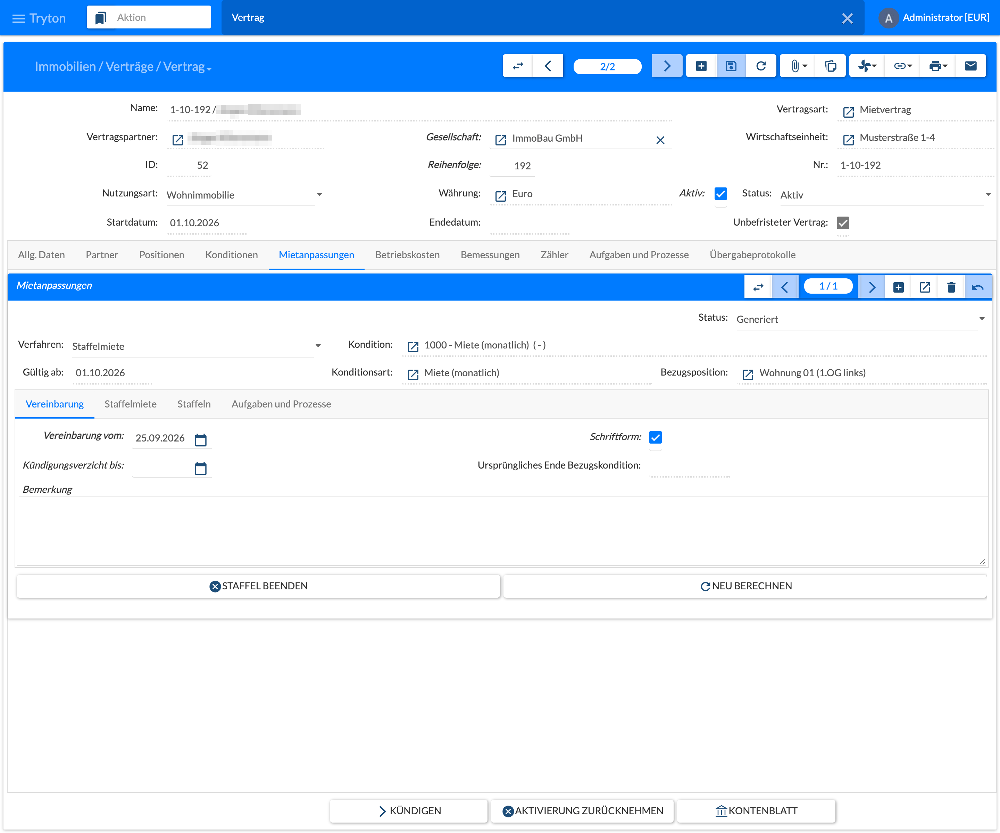
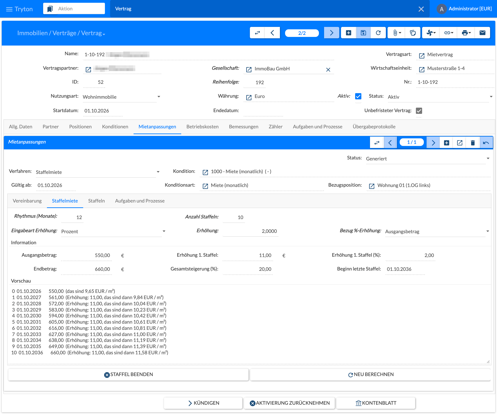
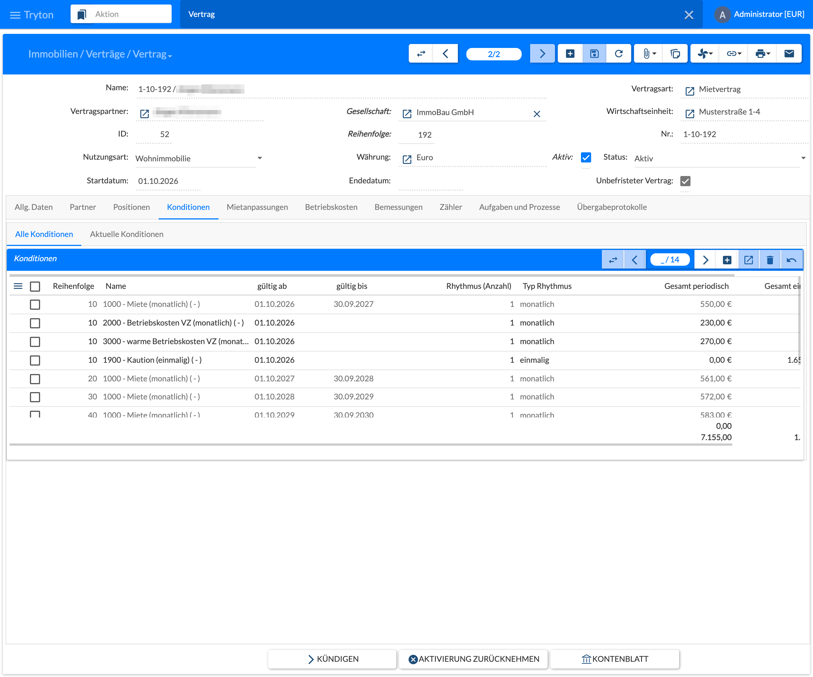

Eine Staffelmiete wird einmal bei Vertragsschluss vereinbart und erzeugt. Danach ist je Staffel nichts mehr zu tun: Jede Staffel ist eine eigene Kondition, und die periodische Buchung stellt ab ihrem Beginn automatisch den neuen Betrag in Rechnung.

## Voraussetzungen (einmalig)

- **Verfahren zulassen:** Die Staffelmiete muss an der Vertragsart und an der Konditionsart der Miete (z. B. 1000 „Apartment rent“) unter **Zulässige Anpassungsverfahren** eingetragen sein. Zusätzlich muss sie bei der Nutzungsart mindestens eines Mietobjekts erlaubt sein; in den Standarddaten ist das bei Wohnung, Büro, Laden usw. der Fall. Siehe [2.5.4 Verträge]().
- **Absoluter Betrag:** Die Konditionsart der Miete darf keinen **Bemessungstyp** haben, sonst bricht **Generieren** mit der Prüfung G15 ab. Ein **Informativer Bemessungstyp** (z. B. Wohnfläche) ist erlaubt; er wird für die Eingabeart „Betrag je Fläche“ und für die Anzeige in €/m² verwendet.

## Vertrag anlegen

1. Den Vertrag wie gewohnt als Entwurf anlegen: Partner, Position mit Mietobjekt, Konditionen. Die Miet-Kondition wird die **Bezugskondition** (Stufe 0). Sie beginnt mit dem Mietbeginn, ihr Ende bleibt in der Regel offen.
2. Optional bei Wohnraum: Mit dem Assistenten **Prüfung Vergleichsmiete Neuvermietung** die Ausgangsmiete gegen die Mietpreisbremse prüfen.
3. Speichern.

## Staffel anlegen und erzeugen

Die Mietanpassung wird im Reiter **Mietanpassungen** des Vertrags angelegt, siehe [6.7 Mietanpassungen]().

Im Kopf der Mietanpassung stehen **Verfahren**, **Kondition** (Bezugskondition), **Gültig ab**, **Konditionsart**, **Bezugsposition** und der **Status** (im Bild: **Generiert**). Die Reiter **Vereinbarung**, **Staffelmiete**, **Staffeln** sowie **Aufgaben und Prozesse** gliedern die Angaben; das Feld **Ursprüngliches Ende Bezugskondition** merkt sich das Ende der Bezugskondition vor dem Generieren – es wird beim Zurücksetzen wiederhergestellt bzw. von der letzten Staffel übernommen.

1. Im Reiter **Mietanpassungen** des Vertrags auf **Neu** klicken, Verfahren **Staffelmiete** wählen, dann die Miet-Kondition.
2. Im Reiter **Vereinbarung**:
   - **Vereinbarung vom** ist Pflicht.
   - **Schriftform** ist bei Wohnraum Pflicht; bei Gewerbe erscheint nur eine Warnung.
   - **Kündigungsverzicht bis** ist optional.
3. Im Reiter **Staffelmiete**:
   - **Rhythmus (Monate):** mindestens 12.
   - **Anzahl Staffeln.**
   - **Eingabeart Erhöhung:**
     - **Absoluter Betrag:** € je Periode;
     - **Betrag je Fläche:** € je m²; die Fläche wird beim Erzeugen festgeschrieben;
     - **Prozent**, mit **Bezug %-Erhöhung**: „Ausgangsbetrag“ ergibt für jede Staffel dieselbe Erhöhung, „Vorstufe“ rechnet mit Zinseszins.
   - Die **Vorschau** zeigt alle Staffeln mit Betrag, Erhöhung und €/m², dazu Endbetrag und Gesamtsteigerung.
4. Auf **Generieren** klicken. Das System prüft G01–G15 und erzeugt dann die Staffeln als eigene Konditionen:
   - Die Bezugskondition endet am Vortag der 1. Staffel, jede Staffel endet am Vortag der nächsten.
   - Die letzte Staffel bleibt offen.
   - Die Zahlungsströme werden neu berechnet; das Vertragsprotokoll zeigt Parameter und Staffelübersicht.
5. Den Vertrag aktivieren und den Mietvertrag drucken. Im Vertragsschreiben stehen die späteren Konditionen – alle Staffeln mit Beginn und €-Betrag – unter § 4. Damit ist die Staffeltabelle Teil der schriftlichen Vereinbarung.

Im Beispiel steigt die Ausgangsmiete von 550,00 € alle 12 Monate um 2 % des Ausgangsbetrags, also um 11,00 € je Staffel. Nach 10 Staffeln beträgt sie ab dem 01.10.2036 660,00 € (Gesamtsteigerung 20 %). Der Bereich **Information** fasst das zusammen: **Ausgangsbetrag**, **Erhöhung 1. Staffel** in € und %, **Endbetrag**, **Gesamtsteigerung (%)** und **Beginn letzte Staffel**. Die **Vorschau** listet jede Staffel mit Beginn, Betrag, Erhöhung und €/m² (über den informativen Bemessungstyp Wohnfläche).

Nach dem Generieren stehen die Staffeln im Reiter **Konditionen › Alle Konditionen** des Vertrags: Die Bezugskondition (Reihenfolge 10, 550,00 €) endet am 30.09.2027, die Staffeln folgen mit Reihenfolge 20, 30, 40 … und je einem Jahr Laufzeit (561,00 €, 572,00 €, 583,00 € …); die letzte Staffel bleibt offen. Gesperrte Stufen sind grau dargestellt. Der Reiter **Aktuelle Konditionen** zeigt nur die zum heutigen Datum gültigen Konditionen.

Solange noch keine Stufe gebucht ist, können **Neu berechnen** und **Zurücksetzen** frei verwendet werden.

Weitere Prüfungen beim Generieren:

- Die letzte Staffel muss vor dem Vertrags- oder Konditionsende liegen (G07); die Meldung nennt die höchstmögliche Anzahl.
- Der Vertrag muss Entwurf oder laufend sein und darf keine erfasste Kündigung haben (G09).
- Warnung, wenn der Staffelbeginn nicht zum Rhythmus der Sollstellung passt (G13).
- Warnung bei Rundungsdifferenzen, wenn die Menge ≠ 1 ist (G12).

## Umsetzung der einzelnen Staffeln

- **Kein eigener Schritt:** Es gibt kein Erhöhungsschreiben, keinen Anpassungslauf und keine Zustimmung des Mieters. Die periodische Buchung stellt ab dem Beginn einer Staffel automatisch deren Betrag in Rechnung, siehe [6.3 Periodische Buchung]().
- **Gesperrte Stufen:** Die Bezugskondition und alle Zwischenstaffeln sind gesperrt. Beginn, Ende, Konditionsart, Rhythmus und Steuern lassen sich nicht ändern, die Stufen lassen sich nicht teilen, und es ist kein anderes Anpassungsverfahren möglich. Menge und Einzelpreis lassen sich korrigieren.
- **Änderung nach der ersten Buchung:** Jede Änderung (Neu berechnen, Staffel beenden, Betragskorrektur) braucht eine bestätigte Warnung, weil dafür ein Nachtrag mit dem Mieter nötig ist. Sie wirkt nur auf noch nicht gebuchte Stufen und wird protokolliert.
- **Staffel beenden:** löscht die ungebuchten Stufen. Die letzte gebuchte Stufe bleibt dann offen.
- **Nach der letzten Staffel:** Die letzte Stufe ist wieder normal anpassbar, etwa per Vergleichsmiete im Anpassungslauf, Modernisierung oder Anschlussstaffel (neue Staffelmiete mit der letzten Stufe als Bezugskondition).
- **Wiedervorlagen:** Die Aufgabenregeln **Staffelmiete endet** (3 Monate vor Beginn der letzten Staffel) und **Kündigungsverzicht endet** (3 Monate vorher) sind vorhanden, aber standardmäßig inaktiv. Bei Bedarf in [2.5.7 Aufgaben und Prozesse]() aktivieren.

## Rechtlicher Rahmen (§ 557a BGB)

| Regel | Umsetzung im Modul |
|-------|--------------------|
| Schriftliche Vereinbarung (Abs. 1) | Feld **Schriftform**: bei Wohnraum Fehler (G10), bei Gewerbe Hinweis. |
| Jede Miete oder Erhöhung als Geldbetrag ausgewiesen (Abs. 1) | Jede Staffel hat genau einen €-Betrag, auf den Cent gerundet. Die Eingabe je m² oder in % ist nur eine Rechenhilfe; maßgeblich ist die gedruckte €-Tabelle. |
| Miete mindestens 1 Jahr unverändert (Abs. 2 S. 1) | Rhythmus ≥ 12 Monate (G02). |
| Keine Erhöhung nach §§ 558–559b während der Staffel (Abs. 2 S. 2) | Sperre der Stufen. Vergleichsmiete (V01), Modernisierung (E02) und Indexmiete (I14) lassen gesperrte Stufen aus. Staffel- und Indexmiete auf derselben Kondition schließen sich aus. Betriebskosten (§ 560) bleiben möglich. |
| Kündigungsverzicht höchstens 4 Jahre ab Vereinbarung (Abs. 3) | Warnung G11; unwirksam wäre nur der Verzicht. |
| Staffel wirkt ohne Erklärung | Kein Schreiben, Buchung direkt aus den Konditionen. |
| Mietpreisbremse je Staffel zum Zeitpunkt ihrer Fälligkeit (Abs. 4) | Noch nicht umgesetzt. Geprüft wird nur die Ausgangsmiete per Assistent bei Neuvermietung; die Vergleichsmiete künftiger Zeitpunkte ist bei Vertragsschluss nicht bekannt. |
