The module justifies a rent increase up to the local comparative rent (§§ 558–558b BGB) exclusively by a **rent survey** (Mietspiegel) stored in the system. Expert opinions, comparable apartments or a rent database are not supported. The work has three parts: maintain rent survey and master data once, classify the objects, and then carry out an [adjustment run]() per increase.

## Master Data (once)

Rent surveys are maintained under **Immobilien › Einstellungen › Mietspiegel** (Real Estate › Configuration › Rent Surveys; group real estate administration).

### Version and Tab Allgemein

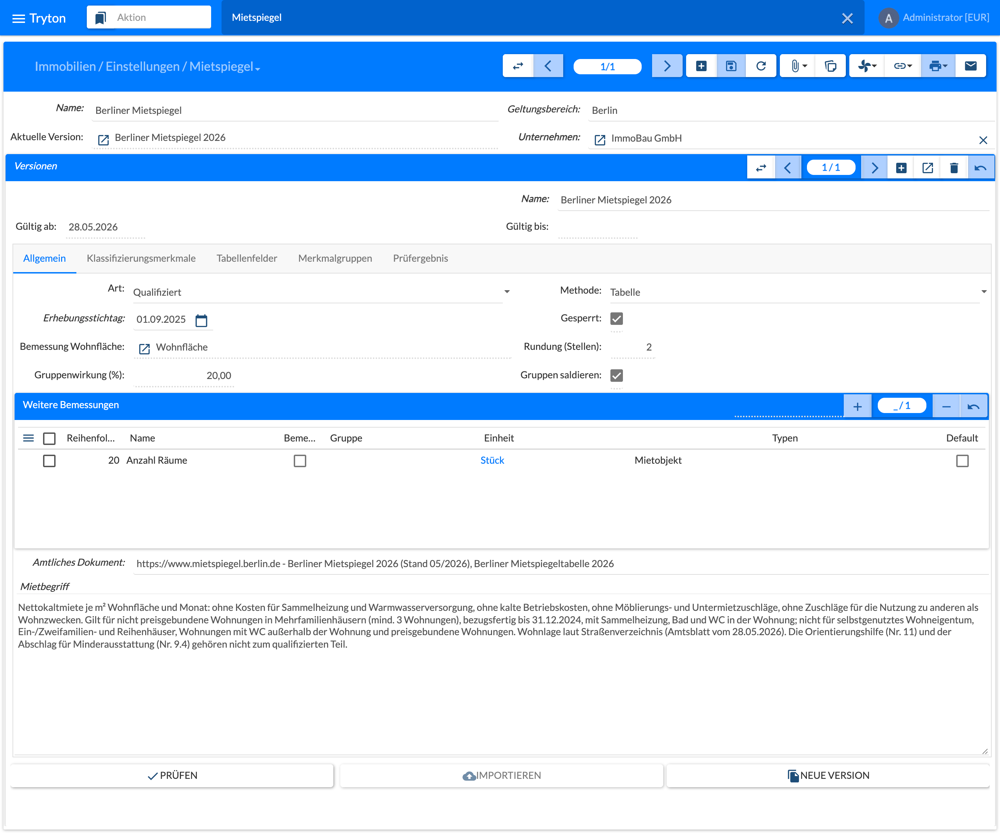

The rent survey has **Name**, **Geltungsbereich** (area of validity), **Unternehmen** (company) and the **Aktuelle Version** (current version); below are the **Versionen** (versions) with name, **Gültig ab** and **Gültig bis** (valid from / to). Each version has the tabs **Allgemein** (general), **Klassifizierungsmerkmale** (classification attributes), **Tabellenfelder** (table fields), **Merkmalgruppen** (feature groups) and **Prüfergebnis** (check result) and the buttons **Prüfen** (Check), **Importieren** (Import) and **Neue Version** (New Version).

In the tab **Allgemein** of the version:

- **Art** (kind): simple or qualified;
- **Methode** (method): table (as in Berlin) or regression;
- **Erhebungsstichtag** (survey key date);
- **Bemessung Wohnfläche** (living area measurement, default living area) and, if needed, **Weitere Bemessungen** (further measurements), e.g. number of rooms;
- **Gruppenwirkung (%)** (group effect: range share of the feature groups, default 20 %) and **Gruppen saldieren** (net groups: positive and negative groups offset each other);
- **Rundung (Stellen)** (rounding, decimals);
- **Amtliches Dokument** (official document, source) and **Mietbegriff** (definition of rent: which rent the survey states and what it applies to); the official document itself is attached to the version;
- **Gesperrt** (locked) shows that accepted calculations use the version; it can then no longer be changed.

### Classification Attributes (Klassifizierungsmerkmale)

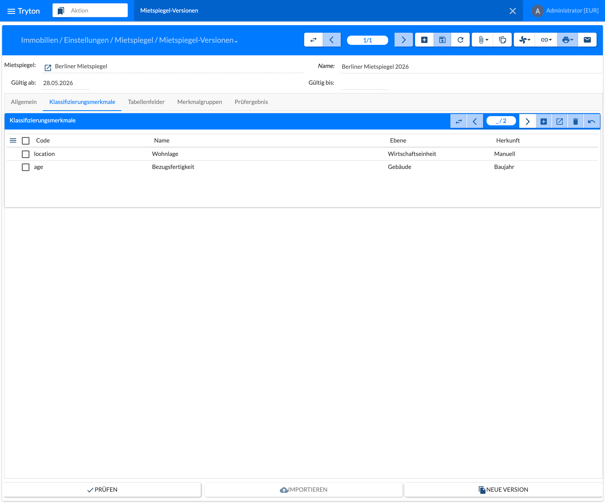

The classification attributes are the table axes with their classes. For each attribute **Code**, **Name**, the **Ebene** (level: property / building / rental object) and the **Herkunft** (source) are set: manual, year of construction of the building, or measurement with a value range per class. In the Berlin example these are the **Wohnlage** (residential location; property, manual) and the **Bezugsfertigkeit** (ready for occupancy; building, from the year of construction).

### Table Fields (Tabellenfelder)

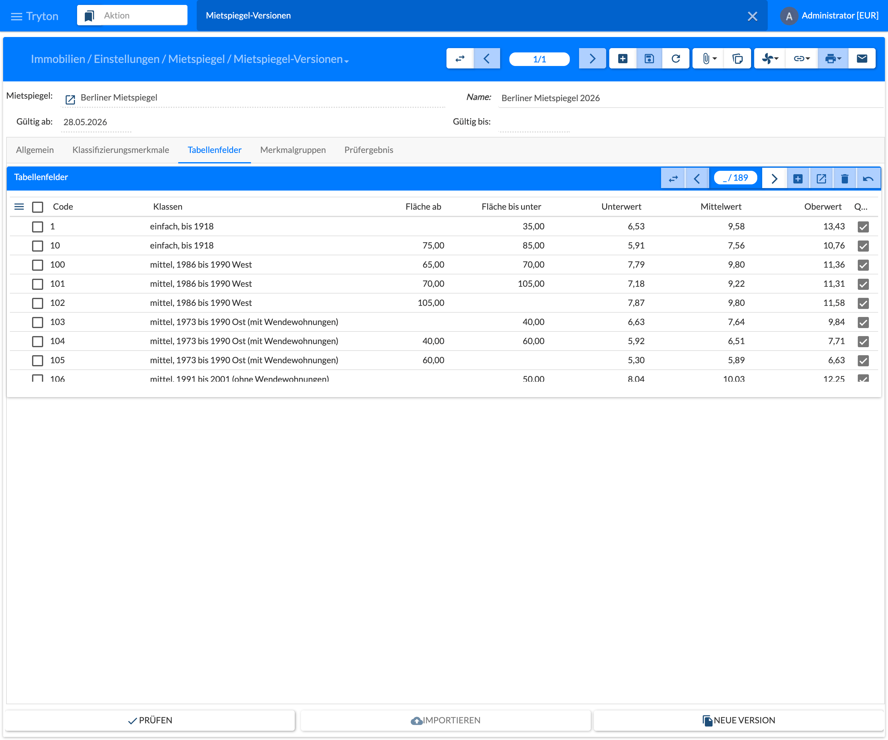

Each table field has a **Code**, one class per classification attribute (column **Klassen**, e.g. “mittel, 1986 bis 1990 West”), the area range **Fläche ab** / **Fläche bis unter** (area from / up to below; empty = open), **Unterwert**, **Mittelwert** and **Oberwert** (lower, middle and upper value) in €/m² and the flag **qualifiziert** (qualified). The Berlin rent survey 2026 has 189 table fields. The calculation looks for the field whose classes and area range match the apartment; the starting point is the middle value, and the feature groups shift it within the range.

### Feature Groups and Features (Merkmalgruppen)

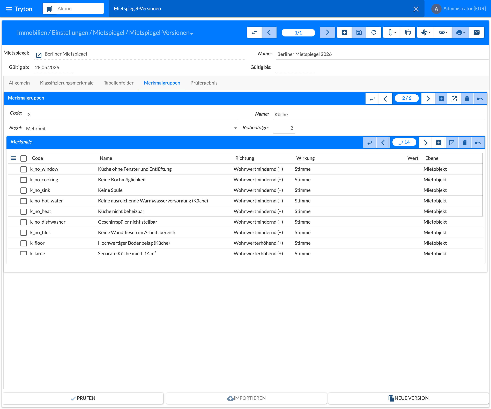

Each feature group has **Code**, **Name**, **Regel** (rule) and **Reihenfolge** (sequence), and below it its **Merkmale** (features) with code, name, **Richtung** (direction: increasing + / decreasing −), **Wirkung** (effect: a vote for the rule majority, otherwise an amount), **Wert** (value) and **Ebene** (level). The figure shows the group **Küche** (kitchen) of the Berlin rent survey with 14 features, e.g. “Küche ohne Fenster und Entlüftung” (kitchen without window and ventilation, −) or “Hochwertiger Bodenbelag (Küche)” (high-quality flooring, +). For the group:

- rule majority (+1/0/−1) or additive (€/m² or %);
- per feature direction, level and “only for classes” (e.g. only up to year of construction 2001);
- automatic setting by a measurement (e.g. energy consumption value);
- mutual exclusions.

### Import, Check, New Version

Table fields and features can be read in with **Importieren** (Import, CSV) with preview and problem list. Afterwards check consistency with **Prüfen** (Check); the result is shown in the tab **Prüfergebnis**. For a new rent survey **Neue Version** (New Version) copies everything; the codes remain the same and so do the classifications of the objects.

### Further Master Data

- **Type of use apartment:** it must allow the comparative rent (default). Only then is an object treated as an apartment with rent survey data; parking spaces and commercial units are excluded.
- **Contract type and term type of the rent** (e.g. 1000): the comparative rent must be listed under **Zulässige Anpassungsverfahren** (Allowed Adjustment Procedures). The rent term must be monthly and must not contain operating costs (V11).
- Optionally the task rules for the consent period and the period for legal action, e.g. M09 “consent period expired”, see [2.4.7 Tasks and Processes]().

## Classify the Objects

Classification is done in the tab **Mietspiegel** (Rent Survey) of the objects, see [5.1 Property](). Classes on a lower level override the classes above; features add up over all three levels.

### Property

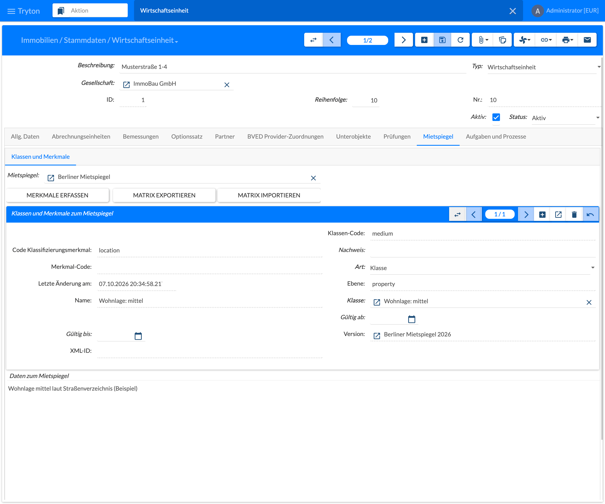

The tab **Mietspiegel › Klassen und Merkmale** (classes and features) shows the assigned **rent survey** and the buttons **Merkmale erfassen**, **Matrix exportieren** and **Matrix importieren** at the top, and below the list **Klassen und Merkmale zum Mietspiegel**. Each entry has the **Art** (kind: class or feature), the classification attribute or feature, the **Klasse** (class), **Gültig ab** / **Gültig bis** and the **Nachweis** (evidence); the figure shows the residential location “mittel” (medium) of the property. The field **Daten zum Mietspiegel** holds remarks and reasons, e.g. the reference in the street directory.

- Assign the **rent survey**. Only then does the tab also appear on buildings and apartments.
- **Classes** on property level. In Berlin this is the residential location simple/medium/good, set manually according to the street directory; the evidence is entered under **Daten zum Mietspiegel** (rent survey data).
- **Features of the residential environment** (group 5), as far as they are on this level.
- **Kappungsgrenze 15 % (Verordnung)** (cap 15 % by ordinance) with validity if the state ordinance applies, otherwise 20 %. Also **Angespannter Wohnungsmarkt** (tight housing market), relevant for the check on new lettings.
- With **Matrix exportieren** / **Matrix importieren** (Export / Import Matrix) all buildings and apartments of the property can be maintained in a spreadsheet – one row per object, one column per class or feature.

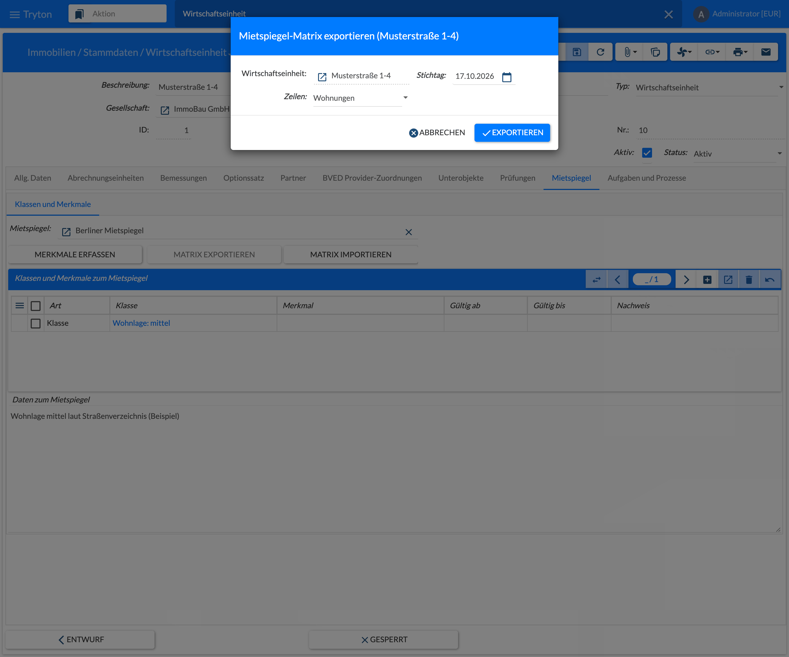

**Matrix exportieren** asks for **Zeilen** (rows: apartments or buildings) and **Stichtag** (key date) and returns a CSV file (separator semicolon): one row per object, one column per classification attribute with the class code and one column per feature of the level, where an “x” marks an assigned feature. The second row starts with “#” and contains the names. This shows all apartments × features at a glance and lets you maintain them in a spreadsheet. **Matrix importieren** reads the edited file, shows the changes and problems in a **Vorschau** (preview) and applies them with **Übernehmen** (Apply) – only if no problems are reported. Valid marks are x, 1, ja/j, yes/y, true/wahr; an empty cell removes the feature.

### Building

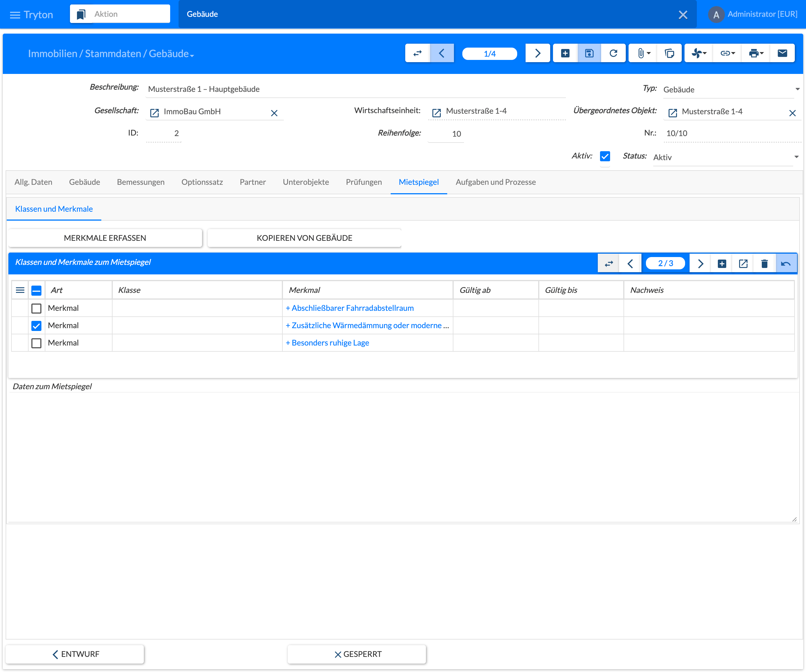

The building has no rent survey field of its own; it comes from the property. The tab shows the buttons **Merkmale erfassen** and **Kopieren von Gebäude**, the list of classes and features with kind (+ increasing, − decreasing the residential value), class, feature, valid from/until and evidence, and the field **Daten zum Mietspiegel**. In the figure three value-increasing features are entered, e.g. a lockable bicycle room and a particularly quiet location.

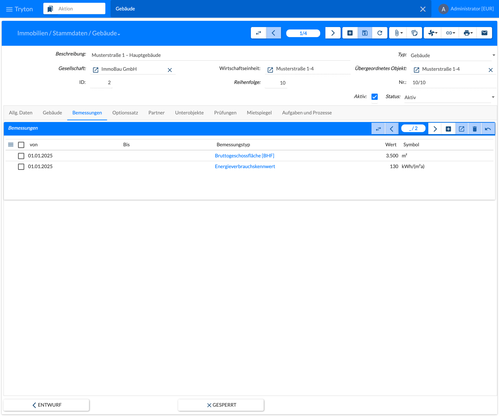

The energy consumption value is entered in the tab **Bemessungen** (Measurements) of the building with **von** (valid from), value and unit kWh/(m²a), in the figure next to the gross floor area.

- **Year of construction** (ready for occupancy): the age class is derived from it, 12 classes in Berlin. Classes depending on the district, e.g. 1973–1990 East/West, are “manual only” and must be assigned.
- Measurement **energy consumption value** (kWh/(m²a)), already converted. The energy features are set automatically from it; B09 warns if the value is missing.
- **Building features** (group 4, e.g. elevator, thermal insulation, condition of the staircase) with validity and evidence – quickly via **Merkmale erfassen** (Assign Features, checklist) or **Kopieren von Gebäude** (Copy from Building).

### Apartment

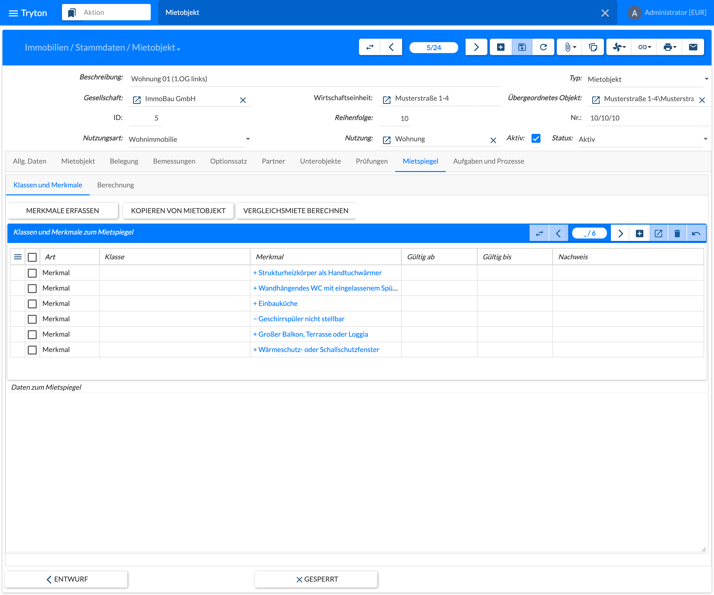

On the apartment the tab **Mietspiegel** has the sub-tabs **Klassen und Merkmale** (classes and features) and **Berechnung** (calculation). Besides **Merkmale erfassen** there are **Kopieren von Mietobjekt** and **Vergleichsmiete berechnen**. In the figure six apartment features are entered, five increasing the residential value (e.g. fitted kitchen, large balcony) and one decreasing it (− no space for a dishwasher).

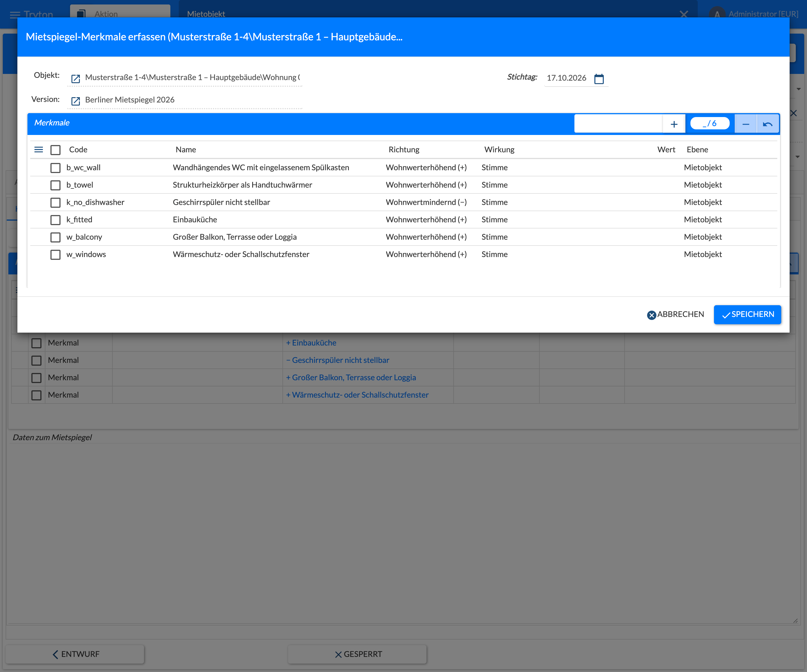

**Merkmale erfassen** opens the dialog **Mietspiegel-Merkmale erfassen** (Assign Rent Survey Features) with object, rent survey version and key date. The list shows the features of the object with code, name, direction, effect (vote or value), value and level; **+** and the search add further features of the level, **−** removes them. **Speichern** (Save) takes the list over into the tab. The dialog is the same on buildings and apartments.

- Measurement **living area** at the key date. It determines the table field (area range) and gives: comparative rent = €/m² × living area.
- **Apartment features** of the groups bathroom/WC, kitchen and apartment, e.g. fitted kitchen, parquet or bathroom without window – via **Merkmale erfassen** or **Kopieren von Mietobjekt** (Copy from Rental Unit), which saves time for identically equipped apartments.
- **Vergleichsmiete berechnen** (Calculate Comparative Rent; actions on the rental object) shows the result for the apartment directly, without a run.

## Rent Survey Calculation

There is exactly one open calculation per apartment and key date, found under **Verträge › Mietanpassungen › Mietspiegel-Berechnungen** (Comparative Rent Calculations) or in the tab **Mietspiegel** of the apartment.

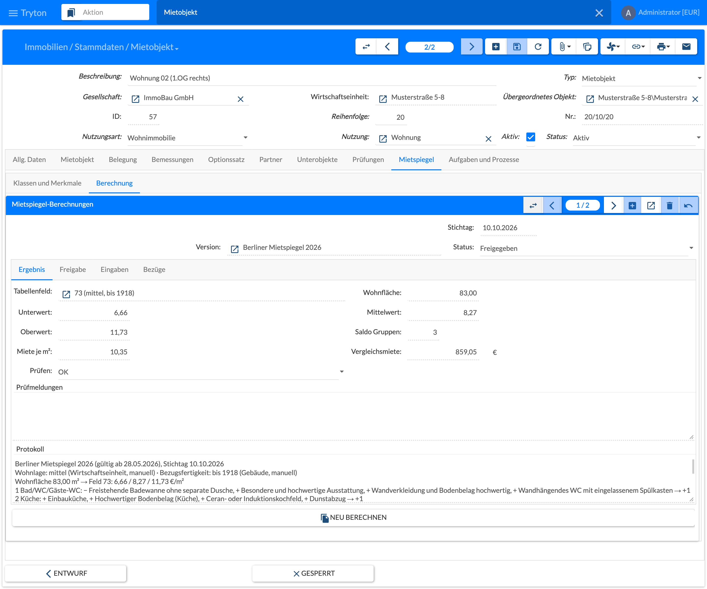

The sub-tab **Berechnung** (calculation) of the apartment lists the rent survey calculations with key date, version and state. The tab **Ergebnis** (result) shows table field, lower, middle and upper value, living area, **Saldo Gruppen** (balance of groups), **Miete je m²** (rent per m²), **Vergleichsmiete** and **Prüfen** (check) with the check messages, below the **Protokoll** of the classification. Further tabs are **Freigabe** (acceptance), **Eingaben** (inputs) and **Bezüge** (references); **Neu berechnen** (Recalculate) calculates again. In the figure: field 73 with 6.66 / 8.27 / 11.73 €/m², balance +3, i.e. 8.27 + 3 × 20 % × (11.73 − 8.27) = 10.35 €/m² and 10.35 €/m² × 83.00 m² = 859.05 €.

1. **Berechnen** (Calculate): version at the key date, living area, classes (manual or derived), matching table field, valid and automatic features, then the range classification per group. The result is a protocol with a snapshot of all inputs. Checks:
   - B01–B04 are errors (e.g. no class, no or several table fields);
   - B05 (outside the qualified range), B06 (mutually exclusive features), B07 and B09 are warnings.
2. **Freigeben** (Accept) is mandatory: the €/m² are taken over, optionally deviating; a warning or a deviating value requires a reason. Accepted calculations are evidence: they cannot be deleted and lock the rent survey version.

## Rent Increase by Adjustment Run

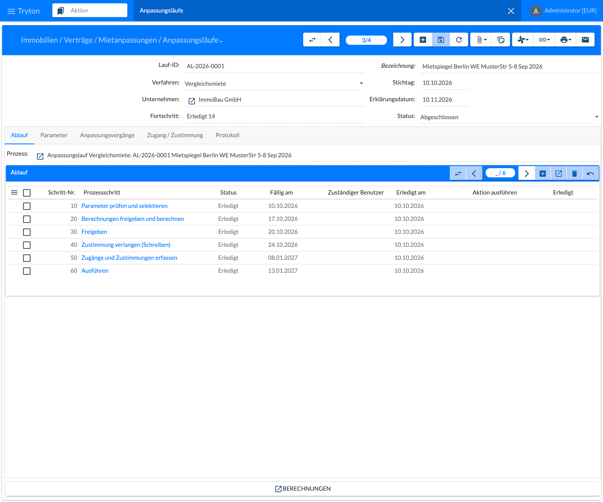

The first selection starts the process **Anpassungslauf Vergleichsmiete** with six steps: 10 check parameters and select, 20 accept and calculate the calculations, 30 approve, 40 request consent (letters), 50 capture receipts and consents, 60 execute. Each step has a due date and is completed automatically with the state of the run. The button **Berechnungen** (Calculations) at the bottom opens the rent survey calculations of the run. In the figure the run is **Abgeschlossen** (closed), all steps are done.

Menu **Verträge › Mietanpassungen › Anpassungsläufe**, **New**, procedure **Vergleichsmiete**:

1. **Parameters:**
   - company, property, optionally contracts;
   - key date and planned declaration date;
   - **Mindesterhöhung** (minimum increase) in € and %;
   - **Berechnungen anlegen** (create calculations, default yes).

   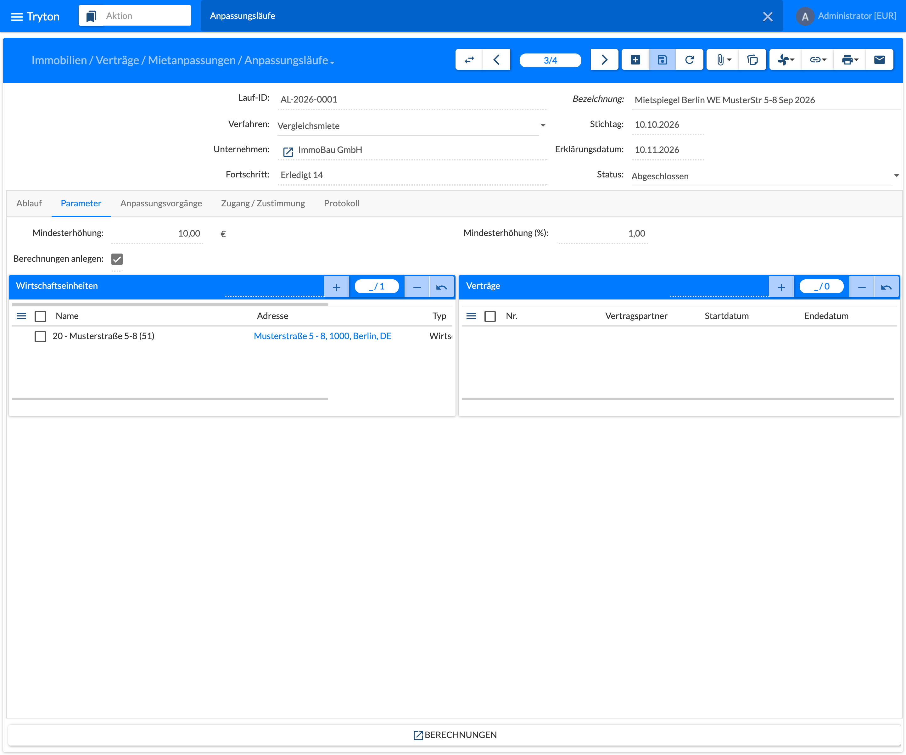

   The tab **Parameter** holds the minimum increase in € and %, **Berechnungen anlegen** and the filters **Wirtschaftseinheiten** (properties) and **Verträge** (contracts); if the contract list stays empty, all matching contracts of the properties are selected. Key date and declaration date are in the header of the run.
2. **Selektieren** (Select): running contracts with a monthly rent term for exactly one apartment are selected. Skipped with a protocol line:
   - V01: index rent or running graduated rent;
   - V02: open adjustment;
   - V03: rent unchanged for less than 15 months – increases due to modernisation or operating costs do not count;
   - V04: last request less than 1 year ago;
   - V05: not exactly one apartment;
   - V06: contract end before the effective date.

   For each term an agreement “Vergleichsmiete” is created automatically, and the rent survey calculation is created or recalculated for each apartment.
3. With the button **Berechnungen** (Calculations) review and accept the calculations.
4. **Berechnen** (Calculate):
   - new rent = the lower of comparative rent and cap;
   - cap = rent 3 years ago × (1 + 20 % or 15 %) + increases not to be counted;
   - effective date = start of the 3rd month after receipt.

   Checks V07–V12, e.g. “cap applies” (note), “no increase / below minimum increase” (error), “posted beyond the effective date” (warning). A manual amount with a reason is possible.

   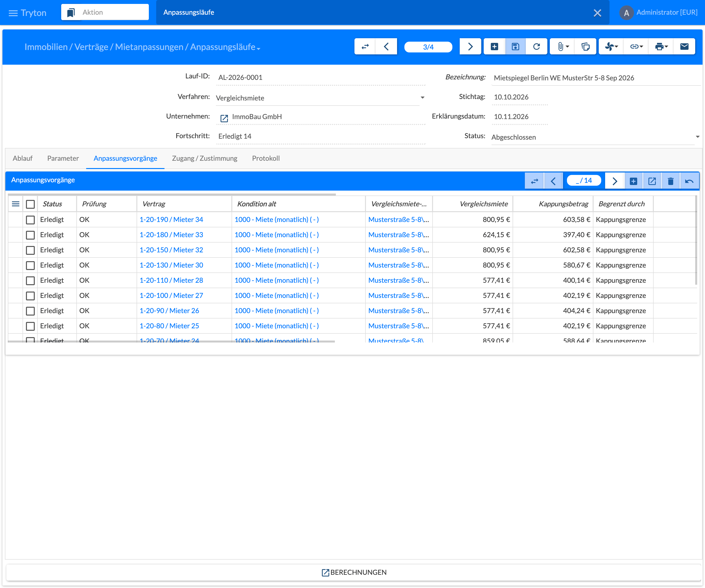

   The tab **Anpassungsvorgänge** (adjustments) shows per contract the state, check, contract, **Kondition alt** (old term), the rent survey calculation, the **Vergleichsmiete** (comparative rent), the **Kappungsbetrag** (cap limit: highest rent allowed by the cap) and **Begrenzt durch** (limited by) – comparative rent or cap. In the figure the cap limits the increase for all adjustments.

   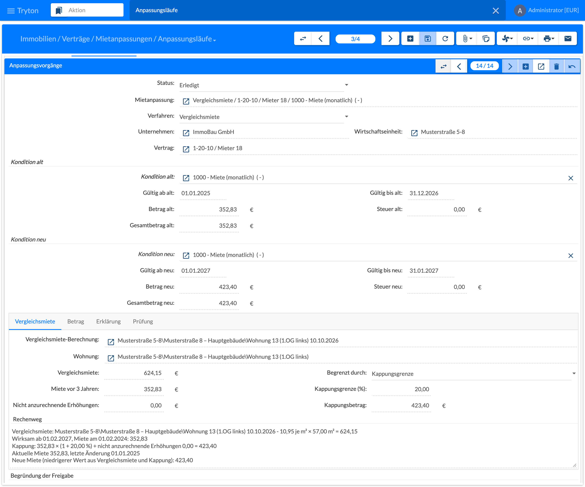

   A double click opens the adjustment with **Kondition alt** and **Kondition neu** (old and new term) and the tabs **Vergleichsmiete**, **Betrag** (amount), **Erklärung** (declaration) and **Prüfung** (check). The tab **Vergleichsmiete** shows the rent survey calculation and the apartment, comparative rent, **Miete vor 3 Jahren** (rent 3 years ago), **Nicht anzurechnende Erhöhungen** (increases not counted), **Kappungsgrenze (%)** (cap), **Kappungsbetrag** and **Begrenzt durch**. The **Rechenweg** (calculation) makes the result traceable, in the figure:

   - comparative rent 10.95 €/m² × 57.00 m² = 624.15 €;
   - cap 352.83 € × (1 + 20 %) + 0.00 € = 423.40 €;
   - new rent = the lower value, i.e. 423.40 €.

   Below is the **Begründung der Freigabe** (approval reason).
5. **Freigeben** (Approve), optionally **Probeschreiben** (Sample Letter), then **Ankündigen** (Announce). The rent increase request (report `comparative_rent_letter_de.odt`) contains:
   - current and new net rent and the effective date;
   - the justification: rent survey, version, table field with range, classification according to the protocol, if applicable the deviating accepted rent with reason;
   - cap, period for consideration and a consent form.

   The original is archived.

   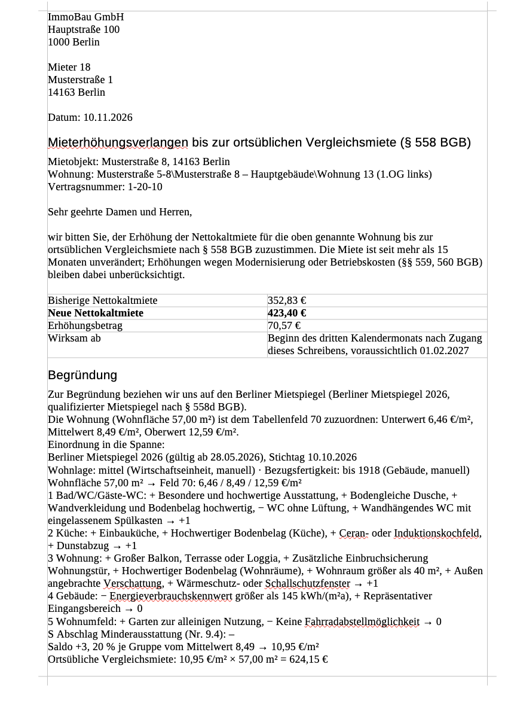

   The example shows the first page: current and new net rent, increase amount and “Wirksam ab” (start of the third calendar month after receipt, expected date calculated from the planned declaration date). The **Begründung** (justification) names rent survey and version, the table field with lower, middle and upper value and the classification within the range: residential location and year of construction, per feature group the features with + / − and the result of the group (+1, 0, −1), the balance (in the example +3; starting from the middle value 8.49 €/m², 20 % of the range up to the upper value per group, i.e. 8.49 + 3 × 20 % × 4.10 = 10.95 €/m²) and from it the local comparative rent 10.95 €/m² × 57.00 m² = 624.15 €. The new rent is limited by the cap to 423.40 €.
6. In the tab **Zugang / Zustimmung** (Receipts / Consents):
   - **Receipt date:** the consent period is calculated from it (end of the 2nd month after receipt), and a task is created.
   - **Consent:** consented / partially (with amount) / refused, with date. The period for legal action ends 3 months after the consent period.

   When all decisions are entered, the run is **Bereit zur Ausführung** (ready).

   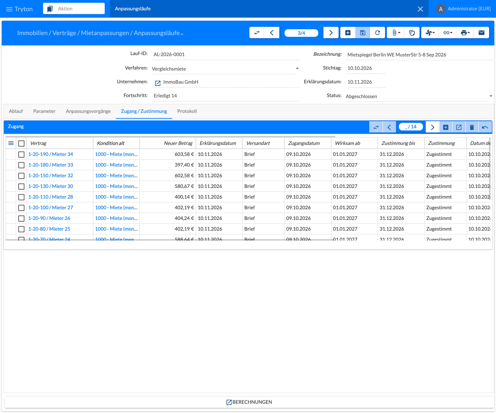

   The list **Zugang** (receipts) shows per contract the old term, **Neuer Betrag** (new amount), **Erklärungsdatum** (declaration date), **Versandart** (dispatch method), **Zugangsdatum** (receipt date), the resulting **Wirksam ab** (effective from) and **Zustimmung bis** (consent until), and **Zustimmung** (consent) with its date. In the figure: receipt in October, so consent until 31 December and effective from 1 January of the following year.
7. **Ausführen** (Execute):
   - **Consent:** the term is split at the effective date with the requested or consented amount.
   - **Refusal:** the adjustment gets the state **Abgelehnt** (refused), and the task **Zustimmungsklage prüfen** (check action for consent) is created. The lawsuit itself is not part of the module.

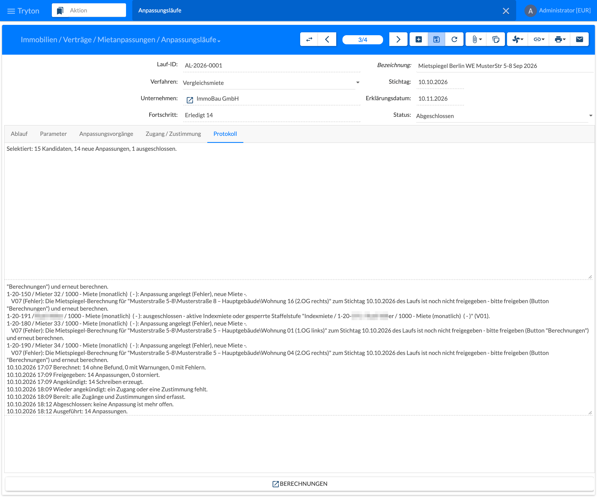

The tab **Protokoll** (protocol) shows the summary of the selection at the top (in the figure 15 candidates, 14 new adjustments, 1 excluded) and below the running protocol:

- per candidate the result with the findings, e.g. V01 (excluded because of an active index rent) or V07 (rent survey calculation not yet accepted – accept it via **Berechnungen** and calculate again);
- per step a line with time stamp: calculated, approved, announced, ready, executed, closed.

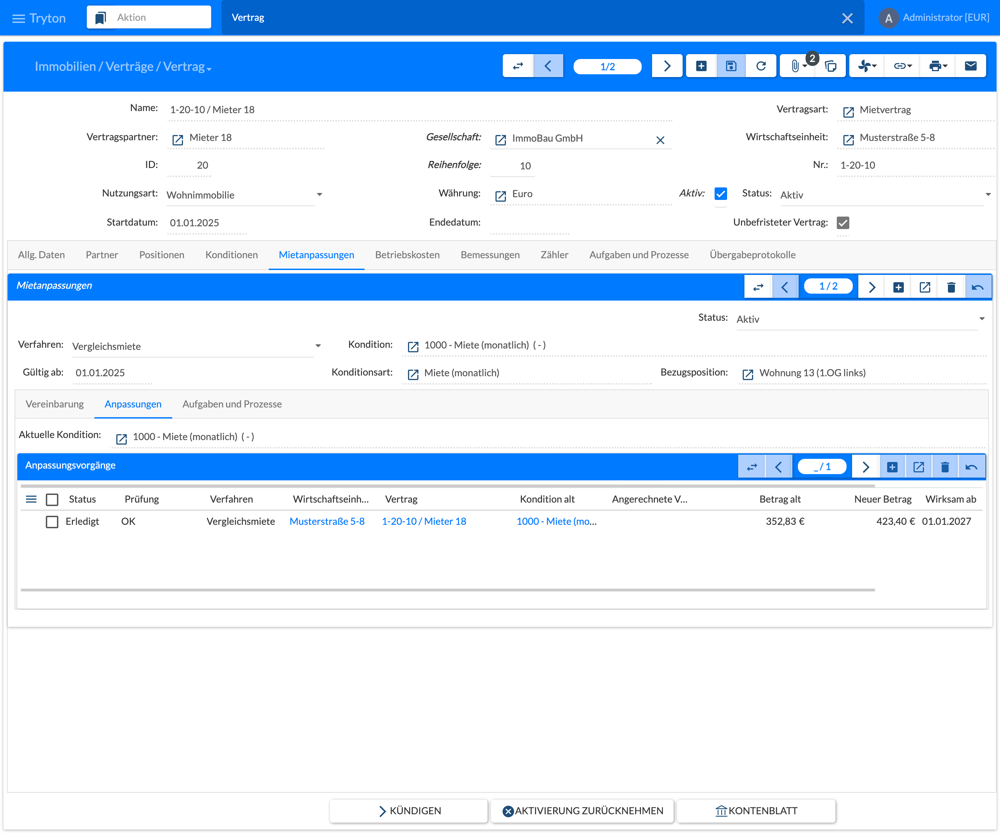

On the contract the comparative rent appears in the tab **Mietanpassungen** as a rent adjustment of its own with procedure **Vergleichsmiete**, term, term type and reference item (apartment). It is created automatically at selection. The sub-tab **Anpassungen** (adjustments) shows the **Aktuelle Kondition** (current term) and all adjustments with state, check, old amount, new amount and **Wirksam ab** (effective from) – in the figure the executed increase from 352.83 € to 423.40 € from 01.01.2027.

## Legal Framework

| Rule | Implementation in the module |
|------|------------------------------|
| Rent unchanged for 15 months, request at the earliest 1 year after the last increase (§ 558 para. 1) | V03 / V04; modernisation and operating costs excluded. |
| At most up to the local comparative rent | Accepted rent survey calculation (V07). |
| Cap 20 % or 15 % in 3 years (§ 558 para. 3) | Automatic; 15 % via the flag on the property. |
| Justification in text form, here rent survey (§ 558a) | Letter with table field, range and classification; only this means of justification. |
| Consent by the end of the 2nd month after receipt, legal action within 3 further months (§ 558b) | Periods calculated, tasks created. |
| Effective from the start of the 3rd month after receipt (§ 558b para. 1) | Effective date from the receipt. |
| Excluded for index or graduated rent (§§ 557a, 557b) | V01, locks. |
| Residential space only | Via the type of use. |
| New letting: rent cap +10 % (§ 556d), otherwise +20 % as orientation (§ 5 WiStG) | Wizard **Prüfung Vergleichsmiete Neuvermietung** on the draft contract, incl. modernisation amount (§ 556e para. 2) and exception for comprehensive modernisation (§ 556f). |

{}
- Expert opinions or comparable apartments as justification.
- The deduction of third-party funds (§ 558 para. 5) is open.
- The classification itself (residential location, features) is the landlord's responsibility.
- The rent survey data must be checked against the official original before productive use.
- The letter template has not yet been legally reviewed.
{}
